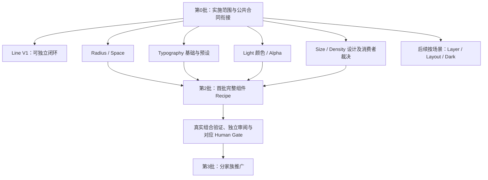

# Rain Next Token 建设总览与启动评估

日期：2026-09-05。工作模式：System Mode，资料汇总与建设评估。本文是本次跨专题审阅的结论与推荐顺序，不改变专题设计、运行实现、阶段授权或已有验收状态。

> 进度说明：本文保留开工前的评估快照。用户随后已授权第 0/1 批建设；当前实现与验收进度见[实施计划](../plans/2026-09-05-token-foundations-v1-implementation.md)和[本批验证记录](../../evidence/runtime/token-foundations-v1/verification.md)。下文“当前实现”描述的是评估时基线。

## 1. 判断

**已经具备分批启动 Token 建设的设计基础。建议完成一次共同的实施收口后，启动颜色、排版、圆角/间距、线条四条建设线；同时推进公共高度及 Size/Density 的设计裁决。**

不需要等待所有 Token 都设计完才开工，也不适合直接全面替换现有组件。当前主要缺口在实施编排、跨文档衔接和部分组件映射；颜色治理的五项修订、线条 V1、非颜色基础档位已经有可执行依据，不必重开整套研究。

“具备启动条件”是本次评估结论。评估时的阶段登记为 B2 Button/Input/搜索操作区试点；新 Token 实施应按实际启动指令登记范围。本文没有启动运行改造，也没有将设计确认写成实现完成或 Human Gate 通过。

## 2. 最新有效文档入口

建议先读本表中的专题主文档，再按实施对象读取其来源和现行运行合同。新设计决定未来目标，现有代码说明实际能力；两者不能相互替代。

| 资料 | 当前有效内容 | 使用方式 |
| --- | --- | --- |
| [颜色 Token 建设、迁移与主题治理规范](../plans/2026-09-05-color-token-governance-design.md) | 57 个 Light Category 输入基线、16 项 Alpha 白名单、公共 Category / Semantic / Recipe、身份与插级、主题、迁移和受控组合 | 颜色主文档；包括 9 月 5 日五项审核修订；实现未开始 |
| [Typography 与布局类 Token 设计](../plans/2026-09-05-typography-and-layout-token-design.md) | 字号、行高、字距、10 个排版预设、圆角、Space、Size/Density，以及层级与响应式候选 | 非颜色主文档；必须区分已确认基础值、可审阅预设、候选与延期 |
| [ADR 0003：Size 与 Density](../adr/0003-size-and-density-responsibilities.md) | Size 选择完整尺寸方案；Density 选择区域默认；显式 Size 优先、不二次缩放；Classic 尺寸来源优先 | 已确认职责；公共高度表及完整默认映射未定稿 |
| [Classic 尺寸、间距与完整方案来源审计](2026-09-05-classic-size-spacing-recipes-audit.md) | 44 项生命周期、8 个公开衍生及内部 Popup、Layout、Pattern 的来源、完整配套和冲突 | 尺寸来源调查已完成；下一步是裁决和验证，不重复调查全库 |
| [线条 Foundation V1 建设文档](../plans/2026-09-05-line-foundation-v1-design.md) | 6 个公共粗细、18 个静态入口、一个内容分隔 Local Recipe、AI 使用规则与验证顺序 | D1–D3 已确认，是线条实施主入口；实现未开始 |
| [线条阶段性设计决定](../plans/2026-09-05-line-foundation-decisions.md) | 公共能力与公共 Token 的区别、绘制方式、虚线、端点、标题标记与 Tab 的职责 | 保留原则依据；具体首版范围以 V1 为准 |
| [B2 ADR](../adr/0002-tailwind-b2-local-fork.md)、[B2 设计](../plans/2026-09-03-tailwind-b2-local-fork-design.md)、[B2 实施计划](../plans/2026-09-03-tailwind-b2-local-fork-implementation.md) | Rain 决定视觉，Tailwind 负责受控组合；Global Master、Local Recipe/Fork、来源追踪、扫描和校验 | 延续消费与隔离机制；原数值及公共入口边界需要按新决定显式更新 |
| [AGENTS](../../AGENTS.md)、[Spike Brief](../../SPIKE_BRIEF.md)、[阶段登记](../../status/current-phase.yaml) | 长期约束、原 Spike 范围、当前授权和独立状态 | 实施时同步相关旧条款；保留历史 Gate 和 B2 对照范围 |
| [旧 Focus/颜色设计](../plans/2026-09-01-day-2-1-focus-color-correction-design.md)、[Day 3 Core UI 设计](../plans/2026-09-02-day-3-core-ui-design.md)、[TextButton 设计](../plans/2026-09-03-text-button-design.md) | 既有 Focus、组件 Parts、状态和专属排版的来源 | 作为当前组件依赖和历史依据；不以旧 Semantic-only 规则否决新 Category 设计 |

当前运行事实入口：[Token 合同](../../packages/foundations/src/token-contract.ts)、[CSS Tokens](../../packages/foundations/src/tokens.css)、[Space 合同](../../packages/foundations/src/composition-contract.ts)、[Typography](../../packages/foundations/src/typography.css)、[Density](../../packages/foundations/src/density.tsx)、[Focus](../../packages/foundations/src/focus.css)、[Motion](../../packages/foundations/src/motion.css)、[Tailwind bridge](../../packages/foundations/src/tailwind-theme.css)、[B2 Manifest](../../manifests/contracts/tailwind-b2.yaml)、[B2 校验器](../../scripts/verify-tailwind-b2.mjs)、[类名合并](../../packages/ui/src/utils/rain-class-names.ts)。

本次核对的主要任务与关系：

- 「规范文字颜色 Token」→「审核文字颜色 Token 治理方案」：颜色设计形成并完成五项治理修订。
- 「审核文字颜色 Token 治理方案 (2)」：非颜色设计、Size/Density 职责及最新 Classic 尺寸来源纠正；最后已交付完整来源审计。
- 「梳理线条 Token 架构」：阶段原则收敛为 V1，最后确认 D1–D3。
- 「确认当前样式技术栈」→「梳理 Button 组件改造方案」：桥接及 Button Tailwind-first 已有实现记录；不能把较早对话中“Button 尚未迁移”当成当前状态。
- 「梳理 Input Tag Card 问题」和「梳理 IconButton 组件方案」：补充组件级决定及尚未归档的衔接项，见第 5 节。

## 3. 各类建设就绪度

| 建设对象 | 当前事实 | 启动判断 | 本批边界 |
| --- | --- | --- | --- |
| Light 颜色与 Color Alpha | 57 个 Category 输入；16 项 Alpha；分层、稳定身份、派生输出、组合资格、主题缺失和迁移规则已定义 | 可启动事实登记与首批受控消费 | 不要求先补齐全部 Semantic、状态色或 Dark；不直接替换全库旧色 |
| FontSize / LineHeight / LetterSpacing | 19 档字号；14 档固定行高与 Equal；0em 默认字距；字号至两倍字号的范围已确认 | 可启动基础定义和组合检查 | 固定长度、无单位倍率、相对字距保留类型区别；组件特殊值不自动公开 |
| Typography | 10 个首批逻辑预设已形成可审阅设计，Reading 三组继续保留 | 可进入首批实现及验证 | 不把尚未视觉验收当成不能实施；不套用最接近预设改变组件完整几何 |
| Radius / Space | 七档圆角；16 档公共间距；数值身份与局部组合原则已确认 | 可作为较小的首批增量 | 已有默认不随新档位自动改变；圆角 0 的讨论记录需归档，不能擅自算作第八档已批准值 |
| Line Thickness V1 | 1–6 CSS px；border / h / w 三类入口；一个真实分隔试点已确认 | 可独立启动并完成闭环 | 使用当前合法颜色；不依赖新颜色完成；不同时迁移 Focus 或所有组件边框 |
| 公共高度、Size / Density | 职责已确认，完整 Classic 来源已整理；公共高度表和目标映射尚未确定 | 先做具体设计裁决，随后实施 | 不从 Next 五档 Button 或 30px Input 推导公共尺度；不只改 height |
| 图标尺寸及点击区域 | 普通图标由宿主 Part 决定；已有独立 IconButton 专项尺寸确认 | 随组件 Recipe 衔接 | 不建立通用全局 Icon 尺寸表；图形盒、图形本身与点击区分别管理 |
| Shadow / Motion / Focus / Component Opacity | 已有基础实现，最新文档规定完整配方及职责 | 本次以复用和迁移兼容为主 | 暂无需要先扩建整套档位的证据；Focus 和 Loading 保持各自完整行为合同；Color Alpha 不替代整体 Opacity |
| Layer | 根层角色和数值为 proposed | 跟随真实浮层方案建设 | 依赖行为层、Portal 和嵌套模态验证；单独登记 z-index 不等于能力完成 |
| ContentWidth / ContainerBreakpoint | 有用途明确的候选，尚未采用或实测 | 跟随 Layout/具名配方验证 | 内容上限、容器条件各自独立；不需要它们先完成才能建设 Space |
| ViewportBreakpoint / Dark / 扩展状态色 | 公共视口断点延期；Dark 缺实际值；完整状态色未登记 | 后置专题 | 不阻塞已定义的 Light 与基础尺寸建设；不宣称已经支持 |

注意：当前运行仍是旧 42 个 Semantic Color、五档 Radius、13 档 Space 等基线。新方案存在不代表新 Token、类名或生成能力已经可用。

## 4. 推荐建设顺序

### 第 0 批：共同实施收口

这是一小段必要的开工准备，不是重新研究所有 Token。

1. 在现有文档体系中写明新 Token 批次、实施范围、交付与验证；登记独立检查点，保留 B2 和既有组件的历史状态。
2. 显式衔接公共 Category 直用、扩展 Radius/Space、Typography 组合、Line 新入口与旧 AGENTS/Brief/B2 条款。Semantic Color 数量目标与 Category、尺寸 Token 分开计数。
3. 统一最少的身份、类型、单位、依赖、状态与派生输出约定。颜色落实自己的 Registry；线条等简单事实可以复用现有合同结构，不强制全域改造成一个复杂注册平台。
4. 明确共享文件的整合负责人和接入顺序。各专题可以并行准备，但同一 bridge、Manifest、validator、类名合并规则只维护一条链路。
5. 保留或隔离原 B2 比较对象与基线。[当前 B2 基线](../../evidence/runtime/tailwind-b2/baseline-results.yaml)仍记录 comparisonStatus 为 not-run；新数值不得混入旧对照后继续声称只比较样式架构。

退出条件：执行边界一致、各专题目标与当前能力分清、共享修改归口清楚。无需等待整个 B2 Human Gate 才能整理新事实与证据；实际改变共同运行时前，必须先解决上述基线归属。

### 第 1 批：四条建设线并行，尺寸设计同时推进

| 建设线 | 线内顺序 | 本批产物与退出条件 |
| --- | --- | --- |
| A：Line V1 | 六个公共值 → CSS/18 个入口 → 合并与校验 → 基础对照和分隔 Local Recipe → 浏览器与隔离验证 | 完整沿用已确认 V1；这是范围最明确、可较早完成的一条线 |
| B：Radius / Space | 已确认数值增量 → 公共消费映射与检查 → 页面自有节点/局部配方样本 | 新档位实际可消费、旧默认不被自动改写、局部作用域有效；不扩公共高度 |
| C：Typography | 字号/行高/字距及类型 → 10 个预设 → 局部拆分与组合规则 → 排版样本 | 完整预设与按需组合均可用；检查最终行高、字距继承、字体角色、混排、缩放和裁切 |
| D：Light 颜色/Alpha | 57 Category/Alpha 事实登记 → 解析/派生与基础检查 → 单源 Quick/Detail View → 首批用途、Semantic/Recipe 与受控入口 | 先形成可追溯的事实和最小消费闭环；颜色分阶段接入，不以完整迁移为本批退出条件 |
| 并行设计工作 | 使用既有 Classic 审计，盘点 Next 当前消费者并形成第一组 Size/Density 与颜色迁移决定 | 为第 2 批提供目标配方及差异清单；这条线本批可以是设计产物，不冒充运行建设 |

各条线先完成自身数据，再接入自身消费和检查。Line 不必等待 Color、Typography 或公共高度；Radius/Space 也不必等待 Layer 和响应式。

共享的 `token-contract.ts`、`tokens.css`、`tailwind-theme.css`、Manifest、validator、`rainCn` 和 Playground 入口采用顺序集成。建议先合入范围小的 Line、Radius/Space 增量，再接入 Typography 与颜色的用途/组合扩展；可根据实际完成情况调整，不把此建议当成领域依赖。

### 第 2 批：首批完整组件 Recipe 与 Size/Density 试点

前置是该组件实际依赖的基础能力和目标方案已明确，不要求所有专题全部完成。

推荐先使用 **Input + Button + 搜索/筛选操作区**，复用现有 B2 资产和 Classic 的真实组合：

- 首先形成同一份完整方案：高度或最小高度、内距、间距、排版、图标盒、点击区、圆角、边框、颜色、Focus 和状态。公共高度表从已论证用途提炼，不先求所有组件统一。
- Classic QueryTable 的 Input Medium 32、Button Small 32、TextButton Regular 是有来源的组合样本，见[审计第 4.2 节](2026-09-05-classic-size-spacing-recipes-audit.md)。它适合用于验证“不同 Size 名称如何等高组合”，不自动成为所有 Default 或 Compact 的标准。
- 公共高度保持固定值身份；Density 选择默认完整方案并管理区域节奏，显式 Size 优先。TextButton、Badge 等无需强行同高。
- 颜色迁移先建立 Next 实际消费者与 Classic 来源的 Decision Matrix，再决定 Exact、Normalized、Recipe 拆分或 Legacy Exception。逐项处理旧 42 个 Semantic，不强行一一改别名。
- 首批只改已经明确的组件 Parts 与状态。Input Clear 的最终颜色、出现时机和状态矩阵需要在该组件变更前收口；不会反向阻塞全体颜色基础数据。
- 若同时进行 B2 样式迁移与新视觉调整，分别记录验证目的和结果：旧架构对照保持原比较对象，新视觉按新 Recipe 验证。

退出条件：代表性组件、局部 Recipe、显式 Size、Density 继承与同排组合可用；实际几何、状态、键盘、图标和隔离证据齐全；再进入独立审阅与对应 Human Gate。不能仅凭 Token 数值测试通过就继续批量迁移。

### 第 3 批：按组件家族逐步推广

首批经验成立后，再按依赖推进已有组件的配方迁移，以及后续获准建设的同类组件：

- 普通文本、链接、标记、表面等相对独立的消费者，可在共同基础稳定后分组并行。
- 表单家族承接已验证的控件完整方案；多行、多选和内容增高不能直接套单行固定高度。
- Table、Tree、复合 Pattern 和 Layout 按各自行为依赖处理，核对虚拟滚动、自动高度、点击区域和容器几何。
- 旧别名只有在消费者已清理、映射明确且回归通过后才移除；未迁移的区域维持明确的旧合同或受控例外。新代码的禁旧边界随已完成迁移范围扩大。

这是一份 Token 依赖顺序建议，不代表本轮已授权建设或迁移上述组件。

### 后续专题：随真实消费者启动

- Layer：随 Overlay/Headless 方案和 Dialog → Select、第二个 Dialog、全局反馈等真实场景建设。
- ContentWidth / ContainerBreakpoint：随 Container、查询区、工作台等具名布局配方验证，再登记实际采用值。
- ViewportBreakpoint：等真实平台壳出现明确切换行为后再提炼；验证屏宽不是公共断点表。
- 状态色与 Dark：等输入与用途明确后分批建设；完整 Light 不需要等 Dark，Dark 也不得用未配置的 Light 静默替代。
- 精确虚线、单侧边框、SVG stroke、标题标记/Tabs 全配方：沿 Line V1 的延期范围，按后续消费者启动。
- Figma 映射/写入、资产发布和业务迁移：共享已验证事实，但各自独立登记状态与操作范围。

图中箭头表示目标配方的依赖顺序；不是要求完成所有颜色、排版预设和组件家族才可开始第 2 批。Line 可在后续配方需要时被引用，没有“先全库线条迁移”的前置条件。

## 5. 需要调整或补充的具体事项

### 5.1 共同开工收口项

| 项目 | 目前差异 | 建议处理 | 影响范围 |
| --- | --- | --- | --- |
| 执行合同 | 新设计已经允许 Category 直用与新数值，当前运行仍按旧公共入口和档位校验 | 在实施批次同步 ADR/AGENTS/Brief/phase 与对应检查；不静默覆盖历史 | 新公共能力接入前 |
| 权威数据与输出 | 颜色已定义逻辑 Registry，最终文件格式留待实施；其他领域已有简单合同 | 选择最小可用事实表达，生成 CSS、检索与消费映射；不维护第二套数值或白名单 | 各专题实施开始时 |
| 联合消费检查 | `text-*` 同时涉及颜色和字号；边框涉及颜色/粗细/样式；线条可用背景绘制 | 按实际类型、属性、Part、用途和作用域校验；颜色斜杠不能误判行高，颜色/粗细类不能相互误删 | Typography/Color/Line 合入共同桥接时 |
| B2 对照归属 | B2 仍在进行，新视觉修改会影响比较条件 | 明确保留或隔离旧比较对象；新 Token 各自提供新证据，不继承旧测试/Gate 为完成 | 修改共同运行时前 |

通用校验规则应能接收合法的新数据与 Recipe；不能每登记一种合法组合都手工修改检查器。反之，仅有 Rain 命名空间也不能证明用途合法。以上方向已在专题文档中提出，当前要落实工程衔接，不是重开治理设计。

### 5.2 对应批次前需要补齐的设计与证据

1. **公共高度及具体 Size/Density 映射。** 已完成 Classic 调查，待完成的是用途提炼与目标裁决。`28/32/36/40/48` 不再是推荐公共高度表，`Compact32/Default36` 是历史候选，Next Input30 只是差异。[最新决定](../adr/0003-size-and-density-responsibilities.md)
2. **颜色实际消费者与迁移矩阵。** 同时盘 Next 运行消费和 Classic 视觉来源，记录父表面、角色、状态与共享关系。完整状态色、Semantic 及所有组件 Recipe 不是事实登记前置，但具体消费者迁移前必须有答案。[颜色迁移规则](../plans/2026-09-05-color-token-governance-design.md)
3. **强边界、OnColor 与特殊 Alpha 的实际适用性。** 新色表存在不保证每个颜色适合必需边界或任意父表面；在使用它的组件迁移前验证。不足时按已定义的缺口或例外流程处理，不取近似色、不强行通过。三项 1% Alpha 归一化按已确认专项豁免执行，不扩大为普遍免验证。
4. **Classic 来源冲突及几何行为依赖。** Select 尾部、Tree 拖拽等差异已归档；TextArea 自动高度、Tree 虚拟滚动、PaneGroup 等依赖实际几何。仅在采用对应对象时处理，不把“待裁决”写成“尚未调查”。Tooltip 7 等特殊值保留为专用需求，不强行取最近公共档。[审计冲突表](2026-09-05-classic-size-spacing-recipes-audit.md)

### 5.3 对话已有内容，需补到长期文档

- **圆角与 Space 使用细则。** 非颜色任务已讨论无圆角/0、四角共用数值、同心轮廓与独立组件、圆角与裁切分工，以及父级 gap、容器 padding、组件内部间距的所有权；现文档第 5 节仍较简略。建议归档讨论结论并区分已确认数值和候选用法，沿现有上下文收口；不将圆角 0 或候选用途默认偷偷写成已批准公共值，也不因此重新询问整张表。
- **IconButton 专项决定。** 「梳理 IconButton 组件方案」已在真实图标对照后确认组件专属 Compact：32px 点击盒/18px 图标，Default：36px/20px；独立组件方向已确认，完整反馈/状态方案尚未收口。仓库当前没有对应独立方案文件。应补入组件设计与 Size/Density 映射记录，保留这项专项确认来源；它不能反推出全局公共高度，后续来源纠正也不应被静默解释为自动撤销此项确认。
- **Input 已确认与未定部分。** Clear 使用正式 circle-close-filled、无可见“清除”文字、保留可访问名称“清除输入内容”已有明确确认；此前 Icon Secondary 等暂名应以最新颜色主文档为准。Clear 颜色、出现时机与交互状态需随 Input Recipe 一起收口，不能直接采纳最后一条尚未确认的全局 Icon Subtle 建议。
- **Classic 与 Next 的修改边界。** 颜色文档出现“Vue 迁移”等长远表述。当前批次应明确 Classic 是只读来源，运行建设在 Rain Next；改写 Classic 另设范围。新近用户决定优先于更老来源，颜色和尺寸按各自最新决定处理，不能用“以 Classic 为主”覆盖所有 Next 专项确认。

## 6. 首批完成应当意味着什么

每条建设线都要形成与自身范围相称的完整链路：

**明确来源与身份 → 类型/单位/依赖 → CSS 与公共消费入口 → Recipe/真实样本 → 正反例与浏览器检查 → AI 使用说明和状态。**

公共数据、映射、文档和校验来自同一事实；组件默认变化与仅增加可选档位分开验证。新合法值可组合，非法用途、作用域泄漏和关联几何错误能被发现。不要把只添加常量表作为该条建设线全部完成，也不要为做一个小型验证样本先建设整套公共组件。

Implementation、Automated Verification、Independent Review、Human Gate、Figma、Publication、Business Migration 和 Git 分别记录。自动验证不替代设计验收；对应 Human Gate 完成也不自动授权发布。

## 7. 本次审阅与交付边界

- 已核对相关任务的最新决定、六份专题与来源文档、B2/阶段合同及相关运行入口；颜色、几何、线条分别进行并行只读审阅。
- 非颜色任务的近期读取接口返回空消息时，使用该任务的本地会话记录核对了最后的用户决定和来源审计交付。
- 当前工作区已有大量未跟踪文件；本轮只新增本文，不修改专题原文、代码、Token 数值、公共合同或阶段状态。
- 本轮验证只覆盖本文的本地链接、Markdown 基本结构及汇总结论的一致性；没有重跑组件测试、浏览器验收或历史 Gate，没有写入 Figma、发布、迁移或执行 Git 变更。
- 下一步建议：以第 0 批收口和第 1 批四条建设线为正式实施范围。公共高度及组件映射的未决事项继续并行推进，不阻塞已确认基础能力。
