# 颜色收口：决定、实施与保留问题

2026-09-12 最新决定：用户查看实际页面后要求 Input / Select 空值提示同色且明显浅于正文，现统一为 **`Text/Neutral/5`**；SearchInput 与 Select 面板搜索同步。普通可用且非危险的菜单/option 说明保持 `/3`，危险红字仍按用户决定保留。Popover 改为紧凑内容，模板分类复用现有 28px Tabs。

全局 Token 值、正文、箭头、单位、计数、禁用、菜单 critical/selected/checked 的颜色均保持。危险中性字候选未实施；边界／Focus、实心 Tag 与其余颜色问题仍未解决。后续用户已确认本轮运行视觉，详见[人工验收登记](../plans/2026-09-12-existing-assets-closure.md#当前运行视觉人工验收)；该确认没有授予颜色例外。

## 页面反馈修订后的当前测量

现有规则 `failures=[]`；当前 Input **150 / 96**、Select **89 / 168**、共享字段 **266 / 0**、公共菜单 **9 / 22**、Tag **2535 / 0**（对比度／用途资格配对数）。占位调浅后，相应发现重新保留。完整受影响记录、验收登记前的 15 个源文件摘要与未改问题/旧例外的指纹见[配方颜色快照](../../evidence/runtime/asset-closure/popup-refinement/color-findings.json)。本轮没有降低阈值或授予例外。人工验收登记后再次计算，248条对比度及286条用途资格记录与该快照逐项一致；新的状态与源摘要见[视觉验收校验](../../evidence/runtime/asset-closure/visual-acceptance.json)。

真实浏览器继续使用下述公开 props 矩阵：Input 192 控件 / 266 条记录，Select 240 基线控件 / 794 条记录；覆盖 Light/Dark、三外观、四尺寸、权限、搜索及既有交互。非禁用占位均为 Light `rgb(116, 133, 168)`、Dark `rgb(136, 145, 173)`；此次实际背景组合最低对比度分别为 **3.2625:1 / 4.2464:1**，都存在低于文字 **4.5:1** 的状态，`contrastPass` 明确记录每一项结果。颜色和行为回归通过不能代替对比度通过。

| 当前证据 | Light | Dark |
| --- | --- | --- |
| Input / SearchInput | [事实](../../evidence/runtime/asset-closure/popup-refinement/implemented-input-light.json) · [截图](../../evidence/runtime/asset-closure/popup-refinement/implemented-input-light.png) | [事实](../../evidence/runtime/asset-closure/popup-refinement/implemented-input-dark.json) · [截图](../../evidence/runtime/asset-closure/popup-refinement/implemented-input-dark.png) |
| Select / 内部搜索 | [事实](../../evidence/runtime/asset-closure/popup-refinement/implemented-select-light.json) · [截图](../../evidence/runtime/asset-closure/popup-refinement/implemented-select-light.png) | [事实](../../evidence/runtime/asset-closure/popup-refinement/implemented-select-dark.json) · [截图](../../evidence/runtime/asset-closure/popup-refinement/implemented-select-dark.png) |
| 紧凑模板 Popover | [尺寸事实](../../evidence/runtime/asset-closure/popup-refinement/popover-compact-light.json) · [截图](../../evidence/runtime/asset-closure/popup-refinement/popover-compact-light.png) | [尺寸事实](../../evidence/runtime/asset-closure/popup-refinement/popover-compact-dark.json) · [截图](../../evidence/runtime/asset-closure/popup-refinement/popover-compact-dark.png) |

Tabs / 搜索 / 底栏按钮 / 收藏按钮实测分别为 **28 / 24 / 32 / 24px**，Radio 本地标签 **13/20**、说明 **12/18**；页面触发器仍是 medium 36px。桌面两主题模板面板实测 360×347px，保留可滚动正文；320px 窄屏与触屏自动检查独立执行。公共菜单仍核对 48 组 props / 168 个状态采样，普通说明 `/3` 和原危险/选择状态保持。真实触屏设备与读屏仍独立待验证；本轮页面运行视觉已由用户接受。

下方 `/3` 测量、图像及旧源摘要是本日第一轮实施的历史证据，保留原状，不代表当前占位色。执行记录见[页面反馈修订](../plans/2026-09-12-existing-assets-closure.md#0203-页面反馈修订)。

## 第一轮加深占位的声明测量（历史）

调用现有 `verifyTokenFoundations()`，规则检查 `failures=[]`。数字分别为对比度／用途资格发现：

| 对象 | 本轮实施前 | 实施后 | 本轮处理边界 |
| --- | ---: | ---: | --- |
| Input | 150 / 96 | **104 / 12** | 已登记非禁用占位无剩余发现；单位、计数、提示等其他部件仍有发现 |
| Select | 89 / 168 | **43 / 84** | 已登记非禁用占位无剩余发现；箭头、选中项等其他部件仍有发现 |
| 共享字段边界与 Focus | 266 / 0 | **266 / 0** | 未修改 |
| 公共菜单 | 9 / 26 | **9 / 22** | 普通可用说明加深；危险和已选说明等发现保留 |
| Tag 全部既有批次 | 2535 / 0 | **2535 / 0** | 未修改 |

这不是全库配对数归零或 WCAG 通过。声明测量与真实浏览器验证分别记录；本轮结果及源文件摘要见[实施后颜色快照](../../evidence/runtime/asset-closure/implemented-color-findings.json)，命令、浏览器范围和独立复核见[续批执行记录](../plans/2026-09-12-existing-assets-closure.md#第一轮用户决定与限定续批)。

### 第一轮加深占位的浏览器证据（历史）

使用真实公开 React 组件和实际 props，未手动指定组件状态属性或覆盖组件颜色；测试挂载容器只提供布局与主题。颜色取自浏览器 computed style，半透明底按读取的父背景合成，未称逐像素采样。以下矩阵在本次 `Background/Neutral/1` 容器中执行，其他声明父背景仍由前述计算独立覆盖。

| 对象 | 真实矩阵与状态 | 本次证据 |
| --- | --- | --- |
| Input / SearchInput / FormItem | 两主题 × 三外观 × 四尺寸 × 8 种真实空值 props：常规、警告、错误、只读、禁用、继承禁用、搜索、搜索加载；另测常规 hover/键盘焦点、只读键盘焦点与一次清空。192 控件、266 条记录 | [Light JSON](../../evidence/runtime/asset-closure/implemented-input-light.json) / [Dark JSON](../../evidence/runtime/asset-closure/implemented-input-dark.json)；[Light 图](../../evidence/runtime/asset-closure/implemented-input-light.png) / [Dark 图](../../evidence/runtime/asset-closure/implemented-input-dark.png) |
| Select | 同样两主题 × 三外观 × 四尺寸 × 10 种空值 props；四模式均测试 hover/焦点/打开/选择/清空，搜索模式另测 Portal 内 Input，保留只读/禁用、箭头、计数与 Tag。240 基线控件、794 条记录 | [Light JSON](../../evidence/runtime/asset-closure/implemented-select-light.json) / [Dark JSON](../../evidence/runtime/asset-closure/implemented-select-dark.json)；[Light 图](../../evidence/runtime/asset-closure/implemented-select-light.png) / [Dark 图](../../evidence/runtime/asset-closure/implemented-select-dark.png) |
| DropdownMenu | 双主题 × default/danger × disabled × critical × 普通/selected/checked，48 组 props、168 个 normal/highlight/hover/pressed 状态采样；不再依赖原无说明的危险演示项来推断说明色 | [Light JSON](../../evidence/runtime/asset-closure/implemented-dropdown-light.json) / [Dark JSON](../../evidence/runtime/asset-closure/implemented-dropdown-dark.json)；普通 [Light](../../evidence/runtime/asset-closure/implemented-dropdown-light-default.png) / [Dark](../../evidence/runtime/asset-closure/implemented-dropdown-dark-default.png)，危险 [Light](../../evidence/runtime/asset-closure/implemented-dropdown-light-danger.png) / [Dark](../../evidence/runtime/asset-closure/implemented-dropdown-dark-danger.png) |

此范围内非禁用占位的最低实际组合对比度为 Light **5.7756:1**、Dark **7.4261:1**，均高于文字 4.5。禁用项单列，不计作通过；菜单原危险/已选说明只核对颜色与优先级保持，未因此授予对比度通过。8 张图是 32px 描边代表或菜单代表，不代替 JSON 的全尺寸/外观状态事实。真实设备、辅助技术及最终组件页面 Human Gate 仍待各自确认。

## 决定前的测量与四类候选（历史依据）

实施前调用现有 `verifyTokenFoundations()` 进行只读核对，`failures=[]`；当时登记与规则检查未报错误，未决颜色发现如下：

| 当前对象 | 低于对比度阈值的配对 | 用途资格发现 | 采用的完整记录 |
| --- | ---: | ---: | --- |
| Input | 150 | 96 | [正式字段测量](../../evidence/runtime/select/formal-color-findings.json) |
| Select | 89 | 168 | 同上 |
| Input／Select 共享字段边界与 Focus | 266 | 0 | 同上；不重复算入各组件 |
| Tag 全部现有批次 | 2535 | 0 | [第二批完整测量](../../evidence/runtime/tag-batch-two/color-findings.json)：共同部分 1991、业务形态 544，二者已包含在 2535 中 |
| 公共 DropdownMenu／Popover 消费 | 9 | 26 | [选择视觉复用后的测量](../../evidence/runtime/dropdown/selection-color-review.json) |

数量是“配方 × 主题 × 父背景 × 状态 × 部件”的配对数，不是独立 bug 数。同一配对可能同时存在对比度和资格问题，不能将两列相加当问题总数。Tag 第一批历史 1970 条、旧 Select 测量和 Dropdown 初版 19 条均不再叠加；旧下拉底座比较实验也不并入公共菜单数量。本次只读计算得到的上述数量与相应现有完整记录相同。

## 四类代表与候选

所有下表数值按 **Light／Dark** 排列，显示到小数点后三位；判定使用未舍入数值。普通文字保持 **4.5:1**，有意义图标、必要边界和 Focus 保持 **3:1**。禁用态单列，不当作正常态通过。

| 分类 | 已存在的真实消费与当前结果 | 建议先看的已有 Token／配方 | 仍需决定或验证 |
| --- | --- | --- | --- |
| **弱文字** | Input 空值提示 `Text/Neutral/5` 对 `Fill/Neutral/Solid/7` 为 **3.708／6.235**。浅色低于 4.5；深色虽然数值足够，仍不具交互区域弱文字用途资格。Dropdown 普通说明 `Text/Neutral/4` 对红色按下底 `Fill/Red/Alpha/1` 为 **4.422／4.658**，同样存在数值或资格问题。 | 先比较 `Text/Neutral/3`：同一输入底面为 **6.565／10.904**；同一菜单底面为 **5.215／7.083**，当前函数在所声明用途下计算通过。菜单的重要说明本来就使用 `/3`，可以复用该文字强度，不能借机改变说明的截断等行为。 | 第一轮曾加深非禁用占位；02:03 页面反馈又将占位统一为 `/5`，箭头原决定继续保留。Input／Select 的三外观、前后缀、单位、计数及箭头需分别核对，不把文字候选套到图标。 |
| **边界／Focus** | 字段默认必要内边界 `Border/Neutral/2` 对 `Fill/Neutral/Solid/7` 为 **1.558／1.568**。选中卡片 Focus `Border/Brand/1` 对 `Fill/Brand/Alpha/4` 叠加 `Background/Neutral/1` 为 **3.410／2.361**，暗色不足 3。 | 已对照最直接的现有色号：字段换 `Border/Neutral/1` 仍仅 **1.899／2.497**；卡片换 `Border/Brand/2` 为 **2.563／1.961**，换 `/3` 为 **1.436／1.296**。这些直接替换均不能收口。 | 建议保留问题，单独确认边界／Focus 的配方设计方向，再做运行比较。不要为了达到数值把品牌 Focus 换成橙／绿语义色、将必要边界改称装饰，或直接改全局 Focus。实际内外邻接面、光晕与状态需浏览器复测。 |
| **危险态／实心 Tag** | 菜单危险文字 `Text/Red/1` 对红色按下底为 **4.335／3.880**。作业实心 Tag 的白字对 `Fill/TagAssignment/Solid/1` 为 **3.587／4.602**；其计分角标再叠加已有 30% 白底后，白字降至 **2.338／2.759**，两主题均不足 4.5。 | 菜单先比较保留红底／红图标、**危险项主标签与说明一起改为 `Text/Neutral/3`** 的完整候选；同底文字 **5.215／7.083**，红图标相同颜色比值 **4.335／3.880** 高于图标 3:1，但仍须验证真实状态。Tag 可先比较已有浅底 `Fill/TagAssignment/Alpha/1` 配 `Text/Neutral/3`，为 **5.703／6.847**。 | 这不是对全部 Tag 颜色的保证。仅去掉角标白叠层，浅色白字仍只有 3.587；仅切换现有彩字浅底，暗色作业文字也只有 **3.775**。计分可另评估“独立中性底＋中性正文”的组合，需先确认角标外观；不在原实心配方内强塞不具资格的深色文字。 |
| **用途资格** | 菜单 `Text/Neutral/4` 对白色背景数值已有 **5.567**，仍违反“弱中性色只能用于非关键、非交互内容”。选中危险项的 `Text/Brand/1` 对红色按下底为 **4.928／5.248**，虽超过 4.5，仍违反浅色族背景只允许中性或同色族前景的规则。 | 普通说明优先比较 `/3`；中性底上的已选说明可比较 `Text/Brand/1` 替代 `/2`：按下底 `Fill/Neutral/Alpha/5` 从 **4.563／4.181** 提升为 **5.522／5.748**。红色危险底的主标签与说明一起比较中性 `/3`，不继续叠加品牌蓝。 | 先决定“危险”与“已选”同时出现时的视觉优先级，再改完整菜单配方。保留既有选择指示器，不把全部文本、图标一刀切；不能因某一对数值达标就授予跨组件用途资格。 |

以上候选计算使用现有 `assessColorUse()`、`resolveColorSurface()` 与 `measureColorContrast()`，未新增色值。计算器返回的候选均为 **actualUse: not-verified**；后续仅对下文列明的页面和状态补充了局部浏览器模拟，不代表受影响全矩阵、Human Gate 或 WCAG 验收通过。

## 证据边界与已有验收

- **字段、菜单声明及 Tag 全量发现属于声明组合计算。** 当前对应源码可核对：[共享字段](../../packages/ui/src/field/field.styles.ts)、[Input 配方](../../packages/ui/src/input/input.styles.ts)、[Select 配方](../../packages/ui/src/select/select.styles.ts)、[菜单配方](../../packages/ui/src/dropdown-menu/dropdown-menu.css)、[Tag 业务配方](../../packages/ui/src/tag/domain-tags.styles.ts)。本次重新计算上述代表；下文另列局部浏览器对照，不将其推广为完整字段、菜单或 Tag 全矩阵验证。
- **已有浏览器事实独立保留。** [Tag paint-samples](../../evidence/runtime/tag-batch-two/paint-samples.json)记录作业实底、白色角标叠层、白字和 opacity；[卡片 browser-facts](../../evidence/runtime/selection-cards/browser-facts.json)记录选中背景叠层和边框，原 [卡片报告](../../evidence/runtime/selection-cards/verification.md)保留 Focus 测量。Dropdown JSON 的 `graphics` 来自 Chromium 实际背景链，仅覆盖中性菜单选择图形；同文件 `publicDeclarations` 的 9／26 不是整套浏览器像素测量。
- **旧摘要不能冒充当前完整快照。** Select 正式测量中的 8 个源文件摘要，实施前核对时有 5 个一致；共享 `packages/ui/src/styles.css`、`scripts/token-foundation-outputs.mjs`、`scripts/verify-token-foundations.mjs` 已与旧摘要不同。因此旧 JSON 原样保留；本轮实施后的实际源文件摘要与数量另见文首新快照；本稿不更新或伪造原来源哈希。
- **已接受范围继续有效。** Tag 各批、Checkbox／Radio、选择卡和 SC-03 的既有视觉决定不重开，也不扩成颜色验收。Button 危险主按钮文字的既有精确例外仍按原范围保留，本次检查记录 8 个配对；QuestionNumber 93 项与 OptionButton 内容 9 项精确例外继续保留，共 102 项。其实际不足和原 4.5／3.0 阈值保留，均不是可读性通过。
- **Tabs 本轮不需要重新修颜色。** [本轮颜色记录](../../evidence/runtime/tabs-visual-refinement/color-findings.json)为 0 findings；[验证报告](../../evidence/runtime/tabs-visual-refinement/verification.md)中 720 个非禁用状态样本，文字最低 **5.181:1**、图标最低 **3.383:1**、指示线最低 **3.377:1**；仅限该底面和状态范围。其局部用途决定不是其他组件的通用豁免。
- **SC-04 整体仍不能关闭。** [执行说明](../../evidence/runtime/selection-playground/verification.md)记录 38 项中 30 项在已有证据范围内完成、8 项受阻；其中人工键盘、真实辅助技术和 SEL-033 暗色卡片 Focus 均需要各自证据。限定页面视觉验收不关闭这些项。

## 决定前建议与后续保留项

1. **弱文字比较已选定方向**：下文保留 Input 与 Dropdown 普通说明的原弱档／`Text/Neutral/3` 对照。第一轮曾选择 `/3`，最新页面反馈后的 `/5` 实施与检查见文首。
2. **菜单状态优先级保留原样**：中性已选说明 `Text/Brand/1` 尚未采用；危险态改中性字候选已由用户明确暂不采用，继续保留红色文字与未决问题。
3. **Focus 单列下一轮设计决定**：已有中性／品牌 Border 直接换档无法解决本代表。当前保留未决，不以“快收口”申请一揽子对比度例外。
4. **Tag 下一轮准备两个作业样本**：普通 Tag 比较彩字浅底与中性字浅底；计分角标比较当前实心白叠层与独立中性承载面。它们涉及已接受外观的改版，目前只有前文代表计算，尚未制作运行对照；其他 Tag 色族随后按同一方法检查。

比较准备阶段：只读调用现有 Token 检查函数、核对 JSON 数量与来源摘要、使用现有颜色函数复算代表值；随后保存下述局部浏览器对照。该阶段未修改共享配方或历史证据；实际续批结果另见文首。

计算事实源 SHA-256：`color-registry.ts` 为 `ec8c8cc3ded78124da9d7a2890323026bc4a092cd87531eee99008c2be7d6a0e`；`tag-token-contract.ts` 为 `01370b0bfb0be5d79f7813f641118547dfb253cc554cadb74a8bf0013441ae07`。来源分别为 [颜色事实及计算函数](../../packages/foundations/src/color-registry.ts)、[Tag 事实及既有角标配方](../../packages/foundations/src/tag-token-contract.ts)。后续实施前应复核实际源码与浏览器状态。

## 决定前的局部颜色对照

取证时使用原运行页面 `#input` 与 `#dropdown`、1440×1050 视口。每对“当前／候选”采用相同裁切与状态，图片顶部标明实验身份；其中“当前”指决定前基线。**这些候选图仅在当时浏览器临时覆盖颜色，刷新恢复。** 首轮发现同文档切换主题会残留临时样式，已废弃该轮结果，全部重新加载独立文档拍摄，并逐项断言基线与候选的前景色。

本次实际覆盖：Input 描边正常空值的 24／28／32／36 四档，仅四个 `::placeholder` 临时设为 `Text/Neutral/3`；“删除课程”菜单项为真实鼠标按下态，只改主标签，保留红底和红图标；“新建学习单元”菜单为正常态，仅两条普通说明从 `/4` 临时改为 `/3`。其他文字与结构未改。**原“删除课程”没有 description，命中数为 0；危险说明组合仍未验证，未虚构内容。**

| 代表 | 当前 | 候选：仅本页临时实验 |
| --- | --- | --- |
| Input · 浅色 | 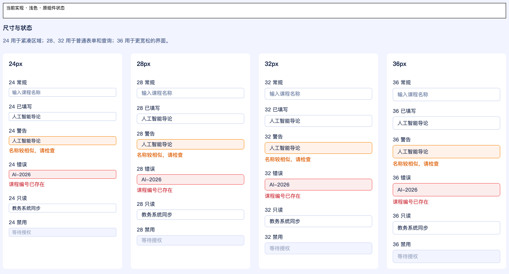 | 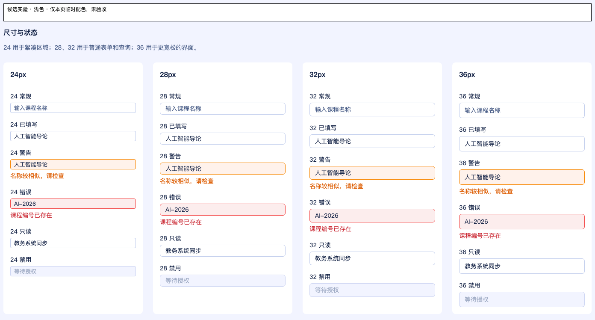 |
| Input · 深色 | 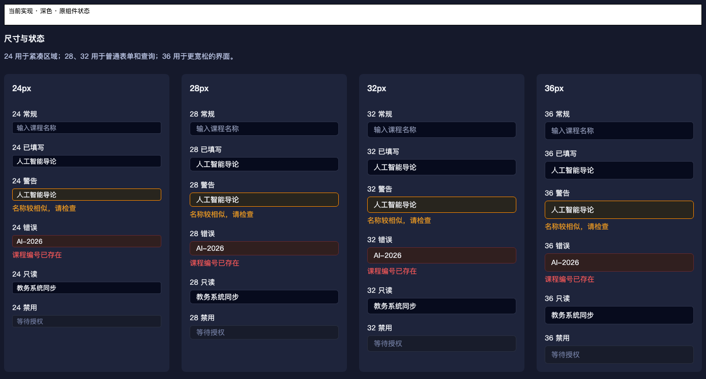 | 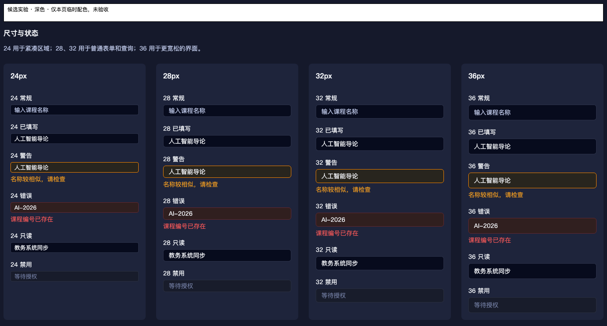 |
| 危险主标签 · 浅色 | 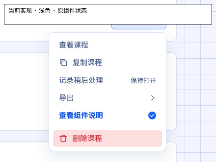 | 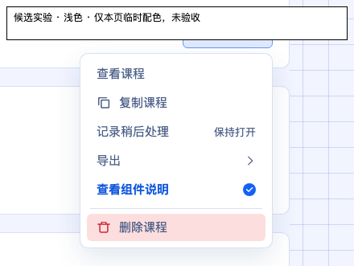 |
| 危险主标签 · 深色 | 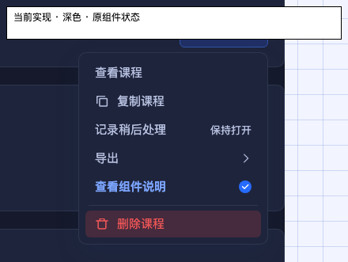 | 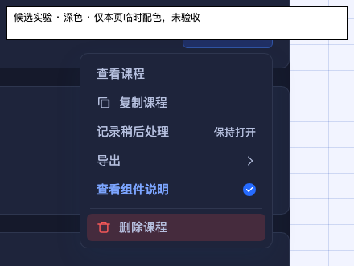 |
| 普通说明 · 浅色 | 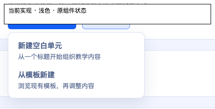 | 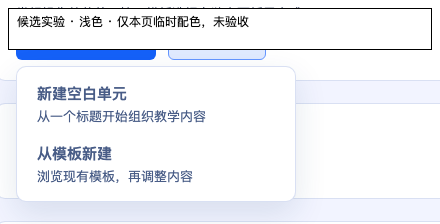 |
| 普通说明 · 深色 | 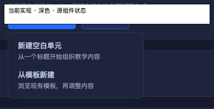 | 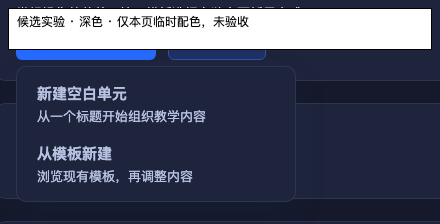 |

[浏览器事实记录](../../evidence/runtime/asset-closure/color-browser-facts.json)包含实际命中元素、主题、状态、裁切、临时 CSS、computed 前景、实际背景链与基于该颜色链的对比度计算，**不是截图像素取样**。本批候选 Input 占位为 **6.565／10.904**；危险主标签为 **5.215／7.083**，红图标保留 **4.335／3.880**。仅这些实测状态可用于本次视觉选择，颜色用途仍按前文声明边界核对。

12 张新截图已形成，浅色候选 Input、深色当前 Input、深色当前／候选危险菜单、浅色当前普通说明已目视查看；每对尺寸一致。6 个运行／Token 源文件的取证前后摘要一致；刷新后临时覆盖为 0，页面错误为 0。未完成 Select、危险说明、菜单其他交互态、Tag、Focus 或辅助技术的新增浏览器验证。
