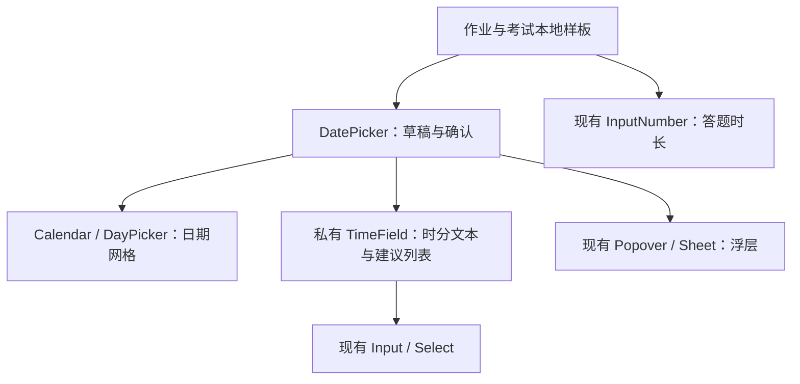

# 日期、截止与时间段优化方案

日期：2026-10-12。状态：四批本地实现完成；形成未发布验收候选，人工视觉验收待用户操作示例。

用户本轮要求：「按这个方向，先制定详细的优化方案和实施计划。重点加强作业、考试的截止与开放时间设置，以及同日、跨日时间段的选择，功能、视觉、交互和动效都要覆盖。」

实施授权：「按这个方案开始实施，按四个批次推进，功能、视觉、交互和动效都落实，完成后给我可操作的作业、考试和跨日时间段示例进行验收。」

工作模式：System Mode / 未发布本地候选。工作区：`/Users/wenchengkai/CodexFile/雨课堂-shadcn组件库架构/.worktrees/card-v2`。本轮实施登记独立日期时间后继范围，旧 G5 接受状态与历史证据保留。

关联：[前期调研](../research/2026-10-12-date-time-experience-review.md)、[实施计划](2026-10-12-date-time-optimization-implementation.md)、[当前 G5 合同](../ai/g5-components.md)、[本轮验证](../../evidence/runtime/date-time-optimization-2026-10-12/verification.md)。

## 1. 目标与交付范围

让教师能够准确、快速地设置「何时截止」「从何时开放到何时关闭」「同日或跨日的一段时间」，并在确认前看懂完整结果、时长和限制。

本轮方案覆盖：

1. Calendar：状态表达、范围预览、初始焦点、触屏命中区和动效连续性。
2. DatePicker：四种既有模式全部保留；增加起止端点编辑、日期手输、统一时分输入、常用时间与日期快捷项、按时长设置结束、明确跨日、约束提示。
3. 三个本地业务样板：作业截止／开放设置；考试开放窗口／答题时长设置；同日与跨日活动时间段设置。
4. 深浅主题、双密度、窄屏和触屏形态、键盘与辅助技术、正常和减少动态效果。
5. 调用说明、公共合同、来源、Registry、独立源码消费及验收证据同步。

**方案选择：沿现有 Calendar＋DatePicker 增强。** 同日和跨日都保存完整起止日期时间，避免增加第二套时间范围的数据与校验引擎。内部复用一个 TimeField；首轮不公开独立 TimePicker / TimeRangePicker。将来出现「宿主只有时钟时间、没有日期」的真实复用需求，再从已经验证的内部能力提取公共资产。

仅改外观不能完成时间段任务；一次建设重复排课、多个不连续时段和全球时区编辑器会扩大范围。本方案暂不包含这些能力，也不包含自然语言解析、秒级选择、月／季／年报表筛选和生产业务迁移。

## 2. 三种时间语义

| 对象 | 示例 | 本轮规则 |
| --- | --- | --- |
| 截止时刻 | 2026-10-20 23:59 | 一个明确到分钟的时刻；不补入隐藏秒数 |
| 开放窗口／时间段 | 2026-10-20 09:00 → 2026-10-20 18:00 | 起止均完整，结束应符合该业务的时长限制 |
| 答题时长 | 每人 90 分钟 | 独立持续时间，不从开放窗口长度自动推导 |

日期型范围允许起止为同一天。日期时间型范围保留通用组件现有默认兼容性；作业／考试窗口显式配置最短 1 分钟，因此两个完全相同的时刻在教学样板中不能确认。

**23:59 与当天结束：** 本轮提供「今天 23:59」「明天 23:59」等准确快捷文案，不使用含义未确定的「今晚」「当天结束」。如果业务以后需要覆盖整天，应明确采用下一日 00:00 前等边界语义，不将 23:59 或 23:59:59.999 作为隐含替代。

**时区：** 保留现有 Date / 本地日、本地分钟 API。样板从真实运行环境获得时区并显示「本机时间（时区名称）」，只有实际为 Asia/Shanghai 才可显示北京时间。此轮不声称已支持固定学校时区与任意设备时区之间的完整编辑转换；生产接入须由业务明确基准时区、持久化与转换规则。不得仅写一个「北京时间」标签而继续按其他设备时区解析。

## 3. 三个核心使用场景

### 3.1 作业截止与开放

页面分成「开放方式」「截止时间」「设置摘要」，不嵌套多层 Card。

- 开放方式沿用 Radio：立即开放／定时开放。立即开放是业务意图，不在页面加载时伪造一个永久固定的当前时刻；定时开放才要求具体值。
- 截止时间沿用单日带时分 DatePicker。可手输日期、选择日历、编辑时分，或使用准确快捷项。
- 定时开放与截止均在表单草稿中；需满足开放早于截止。即使各自字段单独有效，也要在样板保存时检查两者关系。
- 本地新建样板在保存当刻读取时间：立即开放要求截止晚于此刻；定时开放要求开放不早于此刻且截止晚于开放。切换开放方式保留定时字段草稿，立即开放时它不参与校验或保存，切回定时后重新校验。
- 修改截止时保留开放设置；取消日期面板不改变表单值。日期面板「确定」只更新表单草稿，外层「保存设置」才保存本地样板。
- 示例摘要：「定时开放：10 月 20 日 09:00；截止：10 月 23 日 23:59；本机时间……」。保留完整年份的可见查看路径。

首轮样板演示必填截止；「永不截止」、补交、宽限和发布后的修改权限由后续业务接入定义，不把空值解释为无限期。

### 3.2 考试开放窗口

- 使用 DatePicker `mode="range" showTime`，在一个面板中编辑两端。
- 同日结果紧凑显示「10 月 20 日 09:00–10:30 · 时段长度 1 小时 30 分」；跨日则补全结束日期。
- 答题时长为独立 InputNumber，单位「分钟」，采用正整数，不随窗口长度自动变化。
- 本地新建样板保存时要求开放不早于当刻，关闭晚于开放且至少相隔1分钟；这不代替已发布／进行中考试的编辑规则。
- 示例明确展示一种**本地演示策略**：「到达关闭时间统一结束」。这不是对现有雨课堂业务的认定。
- 示例可展示晚进入情形的结果：窗口 09:00–11:00、答题 60 分钟，10:30 进入时，本演示策略最多剩余 30 分钟。与通用日期组件分开计算。
- 答题时长超过窗口长度在该演示策略下为可解释的提醒，不默认改值；真实业务是否禁止由接入合同决定。

### 3.3 同日与跨日时间段

- 同日：`09:00 → 10:30`，始终能看到所属日期。
- 跨午夜：开始 `10-20 23:00`、结束 `10-21 01:00`，明确显示「次日 01:00 · 2 小时」。
- 更长跨日：显示两端完整日期；超过次日显示实际日期，不只写「次日」。
- 同日结束早于开始时保留输入，显示错误并提供明确操作「结束日期改为次日」。操作以开始日期的下一个日历日为准，不能在每次点击时累加一天。
- 手动修改开始时间不自动平移结束。需要按时长设置结束时，用户显式选择「按时长设置结束」；每次操作只计算一次，不建立隐藏时长锁。

## 4. 面板结构与视觉规格

### 4.1 桌面范围面板

```text
选择开放时间
开始                         结束
[2026-10-20] [09 : 00]       [2026-10-20] [10 : 30]
                 当前正在编辑：结束
[常用日期快捷项，按场景提供]
[连续双月日历；窄屏改为单月]
[按时长设置结束 ▾]  30分  60分  90分  120分  自定义
10月20日 09:00–10:30 · 时段长度1小时30分
[正常步骤提示或就近错误]
清空                                  取消  确定
```

该示意表达信息关系，不是最终像素稿。开始／结束各自是有标签的日期与时分字段，不嵌套一个新的公共多字段外框。日期网格可以继续双月；开始与结束不能按“左月／右月”绑定，两个端点都可在任意可见月份选择。

单日模式只显示一个日期及时分组；无时间模式不显示时间控件和按时长操作。桌面范围沿用 560px、单日 320px 的现有宽度基线，受视口限制；不因一条提示出现而反复改变宽度。

### 4.2 字体、尺寸、表面

- 品牌蓝继续固定 #1561F8，由现有 Rain Token 消费；不新增局部色板。
- 日期、时分、时长、说明均用 PingFang SC 与 UI Typography。时长是表单信息，不切到关键数据字体。
- 外层字段保留 24／28／32／36 尺寸和 outlined／filled／underlined；业务样板以 36 为代表。内部控件按区域密度协调，不改变全库默认。
- 时间显示统一两位时分，使用两个现有 Input 的文本草稿，中间固定冒号。保留聚焦时的编辑文本，失焦后才做合法补零。
- 面板、分隔、阴影、焦点、圆角沿现有 Token；日期局部样式不改变其他 Popover、Select、Input 或 Sheet。
- 日期网格维持固定六周高度，提示预留最小一行但允许长错误换行；内容过长滚动，不固定高度截断提示。

### 4.3 状态矩阵

| 状态 | 表达 | 必须检查 |
| --- | --- | --- |
| 今天 | 轻描边／小标记，配合文字语义 | 选中今天仍能辨认，不依赖同一个蓝底 |
| 已选单日／两端 | 品牌实色与清楚前景 | 同一天作为双端时形状完整，不出现错误拼接 |
| 范围内部 | 连续浅色底 | 跨周与跨月仍能识别区间 |
| 候选预览 | 比正式选区更轻，必要时加弱边框 | 不覆盖真实焦点、不更新正式值 |
| 活跃端点 | 字段强调＋开始／结束文字 | 不只靠颜色表示正在改哪端 |
| 键盘焦点 | 独立 focus-visible | 在今天、选中、范围背景上均可见 |
| 非本月 | 次级文字 | 与真正禁用有差别 |
| 禁用 | 既有禁用样式＋邻近规则说明 | 鼠标、键盘都不能选；不依赖 hover 才能读原因 |
| 正常未完成 | 中性文字「请选择结束日期」等 | 首次打开必填字段、选完起点不立即报红 |
| 无效／冲突 | 字段错误状态＋具体原因 | 错误对应端点，不只在面板底部显示笼统信息 |
| 跨日 | 结束日期＋次日标识 | 日期变动后标识同步，跨多日不误称次日 |

## 5. 输入、端点与范围交互

### 5.1 日期输入

保留外层展示式按钮及其 ref；在面板内提供日期输入，支持键入与粘贴 `YYYY-MM-DD`，首轮不解析模糊数字顺序、中文自然语言或任意分隔符。

日期输入与日历是同一个草稿来源。合法文本可生成日历选区；非法或未完成文本保留以便修正，不将 2 月 30 日归一成 3 月。输入不完整时摘要显示「待完善」，不继续显示容易被误认成新结果的旧有效值。

展示月份是独立的导航状态。活跃端日期输入完成并合法后定位该日期；非法／未完成输入不跳月。手动翻月不被未变化的日期文本拉回；时间未填完也不抹掉已合法日期的选区。

### 5.2 时分输入与列表

- 私有 TimeField 复用 Input，不改变 InputNumber 的 number/null 与“不补零”合同。
- 小时、分钟各有独立可访问名称，例如「结束小时」「结束分钟」，保留上下文说明。
- 输入 9 与 5，合法失焦后显示 09 与 05；编辑途中不抢光标、不自动跳段。小时 0–23、分钟 0–59，空值不是 0。
- 允许将完整 `09:30` 粘贴到时间字段，准确分配两段；不合法粘贴不能被截断为另一个合法时间。单段粘贴与全选替换同样保留可修正内容。
- 上下方向键调整当前有效段 1，边界停止，不自动跨段或跨日。完整时间的快捷列表采用 5／15／30 分钟步长，默认 15；列表提供 23:59，非步长合法值仍可手输。
- 列表复用已有 Select，不再写第二套菜单键盘机制。选择列表项只更新当前端点的时分。
- 中文输入法组合期间不解析、不补零、不处理 Enter 为确认；组合结束后进入普通编辑流程。

### 5.3 端点选择与兼容

保留旧的“从日历重新选一段”路径，同时提供明确的单端编辑，避免增加公开模式开关：

| 用户动作 | 结果 |
| --- | --- |
| 空范围点第一个日期 | 建立起点，下一步选择终点；中性提示 |
| 新范围点第二个日期 | 完成日期范围；初次日期逆选保持现有按日归正行为 |
| 未指定编辑端点，完整范围后继续点日历 | 保留既有重新起选路径 |
| 点击／聚焦开始字段 | 进入“编辑开始”，之后日历只修改开始；保留结束及其时分 |
| 点击／聚焦结束字段 | 进入“编辑结束”，之后日历只修改结束；保留开始及其时分 |
| 单端修改造成逆序 | 保留两端值，提示修正，绝不自动交换端点身份 |
| 修改日期 | 保留该端已有时分，不重置为默认 00:00 |
| 点击「清空」 | 清空整段草稿，尚不提交；局部输入删除只影响对应端点 |

打开、整段清空、外部值重建时一并重置选择意图。进入单端编辑后若要重新选整段，使用已有清空操作；清空后第一次日历选择始终建立起点，不残留“正在编辑结束”的状态。

日历候选范围依据操作意图预览：新选终点、修改起点、修改终点分别计算；hover 与键盘焦点都可预览，离开日期网格后恢复草稿展示。跨禁用日期或逆序候选不能用正常已选色伪装有效范围。首轮不增加拖拽选择，避免拖动／滚动冲突。

### 5.4 快捷项与按时长设置

- 作业快捷项示例：今天 23:59、明天 23:59、一周后 23:59。使用时显示计算出的完整日期，进入同一草稿和校验链。
- 快捷值在点击时计算，不能在模块加载时计算后长期复用。无效快捷项不可接受；其不可用原因有可访问说明。
- 教学范围提供 30／60／90／120 分钟和自定义正整数分钟。应用时以有效起点计算完整结束日期，跨午夜会明确显示次日。
- 自定义时长为空、非法或超出配置限制时不能应用，保留可修正输入且不改结束值；`durationPresets=[]` 可仅显示自定义入口。
- 用户选择时长后再改起点，结束值保持原样；可以再次显式应用时长。
- 时长计算采用实际日期时间差；日期型范围的“包含几天”与持续分钟不是同一算法。只在日期时间模式显示时段长度。

## 6. 草稿、确认、错误与校验

状态只有三层：面板文本草稿 → 组件已确认值／表单草稿 → 样板保存结果。不存在“点了日历就写业务”的隐含路径。

| 事件 | 合同 |
| --- | --- |
| 打开 | 复制当前受控／非受控值；清除旧错误、触碰记录和预览 |
| 输入、日历、列表、快捷项、清空 | 仅改变面板草稿；值与摘要立即反馈 |
| 确定 | 用当前约束重新校验；合法且发生变化时只回调一次；随后关闭 |
| 无变化确定 | 关闭，不重复回调 |
| 取消／Esc／外点／Sheet 背景关闭 | 丢弃面板草稿；保留已确认值 |
| 子菜单 Esc | 先关年月／时间列表，下次 Esc 才关日期面板 |
| 输入内 Enter | 完成当前字段规范化或提示错误，不同时确认面板或提交外层表单 |
| 外部受控值变化 | 外部值权威，重建草稿；必要时就近说明设置已更新 |
| 编辑中转禁用／只读 | 关闭并放弃草稿，不能继续从快捷项修改 |
| 样板保存失败 | 保留表单值，说明原因，不假装保存成功 |

校验顺序：参数与日期边界有效 → 日期文本完整有效 → 时分完整有效 → 必填／双端完整 → 起止顺序 → min/max 与禁用日期 → 最短／最长时长 → 样板业务关联。

未完成与错误分开：编辑中先保留输入；字段失焦后才呈现该字段错误。跨字段冲突在两端都有完整值后及时出现。确定在不完整／无效时禁用，原因仍能通过文本和辅助技术获得。

DatePicker 默认保持区间不能跨禁用日。增加明确的可选规则以允许“仅端点不能选禁用日”；必须保留默认值，教学样板不擅自把周末设为禁用日。

当前时间限制由宿主提供。通用组件保留现有 minDate/maxDate 按本地日／分钟比较的合同，只依照最新收到的约束，不把静态 minDate 当作自动走动的时钟。本地新建样板把可选下界设为最新时刻之后的首个完整分钟；例如 10:00:30 对应 10:01，不能将 10:00 当作未来。在打开面板、可选分钟边界变化与页面恢复前台时刷新约束；外层保存再读取精确 now 校验，即使面板期间时间已推进也不能保存过期设置。编辑进行中或已发布任务另定规则，不能一概拒绝过去的开始值。

## 7. 响应式、触屏与可访问性

- 桌面沿现有 Popover；不足 576px 时单月与起止纵向排列，宽度受视口约束，无横向溢出。
- 主要指针为粗指针时采用现有 bottom Sheet；在打开瞬间决定形态，打开期间不因软键盘／旋转重挂载外壳。内容仍可重排，草稿保留在外壳之外。
- 触屏 Sheet 首轮固定单月，不套用桌面576px双月断点，确保600px等中等宽度也能保留44px主要命中区与内边距。
- 仅挂载一份面板，不同时渲染隐藏 Popover 和 Sheet。Sheet 局部放宽高度并使用已有 Body／Footer／安全区，不修改全库 420px 默认高度。
- 触屏日期、导航、时间列表等主要命中区目标至少 44px；通过局部布局实现，不把所有桌面控件变大。
- 操作区在滚动或软键盘出现时可到达；优先固定底部，极小高度允许整体滚动保底，任何情况下都不能遮住当前输入。
- 键盘打开日历时聚焦可用的已选日期；没有可用选中值时聚焦今天或首个可选日期。所有日期禁用、边界无效或没有可选日时，焦点落面板标题或可达取消操作，不遍历寻找不存在的日期。触屏打开不直接聚焦文本输入，避免立即弹键盘。
- 保留 DayPicker 的方向键、PageUp／PageDown 等键盘行为与单一网格 Tab 入口。Tab 顺序按可见布局，不能给非模态 Popover强加整个页面的焦点锁。
- 触发器保留稳定字段名，用 `aria-describedby` 关联当前已选值及宿主帮助；关闭后能获得结果反馈。现有可访问名称定位无需全面改成动态日期名称。
- 正常步骤／已确认结果使用适量 polite 播报；错误关联具体日期／时分输入，不每次 hover 播报完整摘要。
- 检查嵌套 Dialog／Sheet、重复实例 ID、forced-colors、200% 缩放。390px Chromium 视口不等于真实触屏或 VoiceOver 验收。

## 8. 动效规格

只使用现有 Rain Motion 档位，不新增动画库或全局动效规则。

| 动作 | 时长／方式 | 约束 |
| --- | --- | --- |
| 日期、列表项 hover／选中 | Feedback 140ms，颜色／边框 | 值和摘要即时更新 |
| 活跃端点切换 | Feedback 140ms，局部强调 | 字段不移动，不等待动画才接受输入 |
| Popover 开闭 | Overlay 180ms，现有透明度＋0.98→1 | 保留可中断生命周期，不叠加第二次缩放 |
| 月份前后切换 | Region 220ms，现有方向平移＋标题淡变 | 保留 DayPicker 清理；快速点击不积压月份、不留残影 |
| 年月下拉远跳 | 先沿引擎已有切换 | 不把每个中间月份逐次播放 |
| 范围预览 | 即时 | 不给日期格逐个延迟，避免拖尾 |
| Sheet 开闭 | 复用已有 Sheet 行为；若缺失仅在日期局部补 Region 220ms | 原有过渡已存在则不再叠加，保留焦点与关闭层级 |
| 摘要／错误／次日 | 文本即时，必要时 Feedback 140ms 淡变 | 不抖动、不闪红、不自动滚动整页 |
| reduced motion | 取消切月、位移、缩放及非必要过渡 | 状态完整立即可见，清理和焦点仍正确 |

验收包含快速开关、快速连续翻月、动画中选日／Esc、切换减少动态效果、打开时旋转和软键盘。时长数值通过并不代表主观流畅度已接受。

## 9. 实现结构与最小接口差额



DatePicker 使用原始日期文本与时分文本作为唯一编辑草稿，派生可解析日期、日历选区、候选完整值、校验与摘要。不要同时维护两份互相回写的有效 Date 草稿和文本草稿。另外保存活跃端点／选择意图、触碰状态、hover预览及独立的展示月份；展示月份只负责导航，不反向改写选值。

拟议新增接口如下，名称在实施审阅时可按仓库习惯收口，但含义不能隐式改变：

```ts
type DatePickerPreset<T> = {
  label: string;
  getValue: (now: Date) => T;
};
// mode=single 时 T=Date；mode=range 时 T=DateRange。
// 既有 value/defaultValue/onValueChange/open 等接口继续保留。
type DatePickerEnhancements = {
  timeStep?: 5 | 15 | 30;          // 默认15，仅建议列表；手输仍精确到分钟
  durationPresets?: readonly number[]; // 仅 range+showTime，宿主提供30/60/90/120
  minDurationMinutes?: number;     // 仅 range+showTime；默认0保留旧合同
  maxDurationMinutes?: number;     // 仅 range+showTime；默认不限制
  excludeDisabled?: boolean;      // 仅 range；默认true，false只限制两端
};
```

`presets` 进入各自 single/range 分支，类型不能混入另一种值。缺省时不显示快捷项区；`durationPresets` 未提供时不显示按时长区。所有新数字配置必须有限且合法，不能把 NaN、负数或 min>max 静默接受；误用于不适用模式时由类型或开发期检查明确报错。

第一版不新增通用验证框架、自动保存选项、任意日期字符串解析器、独立 disabledTimes 排班规则、业务时区选择器或全局 Form 状态。精确禁用时刻先沿 minDate/maxDate、起止关系和时长限制完成本轮需求。

## 10. 行为验收清单

| ID | 用例 | 预期 |
| --- | --- | --- |
| D01 | 首次打开空必填／选完起点 | 不立即报红，确定不可用且原因可读 |
| D02 | 手输2026-02-30、2028-02-29、跨年日期与未完成日期 | 非法不归一／不跳月；合法完成后定位；手动翻月不被拉回；时间未完不抹掉合法日期 |
| D03 | 输入9:5、粘贴09:30、23:59、25:00、空分钟 | 合法补零；非法／空不变成0；不静默截断 |
| D04 | 仅改截止／范围终点 | 起点的日期和时间完全不变 |
| D05 | 修改起点导致晚于终点 | 保留终点，提示冲突，不交换／平移 |
| D06 | 同日09:00–10:30 | 摘要90分钟；教学窗口正时长有效 |
| D07 | 同日09:00–09:00 | 教学样板min=1拒绝；日期型同日与旧通用默认不被破坏 |
| D08 | 23:00–同日01:00，再显式改次日 | 首先拒绝；改次日后2小时；重复操作不再加一天 |
| D09 | 月末、跨年、闰日范围 | 正确日期、时长和标识；不以固定24小时推算下个日历日 |
| D10 | 应用90分钟，再改开始 | 第一次准确计算结束；后续不隐藏锁定时长 |
| D11 | 快捷项碰上边界／禁用／超时长 | 与手动输入同样拒绝；没有提前提交 |
| D12 | 取消、Esc、外点、清空后取消、重开、编辑结束后清空重选 | 原值不变；确认一次；无变化不重复回调；重开／清空重置选择意图，两点选择仍正常 |
| D13 | 键盘、IME、子菜单、父Dialog/Sheet、全日期禁用 | 单层关闭；无可选日焦点有兜底；Enter不连带提交外层表单 |
| D14 | 外部受控更新／变只读／变禁用 | 不保留陈旧可提交草稿，不越权修改 |
| D15 | 打开期间宿主时钟推进／约束变化、页面恢复前台 | 宿主更新首个可选分钟；组件按最新props校验；外层保存再次读now，不允许已过期设置 |
| D16 | 浅深、双密度、窄屏、200%、600px粗指针与软键盘 | 触屏单月保留命中区且不溢出；内容与操作可达；不重复ID、不丢草稿 |
| D17 | 正常／减少动态效果、快速连续操作 | 无残留月份、无动画队列、无被遮挡焦点 |
| D18 | 作业与考试保存／失败修复、开放方式切换、考试起止临界时刻 | 保存检查精确now；立即开放忽略隐藏定时值，切回重校验；考试演示开始包含、结束不包含，剩余时长不为负；失败保留输入 |
| D19 | 日期型禁用与区间跨越策略 | 默认旧规则保留；允许跨越时禁用端点仍不可选 |
| D20 | 上海与UTC环境的时区展示、分钟精度 | UTC不显示北京时间；不暗加秒；新Date转换若规范化了用户输入必须拒绝 |

## 11. 业务接入前决策与本轮边界

以下不阻塞本地组件与样板实施，但不能由组件改版暗中替现网定稿：

| 决策 | 本地方案基线 | 接入时需核实 |
| --- | --- | --- |
| 开放／截止边界 | 演示按开始可用、到结束停止 | 服务端是否同样采用开始包含、结束不包含 |
| 当天结束 | 首轮不提供歧义文案，只提供明确时刻 | 是否需要独立整日语义及旧数据兼容 |
| 学校／考试时区 | 样板如实显示当前本机时区 | 固定时区转换、持久化、夏令时歧义；不能仅靠浏览器默认 |
| 答题时长与关闭 | 演示关闭时统一结束，明确注明 | 最晚入场、截断／顺延、宽限规则 |
| 已发布／进行中修改 | 本轮为本地草稿样板 | 权限、允许修改字段、变更影响与通知 |
| 当前时间来源 | 固定时钟用于可重复测试；保存时重新取值 | 服务器权威时钟与允许误差 |

现有 Human Gate 不自动转移。后续分别交付自动检查、视觉审阅、真实触屏／辅助技术与生产接入结论；未经验证的范围保留未验状态。
