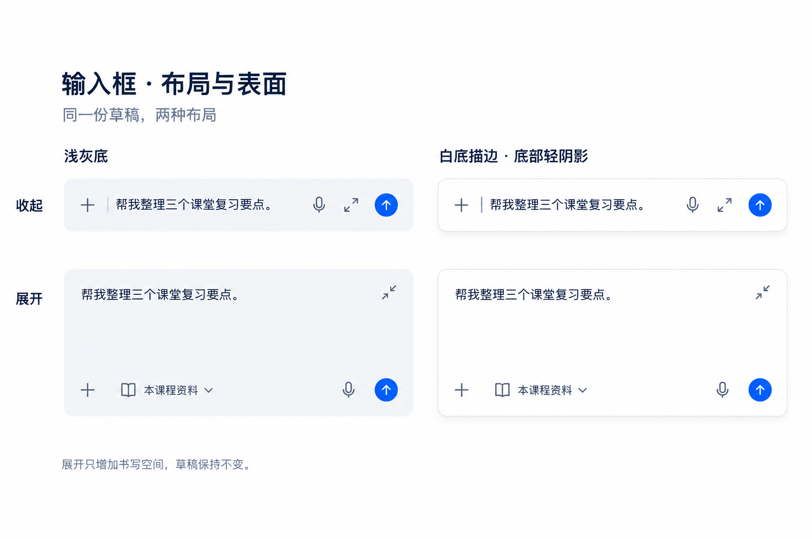
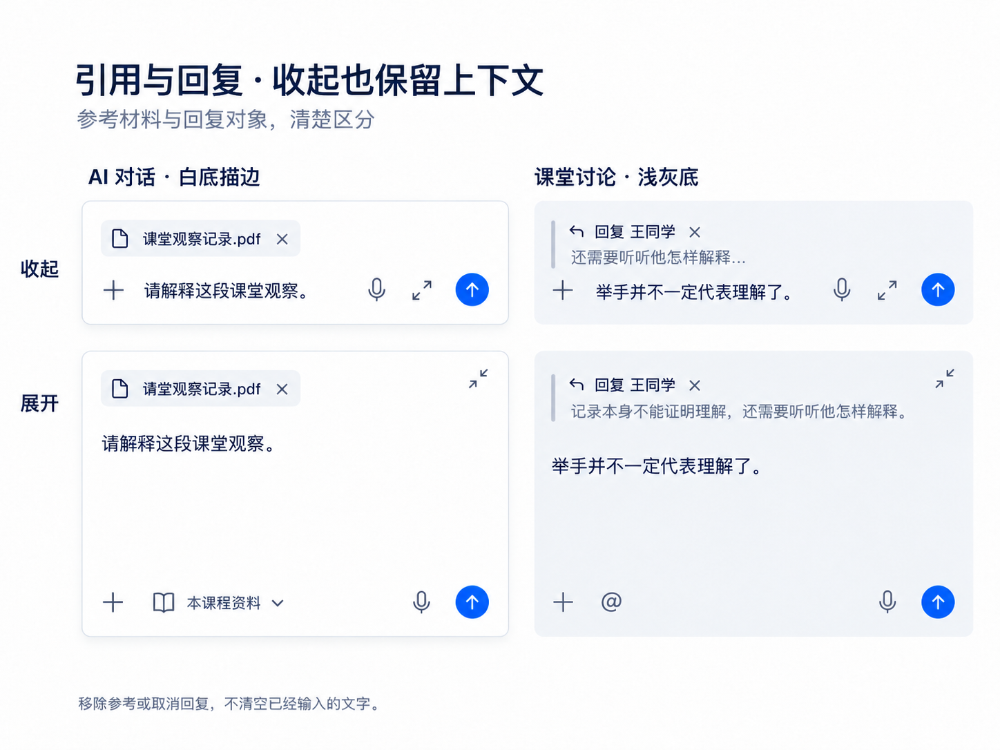
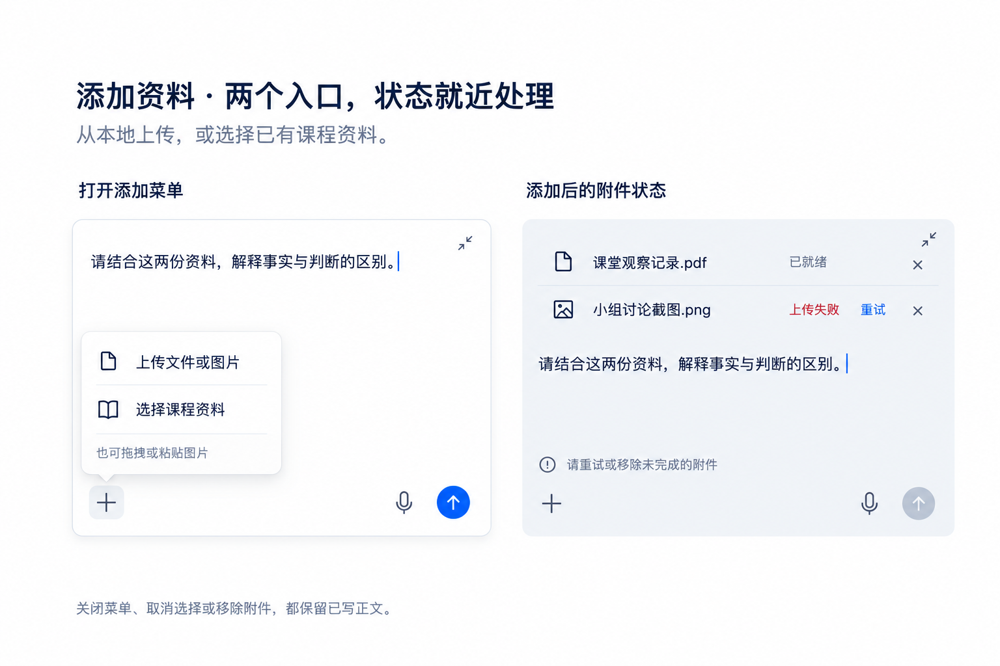
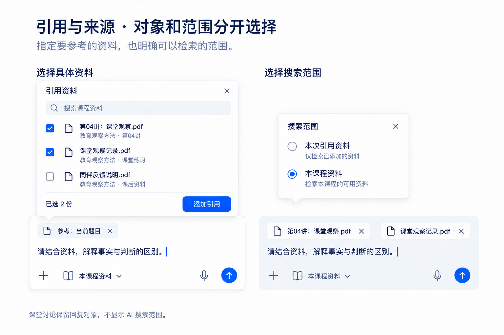
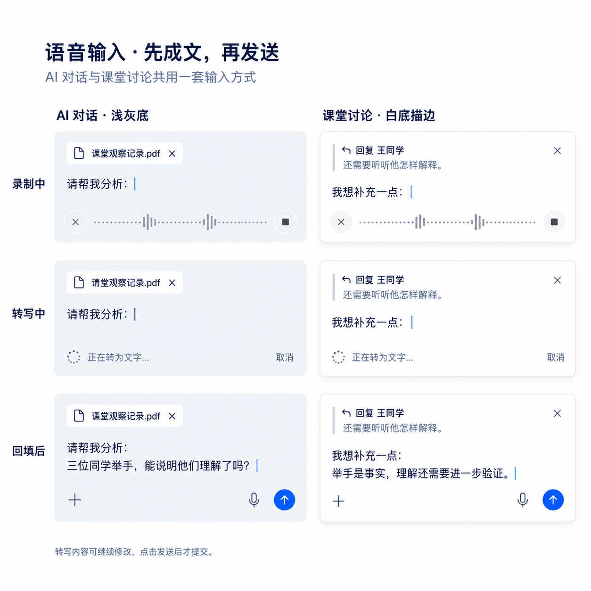
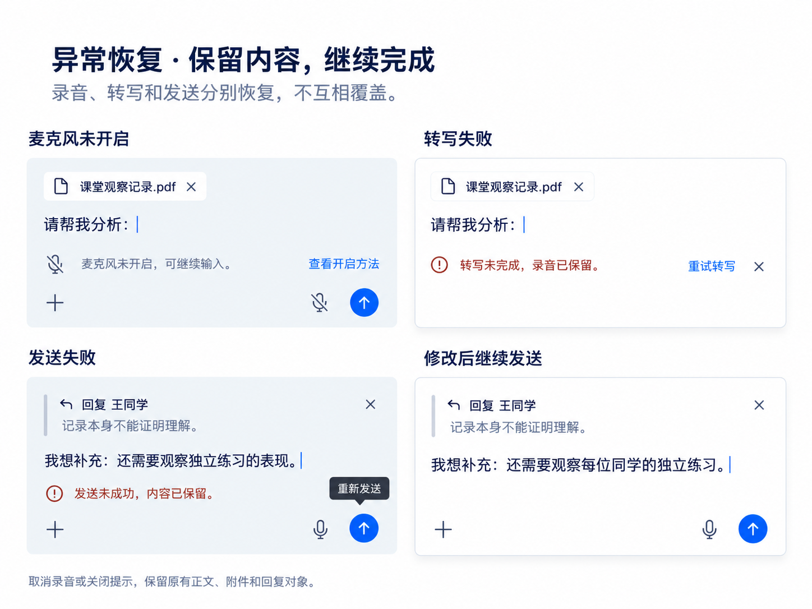

# 对话输入框：完整改造与优化设计方案

日期：2026-10-15 · 工作区：card-v2 · 状态：设计基线；本地候选已实施，运行视觉待用户审阅。

目标是把课程 AI 答疑、人与人交流和课堂讨论中的输入区，整理为同一套可复用的 ConversationComposer。正文、附件、引用、回复对象、语音和发送恢复有统一规则；课程检索、消息请求、权限和保存策略由场景提供。

配套文档：[代码实施方案](2026-10-15-conversation-composer-implementation.md) · [六张最终设计图与来源](assets/conversation-composer-2026-10-15/README.md)。本方案依据当前会话的调研、用户逐轮确认的图稿和 card-v2 当前实现；不把图稿确认扩大为运行时或生产验收。

## 1. 决策状态与交付范围

| 标记 | 含义 |
| --- | --- |
| 已确认 | 本轮用户已确认的外观、信息关系或可见交互方向 |
| 实施建议 | 为使代码行为完整而提出的默认规则；并非此前逐项验收的结果 |
| 服务依赖 | 需要真实业务接口、能力或权限才能成立 |
| 待验证 | 需要实现后以浏览器、设备或人工检查确认 |

本轮交付设计文档、实施计划和最终图稿归档。后续实现按 System Mode 建设共享 Pattern，登记为独立 Recipe 候选；使用现有库完成组合，不增加第三方聊天框架。

### 首轮实现包含

- 灰底、白底描边与底部轻阴影两种表面；紧凑、展开两种布局。
- 自然增高的纯文本编辑、稳定光标、明确焦点、现有 Enter 换行规则。
- 本地文件选择、拖入、图片粘贴、上传反馈、逐项重试与移除。
- 课程资料引用选择、独立检索范围选择、讨论回复对象。
- 录音、取消、结束、转写、保留录音重试、文字回填后由用户发送。
- 提交确认、失败保稿、修改后清除过期错误、AI 生成与下一条草稿分离。
- 独立 Playground 和现有两个 G6 场景接入，专项验证与来源登记。

### 留在后续独立范围

富文本编辑、Markdown 工具栏、@ 提醒、表情/GIF、语音消息直接发送、联网搜索/模型切换、任务队列、多个 AI 任务并发、离线发送、跨设备草稿同步、录音跨刷新保存、业务生产迁移。没有接入能力的入口不作为可用功能展示。

## 2. 当前问题与改造收益

当前输入区位于 apps/playground/src/docs/components/g6-course-conversation.tsx，依赖 Textarea 的 blockStart/blockEnd。核对结果如下：

| 当前事实 | 改造目标 |
| --- | --- |
| AI 与讨论分别组合输入区，尚无公共 Composer | 共享布局、输入行为与状态呈现，保留各自业务适配 |
| 通用 Field 聚焦使用整框品牌浅色与光晕 | 使用 Composer 自己的表面与清晰焦点，保持确认的中性外观 |
| 已有自然增高、上限滚动、清空回缩 | 保留这些能力，并增加独立的手动展开/收起 |
| G6 添加资料仅记录第一个文件名 | 复用现有真实 File 上传能力，显示上传与资源可用状态 |
| 讨论失败保留正文/回复，但编辑或取消回复后错误仍可残留 | 内容发生变化后清除旧失败提示，发送修改后的新内容 |
| AI 当前直接清稿并启动本地定时生成 | 拆开提交确认与 AI 回答，避免失败时丢稿或回填覆盖下一条 |
| AI 生成中可编辑下一问，停止保留下一问 | 保留这一能力，并明确停止不等于发送 |
| 已有回复定位、历史加载、阅读位置保持 | 改输入器时继续验证，不重写 MessageScroller |

当前 AI 回答和讨论发送是本地演示，不能据此推断真实网络上传、服务幂等或语音识别已接入。

## 3. 结构、布局与视觉

### 3.1 两种表面 × 两种布局【已确认】

表面和布局是两个独立维度，均可用于 AI、聊天或讨论，不按业务身份固定配色。

| 维度 | 方案 | 规则 |
| --- | --- | --- |
| surface | gray | 中性浅灰承载，层次简洁，主要操作局部点蓝 |
| surface | white | 白色任务表面、轻描边，阴影视觉重点位于底部 |
| layout | compact | 操作贴近编辑区；已有引用、附件、回复仍能识别 |
| layout | expanded | 编辑区与底部工具行分开，适合长文本与多个上下文对象 |

建议组成顺序：上下文区 → 正文区 → 工具/主操作 → 局部反馈。紧凑态可调整正文与操作的排列，但不把上下文藏进不可见菜单。展开是同一个编辑器的布局变化，不创建第二份草稿或切换到弹窗。

### 3.2 布局行为【实施建议】

- 默认紧凑；用户展开后保持选择，发送成功或清空文字不自动改变布局。
- 正文仅在当前布局的高度范围内增高；多一行文字不触发自动展开。
- 紧凑正文先按最多约 4 行、展开按约 8 行校准；视口较矮时再受容器高度约束。具体像素值须用真实字体和两种布局检查后确定。
- 超出上限只滚动正文，不让工具、引用或回复操作离开可见区域。
- 开关菜单/选择器不会拉高输入框。引用确认加入、错误出现等实际内容变化才改变占用高度。
- 切换布局保留焦点、选区、正文、附件、引用、回复和滚动位置；保持同一 textarea DOM 节点。
- 窄容器允许工具区合理换行，优先保留添加、语音、主操作；不能靠隐藏引用或横向页面滚动维持外观。最低 320px 容器专项检查。

### 3.3 Rain 视觉落地【实施建议 / 待验证】

| 项目 | 落地原则 |
| --- | --- |
| 字体 | PingFang SC；正文沿 Reading 14/24，工具与辅助文案沿 UI Typography |
| 圆角与间距 | 先以既有 Radius16、Space8/12/16 校准；不把生成图测量当精确规格 |
| 颜色 | 使用 Rain 的背景、中性文字、边框、品牌与错误语义 Token；主蓝保持 #1561F8 |
| 深色主题 | 使用主题映射后的语义表面，不在组件内强制白色/浅灰字面值 |
| 发送 | 小蓝色圆形视觉与上箭头；用 IconButton 命名局部配方，不新增全库 primary tone |
| 点击范围 | 先使用现有完整 36/20 尺寸配方；蓝色视觉圆可小于点击区域，禁止只按图缩小命中范围 |
| Focus | 输入、工具、上下文操作均有可见焦点；使用既有 Focus Token，不恢复整框蓝色填充 |
| 阴影 | 当前只有 none/overlay/dialog 等现有配方，没有已核实的“输入框底部阴影”Token；先评估现有 overlay 的局部底部投影效果。若过重，作为独立局部配方差异提交评审，不临时新增全库 Token |
| 动效 | 展开与波形克制；减弱动效下使用静态或低变化状态，状态变化仍可感知 |

图标必须从现有 available 目录选择并核对实际轮廓。发送的向上箭头、录音结束的方形停止是本任务已确认局部语义，记录其与默认图标规则的差异；不改变全库发送图标规则。加号、关闭、语音、搜索、文件、重试、展开/收起均复用真实资产，不绘制替代 SVG 或使用近似字符。

## 4. 内容与场景差异

| 对象 | 表达内容 | 删除/取消效果 |
| --- | --- | --- |
| 正文 | 本次要说的话或问题 | 只改变正文 |
| 本地附件 | 用户选取/拖入/粘贴的真实文件，带上传与可用状态 | 移除当前草稿关联；不等同永久删除服务器文件 |
| AI 引用 | 本次明确选择的课程资料，使用稳定 ID 与名称快照 | 移除指定引用；不暗改来源范围 |
| 来源范围 | AI 本次允许检索的范围 | 只影响下一次提交，不能改变已经发出的请求 |
| 讨论回复 | 作者、原消息摘要及消息 ID | 取消回复保留正文和附件；不自动产生 @ 通知 |

紧凑态保留对象名称/作者和移除操作，可截断长摘要；完整名称通过详情或可访问描述读取。多个上下文可换行；数量过多使用明确的“查看全部 N 项”入口，不能静默隐藏尚未完成或失败的附件。

AI Recipe 使用引用和来源，讨论 Recipe 使用回复；通用组件不根据“教师/学生”等身份推导能力。公开 API 由宿主显式提供这些能力。

## 5. 添加文件与课程资料

### 5.1 添加入口【已确认】

“＋”打开动作菜单，只有“上传文件或图片”“选择课程资料”两类入口，说明可拖入文件或粘贴图片。宿主无课程资料能力时省略第二项，不显示假入口。点击第一项后才打开系统文件选择器。

### 5.2 文件行为【实施建议 / 服务依赖】

- 文件选择、拖入、图片粘贴进入同一个校验和上传入口，受同一 accept、数量、大小、总量和重复策略约束；具体额度由宿主提供。
- 普通文本粘贴保留浏览器编辑行为；只有识别为文件/图片的部分交给附件流程，避免吞掉剪贴板文本。
- 复用 useAttachmentUpload，首个 Recipe 显式开启 autoUpload，选完通过校验即上传。正文中的紧凑附件使用 Attachment Parts；需要时打开现有 AttachmentPreview。被类型/大小等规则拒绝的文件即使未进入列表，也必须显示拒绝原因。
- 上传中、处理中、失败、取消、资源不可用均可识别。失败项在本项显示重试/移除；未解决时主发送不可用。
- 上传百分比未知时不造数值；100% 或 HTTP 成功不等同 AI 可读取。上传状态和 availability 分开校验。
- 已完成的课程资料引用不重复上传；上传得到的文件也不自动冒充课程知识库已收录。
- 移除失败项后重新计算发送条件，不清空其他内容；文件名过长仍能查看完整名称。

仅附件发送由宿主明确支持：建议讨论允许已就绪附件单独发送；AI 仅在接口支持文件分析时开启。仅引用默认不算有效消息，需要正文或可发送附件。

## 6. 引用选择与来源范围

### 6.1 引用选择器【已确认结构 / 实施建议细则】

以 Popover 容纳搜索、复选列表、已选数量与“添加引用”确认。打开时从现有引用复制一份临时选择；搜索不清空已选项。确认后才写回草稿；取消、Escape、外部关闭放弃临时变化。采用最终修订图的关系：相同布局、相同行数和相同上下文行数下，两侧输入框等高，弹层不撑高输入框。资料列表超过可用高度时内部滚动；资料选择器和范围浮层各按内容限高，不强制同高。

列表需包含加载中、无资料、无搜索结果、加载失败与资料不可用状态。旧搜索请求晚返回时不得覆盖新结果；已选项在搜索结果中暂不可见也不能丢失。确认时由宿主按全部已选 ID 重新解析可用性，检查期间避免重复确认并允许取消。发现失效项则保留临时选择和原草稿，标明原因，允许取消勾选后重试；全部有效才应用。发送时仍需业务权限校验。

### 6.2 来源范围【已确认结构 / 实施建议细则】

首个课程 Recipe 只提供真实支持的“本次引用资料”“本课程资料”两个互斥范围，使用单选。默认建议“本课程资料”。没有引用时，“本次引用资料”不可选择并说明原因。

已经选择“本次引用资料”后，若用户移除了最后一个引用，保留该选择并提示“请添加引用资料或更改范围”；阻止发送，不自动扩大到全课程。已发送请求绑定提交时的引用和范围快照。

显式引用失效时在原位置显示“资料暂不可用”，需要移除或重选。讨论原消息被删除则保留作者和文字快照，可提示无法定位；这是不同的对象规则，不应按失效资料强制丢弃回复内容。真实服务若禁止回复已删除消息，由宿主给出具体校验原因。

## 7. 语音输入：录音、转写、审阅

### 7.1 用户可见流程【已确认】

普通编辑 → 点击麦克风 → 简约灰色波形 → 点击方形按钮结束录音 → 转写中 → 文本回填 → 用户检查并点击蓝色上箭头发送。

正常录音界面只显示灰色波形、取消和结束按钮；不显示计时、红点或“正在录音”文字。无可见文字不代表没有语义：读屏需得到录音开始、结束和转写状态，两个按钮有明确名称。结束录音不使用发送箭头。

### 7.2 生命周期【实施建议】

| 状态 | 用户动作与结果 |
| --- | --- |
| 请求麦克风权限 | 可取消；保留草稿，不等待无限时间后擅自进入录音 |
| 录音中 | 保留原稿可见，冻结正文/附件/引用修改；取消丢弃本次录音，结束进入转写 |
| 转写中 | 保留原稿；取消仅停止本次转写并回到“录音已保留”，明确丢弃操作才删除录音 |
| 转写成功 | 在记录的光标位置插入文字，恢复编辑；不自动发送 |
| 转写失败 | 录音保留，恢复编辑，显示“重试转写”和丢弃录音；不要求重新录制 |
| 已取消/离开会话 | 关闭录音资源并忽略迟到结果，不回填到当前或另一个会话 |

开始录音时记录选区末尾；有选区时按末尾插入，不覆盖选中文字。位置不可用时追加末尾。失败后用户可继续编辑；重试转写时重新记录当前光标与草稿版本，并在该次转写期间冻结编辑。

服务返回成功但文字为空或只有空白时，保留录音并提示“未识别到文字，录音已保留”，沿用重试/丢弃入口，不按成功处理而释放唯一录音。

取消操作不使用旧快照覆盖当前文字。录音阶段取消会丢弃尚未提交转写的本次录音；转写阶段取消则保留已完成的录音，允许重试，关闭“录音已保留”提示才明确丢弃它。保留录音期间可以编辑文字，但发送暂不可用，提示先完成转写或丢弃录音；也需先丢弃才可开始新录音，避免静默遗失唯一可恢复内容。权限拒绝或无设备没有保留录音，不阻止文字发送。录音只保存在当前页面内存，不承诺刷新恢复。

首次实现中，AI 正在回答时允许准备文字和资料，但暂不允许启动语音；显示可访问的不可用原因，避免同时出现含义相近的停止回答/停止录音主操作。并行语音能力留待独立设计。

### 7.3 真实能力边界【服务依赖】

原生录音由用户操作触发。getUserMedia 需要安全上下文和权限，用户也可能一直不处理权限请求；取消后即使权限迟到获准，也必须关闭新获得的媒体轨道。[MDN：getUserMedia](https://developer.mozilla.org/en-US/docs/Web/API/MediaDevices/getUserMedia)

MediaRecorder 格式须检测浏览器支持，不把 WebM 写死为所有浏览器通用格式；停止、取消、卸载都要释放轨道、分析器和对象 URL。[MDN：MediaRecorder](https://developer.mozilla.org/en-US/docs/Web/API/MediaRecorder)

语音识别服务由宿主提供。演示转写文本必须标明本地模拟；只有真实录音、真实识别和故障验证完成后才能描述为已接通语音输入。

## 8. 发送、生成与草稿恢复

### 8.1 状态分别管理【实施建议】

| 状态维度 | 状态 | 主要规则 |
| --- | --- | --- |
| 草稿 | 正文、引用、回复、范围、修订号 | 由宿主按 conversationId 持有 |
| 提交 | idle / pending / failed | pending 阻止重复提交，失败保留本次内容 |
| AI 回答 | idle / running / stopped / failed / done | 消息区域负责回答状态；running 可编辑下一稿 |
| 语音 | idle / requesting / recording / transcribing / retained | retained 表示失败或取消转写后保留录音，原因分别显示；权限问题为独立提示 |
| 附件 | 现有上传状态 + 资源可用性 | 由一个上传 Hook 实例持有，不复制到第二个状态机 |

### 8.2 提交规则【实施建议 / 服务依赖】

1. 点击发送时检查正文/附件有效性、资料可用性、范围、权限与其他阻塞条件。空白正文不算内容，但不要为了检查而提前破坏用户原稿。
2. 创建固定快照与 clientMessageId；等待业务确认期间冻结本次编辑、附件和上下文，按钮表现为发送中。
3. 明确收到业务接收确认后，清空本次正文、已发送附件/引用/回复，再开始 AI 回答或显示讨论消息。布局、表面和来源范围偏好保留；保留的“本次引用资料”范围若已无引用，按第 6 节提示补选，不静默改范围。
4. 明确发送失败则原内容保留。原发送按钮承担“重新发送”，不再在错误旁增加第二个发送入口。
5. 正文、附件、引用、回复或范围发生用户修改，立即清除旧发送失败提示；下次属于新内容。单纯展开/收起不清错误。
6. 未修改的失败快照重试复用 clientMessageId，避免重复消息；宿主/服务必须支持幂等。请求超时且服务是否接收未知时先核对该 ID，不直接把“未知”当“未发送”。

提交成功后 AI 生成失败，错误属于已发消息；不得把旧问题重新填回并覆盖用户正在准备的下一条。回答停止、重试、重新生成保持消息身份，迟到回调不覆盖新尝试。

### 8.3 主操作优先级【实施建议】

| 条件 | 主操作 | 编辑能力 |
| --- | --- | --- |
| 录音中 | 结束录音，另有取消 | 正文和上下文暂时冻结 |
| 转写中 | 转写状态，允许取消 | 正文和上下文暂时冻结 |
| 有尚未处理的保留录音 | 重试转写，或明确丢弃；暂不可发送 | 可编辑；处理录音后恢复发送 |
| 提交 pending | 发送中，不可重复激活 | 冻结本次草稿 |
| AI running | 停止生成 | 可编辑下一稿，首版不并发发送或自动排队 |
| 明确发送失败且未修改 | 蓝色上箭头，名称/提示为“重新发送” | 可编辑；修改即回到普通发送 |
| 普通编辑且条件满足 | 蓝色上箭头，发送 | 可编辑 |
| 空稿或其他阻塞 | 不可用发送及具体原因 | 允许解决对应阻塞 |

进入录音、提交与 AI 生成的条件互相约束，使表中的冲突组合无法出现。停止 AI 回答只停止当前回答，绝不顺便提交下一稿。

### 8.4 草稿与会话【实施建议】

首轮只保证当前页面内按会话恢复正文、引用、回复、范围和已完成附件引用。切换会话时终止录音、忽略旧回填；保存旧会话附件的最新快照，将未完成上传标记为已取消，再完成 Hook 所属会话交接并 reset 到目标快照，同时中止旧任务。不依赖刚调用 cancel 后尚未重新渲染的旧 items，不让恢复后的附件永久显示“上传中”。仍在等待提交确认的结果只归属原会话，不能清空新会话草稿或重置新会话正在使用的上传 Hook。

刷新后的 File/Blob、录音和服务任务恢复不在首轮保证范围。需要刷新持久化时，必须另定可序列化快照、服务端附件标识和恢复协议。

## 9. 错误反馈与文案

错误贴近其对象；正文、上下文和其他已完成项保留。每类错误只有一个主恢复入口，不用大块错误背景占据编辑区。

| 情况 | 正式文案建议 | 主恢复入口 |
| --- | --- | --- |
| 麦克风未开启 | 麦克风未开启，可继续输入文字。 | 查看开启方法 |
| 无录音设备 | 未找到可用麦克风，可继续输入文字。 | 查看设备设置方法 |
| 转写失败 | 转写失败，录音已保留。 | 重试转写；旁侧关闭仅丢弃录音 |
| 取消转写 | 已取消转写，录音已保留。 | 重试转写或丢弃录音 |
| 上传失败 | 上传失败 | 本附件的重试；也可移除 |
| 资料不可用 | 资料暂不可用，请移除或重新选择。 | 在该引用处理 |
| 引用范围为空 | 请添加引用资料或更改范围。 | 添加引用或调整范围 |
| 明确发送失败 | 发送失败，内容已保留。 | 原主按钮重新发送 |
| 发送结果未知 | 正在确认发送结果，请稍候。 | 宿主核对原请求，确认后再恢复动作 |
| 修改过失败草稿 | 移除旧错误，不显示恢复成功庆祝提示 | 普通发送 |
| 原回复不可定位 | 原消息暂不可用，引用内容仍保留。 | 保留摘要，允许返回输入 |

麦克风问题不阻止文本发送。查看开启方法应打开针对当前浏览器的说明，不能声称程序能直接替用户开启系统权限。

## 10. 键盘、焦点与响应式

- 保留现有 Enter 换行、点击发送；首轮不新增 Enter 发送或未确认的快捷键。中文输入法候选确认不能触发提交。
- 所有纯图标操作有可访问名称；发送/重新发送、停止生成/结束录音按真实行为分别命名。
- 菜单使用既有 DropdownMenu 键盘行为；资料选择器使用 Popover、搜索框和 Checkbox，范围使用 RadioGroup。不要在 menuitem 内再嵌套可交互 Checkbox/Button。
- 从添加菜单切换到资料选择器时，菜单先关闭，再把焦点交到搜索框；取消返回添加触发器，确认回到编辑器。Escape 只关闭最上层浮层，不清稿。
- 删除附件/引用后焦点到相邻操作或编辑器；取消回复后回到编辑器；停止生成后回到下一稿。焦点不得落到已移除 DOM。
- 用温和的 live region 播报状态切换，不逐帧朗读波形或每个上传百分点。阻塞原因能被键盘和读屏用户获取。
- 覆盖浅/深色、减弱动效、forced-colors、桌面 1440×1000、窄视口 390×844 和 320px 组件容器；软键盘、触摸和真实 Safari/VoiceOver单独记录检查结果。

## 11. 共享架构与资产定位

采用一个共享 ConversationComposer Pattern，源码在 packages/ui/src/conversation-composer，登记为 recipe-conversation-composer。它拥有组合布局、原生 textarea、自动增高、菜单/选择器、语音交互和状态呈现；不另建一套同名基础组件再套一层 Workflow。

| 责任 | 所有者 |
| --- | --- |
| 表面、布局、焦点、输入、局部交互 | ConversationComposer |
| 上传队列、File、取消/重试、对象资源 | 既有 useAttachmentUpload，由宿主创建唯一实例 |
| 课程资料检索、权限、范围解释 | 课程场景适配器 |
| 消息提交、确认、幂等、回答流 | 场景适配器/真实服务 |
| 会话草稿与业务记录 | 宿主，按 conversationId 保存 |
| 消息呈现与阅读位置 | 既有 Message、Bubble、MessageScroller 及现有宿主 |

不用现有 Textarea 外框的原因是其 appearance 没有无框模式，现有 Field 焦点表现也不符合本次外观。Composer 使用原生 textarea 保持标准输入语义；不通过高优先级 CSS 覆盖共享 Field，不改全库默认行为。现有 IconButton、DropdownMenu、Popover、Checkbox、RadioGroup、Attachment 和上传引擎无需为首轮扩大公共 API。

## 12. 验收编号与边界

| 编号 | 必须可演示/验证的结果 |
| --- | --- |
| C01 | 两表面 × 两布局完整；切换不丢稿、不重建编辑器、不跳光标 |
| C02 | 自然增高/上限滚动/清空回缩；Enter 换行与 IME 安全 |
| C03 | 加号菜单语义正确；文件选择/拖放/图片粘贴同一入口；失败项可恢复 |
| C04 | 引用临时选择确认/取消、范围单选、失效资料与空范围规则成立 |
| C05 | 紧凑/展开均可识别回复；取消不丢正文，原消息无法定位仍保留摘要 |
| C06 | 录音简约外观；停止后先转写审阅；权限、取消、迟到结果与资源清理正确 |
| C07 | 转写失败保留录音；可重试/丢弃；不自动发送，不覆盖新增文字 |
| C08 | 提交确认前保稿、防重复；失败可重试，修改后旧错误消失 |
| C09 | AI 生成与下一稿分离；停止不发送；重试保身份；回答失败不覆盖下一稿 |
| C10 | 会话切换不串稿/串附件/串转写，旧提交结果只更新所属会话 |
| C11 | 改输入区不破坏历史阅读、prepend、返回最新、回复定位与焦点 |
| C12 | 键盘、主题、窄屏、减弱动效和状态播报有检查证据 |
| C13 | 公共导出、Registry、Manifest、示例与本轮证据对应；不改原 G6 十二项分母 |

图稿方向已确认；尺寸、真实图标、主题、交互实现和服务行为仍待验证。代码与自动检查完成后，记录实际 Human Gate，不继承其他组件或旧 G6 的人工接受。首轮资产仍为 registry-candidate、unpublished；真实服务接入、实际设备、发布和业务迁移各自独立。

## 13. 调研依据与采用方式

外部参考帮助区分输入、上下文和异步过程；视觉最终采用本任务确认图与 Rain 语言，不复制外部产品整套外观。

- [Carbon Prompt line](https://chat.carbondesignsystem.com/tag/latest/docs/documents/UI_customization.Prompt_line.html)：借鉴紧凑/展开与输入状态的分离；此前已观察公开演示，不据此认定 Rain 实现已验证。
- [Notion Agent](https://www.notion.com/help/notion-agent)：借鉴可辨认的上下文对象；不引入无业务需求的模型/工具选择。
- [Liveblocks Composer](https://liveblocks.io/docs/api-reference/liveblocks-react-ui#Composer)：借鉴新建/回复/编辑的状态区别；不引入评论数据服务。
- [Sendbird quote reply](https://sendbird.com/docs/chat/uikit/v3/react/features/message-threading/quote-reply)：借鉴回复对象与正文分离；不继承其线程深度产品限制。
- [Cursor prompting](https://cursor.com/docs/agent/prompting)：参考显式上下文和语音输入能力的区分；首轮不扩展为任务队列。

本仓库落地依据还包括 AGENTS.md、docs/ai/prototype-design.md、docs/ai/icon-selection.md、现有 Attachment Workflow 合同及 G6 当前源码。具体文件、实施顺序和验证命令见[代码实施方案](2026-10-15-conversation-composer-implementation.md)。

执行记录：用户随后授权按两份文档实施，本地交付及未验证范围见[本轮验证](../../evidence/runtime/conversation-composer-2026-10-15/run-01/verification.md)。图稿确认与运行验收仍分别记录。

## 14. 运行体验反馈后的优化（2026-10-15）

用户在进一步交互与视觉评审后授权按建议顺序实施。当前修订让两种布局均直接展示范围；仅引用范围发送成功后保留范围，空稿安静，有下一稿内容时再提示补选。资料选择器使用真实布局容器、36px搜索和普通资料名字重，并区分搜索结果与已选资料。局部附件/录音反馈合并，独立业务限制仍展示；文件拒绝带文件名并可清理。失败发送沿原按钮用refresh表达重试；保留录音用明确文字丢弃。多资料收纳只影响已就绪项，异常与进行中项保持可见；长引用可换行。白底投影与展开图标按现有配方校准，体验区前置。

这是对实施建议及实际呈现的用户授权修订。原表面方向、同一编辑器、失败保稿、独立提交/生成、语音转写后审阅继续适用。实时音量波形、真实业务服务、设备和人工验收边界独立。运行证据见[run-04](../../evidence/runtime/conversation-composer-2026-10-15/run-04/verification.md)。

## 15. 第二轮研究后的结构与状态修订（2026-10-15）

用户在第二轮产品与组件库对照研究后授权“按顺序开始优化”。本轮按结构、资料与范围、视觉、状态动效、完整会话检查实施。该授权修订此前“紧凑行内工具、展开角落收起”的排布：两态正文均占满可用宽度，工具固定在正文下方；展开仅增加书写空间，布局切换保留同一 textarea、草稿、光标与操作位置。紧凑不再用工具压缩正文宽度，也不按字数自动切换布局。

课程引用与上传文件复用同一 Attachment Parts 外形，显示名称、真实来源类别、状态和移除动作；只有已有服务支持的附件提供预览，不虚构引用详情。需处理项优先排列，视觉顺序与键盘 DOM 顺序一致；额外就绪项仍可收纳，资料区域限高并支持键盘滚动，正文与主动作保留在区域外。

范围保留原语义与可见标签，调整为低一级的工具样式；不自动扩大检索范围。Picker 整行表达选中，未选且原稿无引用时禁用确认；原稿已有引用时允许明确清空。没有新增章节、更新时间或其他服务未返回的信息。

录音、转写沿稳定工具行切换，结束录音位于主动作槽；现有文字保持可见。计时从实际录音开始，停止后冻结，在失败保留和重试时继续显示；丢弃、新录音、切会话清零。波形仍只表示录音状态。弹层使用现有 180ms Token 淡入，关闭即时交还焦点，资料出现使用 220ms，局部反馈使用 140ms；不逐字动画正文高度，减少动效时关闭这些效果。

参考来自第二轮已读取的 [AI Elements Prompt Input](https://ai-sdk.dev/elements/components/prompt-input)、[assistant-ui Composer](https://www.assistant-ui.com/docs/ui/Composer)、[Ant Design X Sender](https://x.ant.design/components/sender) 与 [Carbon Motion](https://carbondesignsystem.com/guidelines/motion/overview/)。借鉴组成与状态连续性；Rain 字体、颜色、图标、焦点与表面继续沿用本地来源。

执行及验证见 [run-05](../../evidence/runtime/conversation-composer-2026-10-15/run-05/verification.md)。这是本地未发布候选的修订，不代表用户已接受本轮视觉或真实服务、设备验收。

## 16. 实际页面复查后的动效与窄屏恢复修订（2026-10-15）

用户要求继续检查窄屏、多附件、语音及发送失败恢复，并明确要求展开/收起更顺滑。本轮保留第 15 节的全宽正文和固定工具行，只在手动切换布局时让编辑器外层高度使用既有 `region` 220ms 与 `ease-out` 过渡；快速反向从当前高度继续，不缩放文字或重建 textarea。逐字输入、容器或窗口宽度变化以及会话切换直接更新高度，不沿用布局动画；减少动效时禁用该过渡。长稿原本位于底部时，收起仍显示正文末尾并保留选区。

不超过 400px 的组件容器中，资料名称最多显示两行；带文字恢复操作的附件把按钮排列到名称和状态下方，避免长名称与重试、取消、移除互相挤压。本地文件的来源类别保留中性色，错误原因继续在对象内单独表达。资料区域原有限高、异常项优先和键盘滚动规则保持。

附件重试、取消上传或取消替换后立即回到正文，避免异步完成使操作按钮消失或资料项重排时丢失键盘焦点。该回焦不改变上传状态、替换事务、发送阻塞或失败保稿规则。

实施与验证范围见 [run-06](../../evidence/runtime/conversation-composer-2026-10-15/run-06/verification.md)。语音恢复、发送确认和会话隔离继续沿原合同；真实服务、设备与人工视觉接受仍分别记录。

本轮补查：长草稿中段与末尾收起后均保持光标可见。手动切换在实际布局更新后原生回焦，同步还原祖先滚动位置；受控布局采用同一路径；用户已转移焦点时不抢回，会话变化取消旧回焦请求。

## 2026-10-16 底部操作密度反馈

用户要求底部操作适当紧凑、缩小。本组合采用现有次级28/16、主动作32/18配方，统一发送、重试、录音停止和生成停止的尺寸；范围高28px，工具组间距2px，正文与工具间距6px，底部留白8px。仅此组合的视觉密度修订，正文、动效和业务行为不变，不改公共IconButton或Tokens。验证见[run-07](../../evidence/runtime/conversation-composer-2026-10-15/run-07/verification.md)。

2026-10-16 后续图标反馈：用户指定正常发送为正式图库 `icon/publish-filled`，内部16px、按钮外圈保持32px；替代此前 `up` 的局部选择。失败保留 `refresh`，使用同一32/16配方；停止动作不变。见[run-08](../../evidence/runtime/conversation-composer-2026-10-15/run-08/verification.md)。

同轮补充：用户要求空稿占位文字很浅，以和正式输入明确区分。限定本组合placeholder为neutral-6与55%不透明度，正文颜色和其他输入组件默认不变。

## 2026-10-16 本地整体验收与登记收口

用户明确授权整体验收、登记收口和直接修复问题，真实业务接口后续接入。当前验收对照 C01–C13 / Task 0–9，结果及全部实际运行证据统一见 [run-09](../../evidence/runtime/conversation-composer-2026-10-15/run-09/verification.md)。历史 run-01–08 保留原始范围。已确认的工具行尺寸、发送图标与极浅占位文字保持；补查公共适配器省略移除状态时的异步移除守卫，以及本组件在资产索引中的可检索性。最终人工确认、真实设备、对比度、发布各自独立，Task 10 不纳入本轮完成判断。

## 2026-10-16 整体验收通过

用户明确确认：“确定，当前本地版本整体验收通过，更新登记状态，完成收口。真实业务接口后续再接入。”当前本地版本整体 Human Gate 更新为 accepted，完成本专项登记收口。确认范围、接受版本绑定与当前结果见 [run-10](../../evidence/runtime/conversation-composer-2026-10-15/run-10/verification.md)；保留 run-09 的原始检查与接受前状态。真实业务接口依指令后续接入，实机、广泛对比度与发布状态各自独立。
