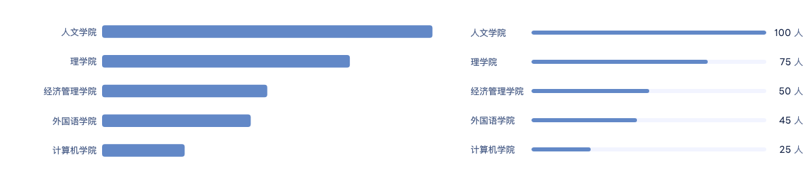

# 业务图表名称颜色与列宽修订

用户2026-10-09截图与浏览器评论授权修订；实际改动及5173预览位于 `.worktrees/card-v2`。System Mode，未发布共享候选的局部消费配方；依据V04/D02/D05保留同类名称的阅读层级、共同对齐和内容适应。

## 结果与范围

业务横条轴名称和排名名称默认使用现有Text/Neutral/3，与表格名称按钮一致。原轴还叠加0.7透明度，局部取消该淡化后默认颜色实际均为rgb(73,93,135)。只覆盖固定vendor内联opacity，原生150ms悬停文字变化与Tooltip保留；指针悬停实测rgb(20,35,70)，Tooltip仍读25人。表格Button本来就采用同色阶，默认/悬停/Focus实现没有改动。

排名首列改为内容宽度并在长名称时封顶，其余空间交给数量条。1231px实际首列由191.938px缩到78px，等于最长文本宽度；五行条形起点和数值右端差均0。长名称首列195.406px并省略，无页面溢出；单项名称65px。保留subgrid、12px列间距及600px以下名称上移的两行布局。

本轮仅修改运行时业务CSS；两条局部颜色消费登记及生成合同同步。本轮没有修改公共图表默认、vendor与来源锁、字体/字号、量程、数据、交互入口、Button、分类矩阵。README、AI指南、Bar Manifest、阶段和验证证据同步，既有测试仅调整证据目录并增加截图，不新增简单CSS断言套件。当前源指纹见 `final-source-hashes.json`。

## 检查与证据

| 检查 | 结果 |
| --- | --- |
| 修改前 | 用户截图 `user-before.png`；实际1231px颜色/透明度/列宽 `baseline.json` |
| 实际浏览器对比 | 默认共同颜色、透明度1、正常/单项/长名称几何、真实pointer悬停Tooltip，见 `cua-layout-colors.json` |
| 既有浏览器回归 | 2文件14项通过：5/40行更新、筛选量程、稳定ID、提示、1440/916/390、长/异常状态、200%页面与文字、超长整数和主值基线。见 `browser.log` 与 `browser/` |
| 颜色/来源/登记合同 | 初次2文件9项通过，未放宽原Text/Neutral/5等其他来源的待审阅断言。并行分类尺度源码加入时 `final-contract.log` 严格报来源锁暂未登记1项失败；其来源登记补齐后 `merged-contract.log` 重新9项通过 |
| 类型与构建 | Playground类型与构建通过，原有大包体提示保留。见 `build.log` |
| Token生成 | 仅生成合同JSON需要同步，颜色值/全局Token未变；生成一致性复验通过。见 `final-contract.log` |
| 初次冻结版21份独立消费 | 7业务状态+14迷你下载闭包、类型、构建、Chromium读数/更新/390px检查通过，无pageerror。见 `consumption/facts.json` 与 `isolated-consumption.log`；此结果不代表后续并行改动后的整个消费脚本通过 |
| 前置170官网源码 | 现有消费脚本同时执行170份源码闭包、类型、构建与模块路径审计，无宿主外模块；本轮没有跑170份浏览器。见 `consumption/official-variants/facts.json` |
| 初次独立消费的源一致 | 当时2313共享源、包清单、去重下载文件、Registry和exporter匹配，见 `consumption/current-source-audit.json`；该审计保留为历史快照，不覆盖之后并行任务新增源码 |
| 独立复核 | 代理只读核对最小布局、颜色登记、Button和vendor边界，并执行原消费脚本，未改生产代码或放宽断言 |

独立消费第一次运行时README仍在同步，完整包冻结检查严格拒绝这一处文档漂移。类型/构建本身通过，但未进入21份浏览器检查；保留 `first-source-drift/`。冻结全部复制文件后用原脚本重跑通过，没有把首次结果当作最终通过。

随后同一工作区的并行图表任务加入分类尺度辅助函数及4个测试，并改动日期/分类兼容路径和来源登记。这些文件不是本轮修改，不回退或代替其实现。9项合同、14项业务浏览器及Playground类型/构建已经在当前合并版本重新通过，见 `merged-contract.log`、`merged-browser.log`、`merged-build.log`。两次完整源快照及Registry在33秒观察期间一致，见 `merged-source-freeze-first.json`、`merged-source-freeze-second.json`；因此对当前合并快照另用原消费脚本做一次验证，结果另存 `consumption-merged/`，不把旧消费结果说成新版本通过。

该并行任务也将消费脚本扩展为34入口。当前合并快照170官网源码类型/构建、34下载类型/构建，以及7业务状态+14迷你渲染检查通过，无pageerror；新增分类轴检查在脚本第116行因 `.rain-category-plot svg` 期待1、实际2而失败，后置业务下载更新/窄屏检查未执行。本轮没有修改新增断言或并行源码。`consumption-merged/current-source-audit.json` 分别登记2318共享源对应通过和整体消费失败；本页本轮修订与当前合并浏览器14项通过不被表述为新增分类图表下载全部通过。

消费使用复制的完整当前包与依赖缓存，不代表干净/最小安装。完整对比度、用户视觉接受、真实Safari/VoiceOver和物理设备仍未验证；contrastAcceptance=not-granted，visualHumanGate=awaiting-user-review。没有发布、Figma写回、业务迁移或Git提交，保留共享工作区其他改动。
