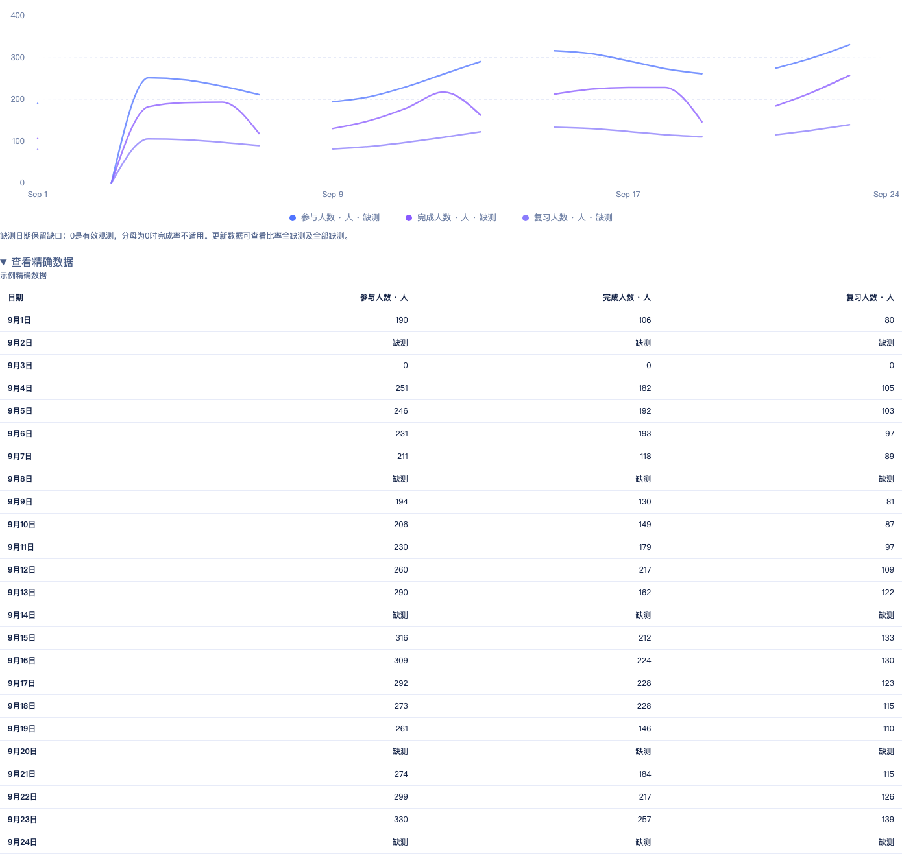
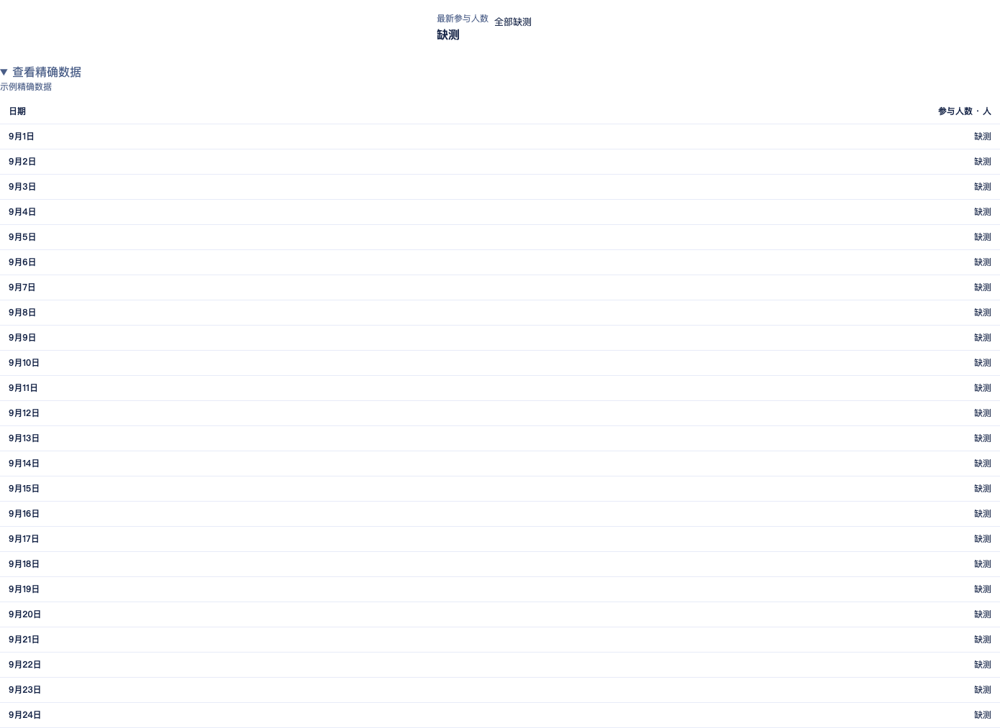
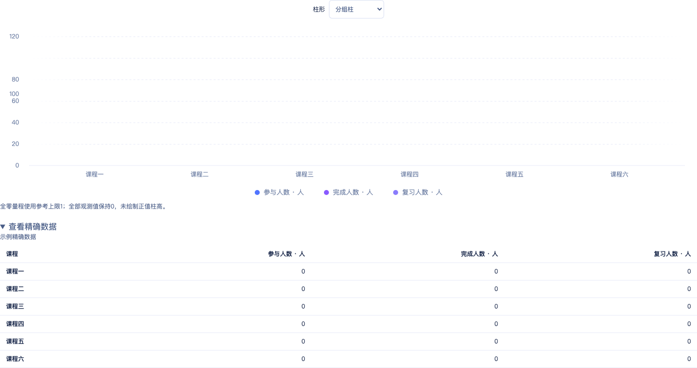
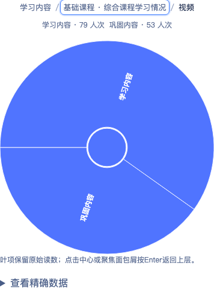

# 第一批体验审阅

日期：2026-10-10。工作区为 `.worktrees/card-v2`；第一批 E01—E03 已实施，自动检查和用户体验确认分别记录。图表继续保持 `registry-candidate / unpublished`。

## 实际页面与建议检查顺序

1. [默认折线](http://127.0.0.1:5173/#chart-line)、[面积](http://127.0.0.1:5173/#chart-area)、[组合](http://127.0.0.1:5173/#chart-composed)：选择“缺测”，查看9月2日缺测、9月3日真实0与末日缺测；组合图零分母为“不适用”。打开精确数据，与指向提示逐点对照。
2. 保持缺测状态点击“更新数据”：第1次保留计数观测，完成率全部缺测；第2次所有观测缺测，图形停止绘制并保留24个日期；第3次恢复部分缺测。更新继续按这一顺序循环，日期与对象身份保持。
3. 折线／面积切换“迷你”，分别查看compact 96×32与comfortable 128×48：末值为“缺测”，全部缺测仍保留槽位和说明。切换正常、零值、单点与非法状态检查读数与布局。
4. [默认条柱](http://127.0.0.1:5173/#chart-bar)选择“零值”：近图说明参考上限1，精确表和实际柱高仍为0；两种迷你尺寸也可查看。[实际嵌入](http://127.0.0.1:5173/#chart-business)保留表格、卡片、列表的共同量程和就近读数。
5. [默认旭日图](http://127.0.0.1:5173/#chart-sunburst)：Tab到当前层级按钮，用Enter或Space进入下级，焦点转到可返回的面包屑；返回后回到原按钮。正常样本的叶项只显示原始读数；“长标签”样本可继续进入视频等内容并逐级返回。更新／重播保留有效层级；失效路径回根，外部控件焦点保持。

检查正常运动和系统减少动效两种设置；390px下可查看长名称、深层路径和可见焦点。当前打开的本地审阅页保留在旭日长标签第二层，便于直接返回和继续操作。

## 改前与改后

| 对象 | 改前基线 | 当前结果 |
| --- | --- | --- |
| 默认缺测 | 标准入口门控停止绘制；迷你入口仅保留占槽状态 | 保留真实日期，部分缺测断口可读；全部缺测提供状态，摘要／Tooltip／表区分缺测、0和不适用 |
| 全零条柱 | 零值几何和DataBar边界已有正确行为，参考量程缺少就近说明 | 补全零参考1的说明；非空且所有实际观测为0才显示，全缺测和空集合不误标全零 |
| 默认旭日 | 鼠标下钻、面包屑返回已有；默认入口缺少键盘进入下级 | 使用Rain Button和Breadcrumb；补多级返回、焦点恢复、有效层级保留、失效路径及悬停对象清除、完整路径提示 |

基线源码与失败断言保留在[基线快照](baseline/source-hashes.json)和[实施前目标失败](implementation/root-red.log)；实际检查、固定版本和下载结果见[技术记录](verification.md)。

## 代表画面

普通运动的[下钻过程帧](acceptance/default/e03-sunburst-no-preference-390-long-deep.png)记录过渡过程；最终几何可在实际页面观察，不能把该过渡帧当作终态布局。

## 独立确认范围

- 本批视觉、连续操作手感与新键盘流程待用户审阅；不由自动检查代替。
- 矩阵、中国地图、雷达和迷你等既有局部Gate保持各自状态；网络已有确认也不扩展为全目录通过。
- Safari／VoiceOver、实体触屏、完整对比度与深色／强制颜色、任意大数据和生产数据接入尚未验证。3D本次只复核静态柱位置，未验证更新动效或完整立体表面贴合。
- 未执行Git提交／推送、Figma写入、发布或业务迁移；第二批仍待后续授权。
