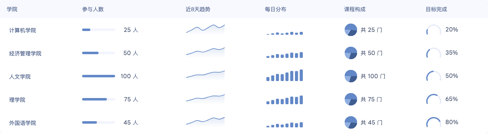

# 迷你图表字号、面积走势与圆头反馈

2026-10-09，用户四项截图反馈授权实施。实际预览与改动位于 `.worktrees/card-v2`，为未发布共享候选的局部增量；保留已有共享工作区改动，无Git提交、Figma写回、发布或业务迁移。

## 已完成行为

- 横向图左侧BarYAxis、数量排行和表格学院名称使用13px；普通迷你标签、数值、单位、百分比、短说明、状态与表格文字统一现有13px / 20px。重点指标数字28px / 36px与标题层级保留，UI/数据字体职责不变。
- 参与人数卡与5行表格趋势使用现有面积compact96×32，真实面积填充可见；离屏占位同型号。画廊及独立折线页仍提供折线和面积的两档选择，不改变MiniTrend默认或公共Props。
- DataBar改为真实宽度动画，保留550ms过渡、既有缓动与减少动效即时行为；取消填充scaleX，避免圆角横向压扁。表格80×6、画廊120×6 / 160×8、列表评分120×6及完整比较域不变。
- 缩小进度文字后，卡片基线实测有2px偏差；将既有主数字偏移由-6px调整为-8px，保留原≤1px断言，三张卡片实际差0px。
- 原生vendor与来源锁、Token、颜色登记、数据校验、数量/进度语义、异常状态、分类矩阵页面归属和依赖不变。README、AI指南、5份关联Manifest、现有消费断言与阶段记录同步。

## 验证

| 检查 | 实际结果与证据 |
| --- | --- |
| 反馈基线 | 新增3项浏览器回归均按预期失败：轴12px与普通读数12/14/16px，宿主趋势line且卡片comfortable，数量条scaleX压扁圆头。见 `baseline-browser.log`、`baseline-browser/` |
| 面积检查等待修订 | 首次修订后的字号和圆头通过，面积探针采集早于滚入视口的原生首次绘制。检查改为先滚入宿主并等待真实闭合面积path；未放宽填充或几何条件。保留 `focused-area-probe-error.log` 与失败trace |
| 相关单元 | 6文件91项通过，含DataBar校验/状态、mini数据/组件、下载合同、18入口/来源锁与颜色消费验证。`unit.log` |
| 相关浏览器 | 4文件26项通过。包含字体/面积/圆角3项、正常与减少动效、25→75→50中间宽度、5/40行更新与稳定ID、Tooltip门户、筛选量程、1440/916/390px、长/异常状态、200%页面与独立文字放大。`final-browser.log`、`browser/` |
| 卡片对齐 | 原断言先失败2px，修正后通过且三卡基线差0px。`host-browser.log`、`host-browser-fixed.log`、`host-baseline-before-alignment.json`、`browser/sizes/host-readings.json` |
| 类型/构建 | UI类型、Playground类型及构建、Prototype类型及构建全部通过。`ui-typecheck.log`、`playground-build.log`、`prototype-build.log`。保留已有大包体提示，未拓展为打包优化 |
| Token生成一致性 | `generate-token-foundations.mjs --check` 通过。`token-check.log` |
| 文档与登记同步后复验 | 9项Manifest/Registry/来源锁/样式边界/颜色登记检查再次通过，已包含在91项唯一单元中，不重复累计。`final-metadata.log`；本轮文件空白检查通过 |
| 21份独立消费 | 7业务状态与14份单图下载闭包、类型、构建和Chromium检查通过，无pageerror。验证普通13/20、更新、两档几何、390px内部滚动。`consumption/facts.json`、`isolated-consumption.log` |
| 消费前置170入口 | 现有脚本无21份单独flag；前置170官网下载闭包、类型、构建和模块解析审计通过，16家族/3172模块/宿主外模块0；本轮未跑170入口浏览器。`consumption/official-variants/facts.json` |
| 当前源对应 | 2313份共享源、16份下载源及包清单/Registry/exporter与独立消费哈希一致，零漂移。`consumption/current-source-audit.json`；本轮最终源码与文档指纹见 `final-source-hashes.json` |
| 独立复核 | 两个代理分工只读复核排版、圆头、源码及卡片/表格截图；除新反馈测试文件外不改生产源码，未发现新问题。此复核不是用户视觉接受 |

26项浏览器回归测得：左侧25个标签均13px；普通迷你文字13/20；卡片与表格6个趋势均area compact96×32且有实际渐变面积；25/50/100/75/45%条长准确，6px厚度与两端物理圆弧半径3px一致，无横向缩放。

5/40行局部更新采样的帧间隔p95为16.2/9.3ms，但各有113/127ms长任务，最大帧间隔108.9/133.4ms，不能据此声称持续60fps。范围仅当前本地Chromium，见 `browser/embedding/performance.json`。

## 视觉证据与边界

消费使用完整当前UI/Foundations与已安装依赖缓存，不是干净安装或最小Registry安装；computed font-family不证明指定字体文件实际加载。真实Safari、VoiceOver、物理设备与完整视觉/对比度Gate仍待独立验证，`contrastAcceptance=not-granted`，`visualHumanGate=awaiting-user-review`。本轮只完成已授权的本地技术修订。
