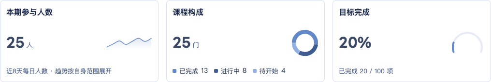
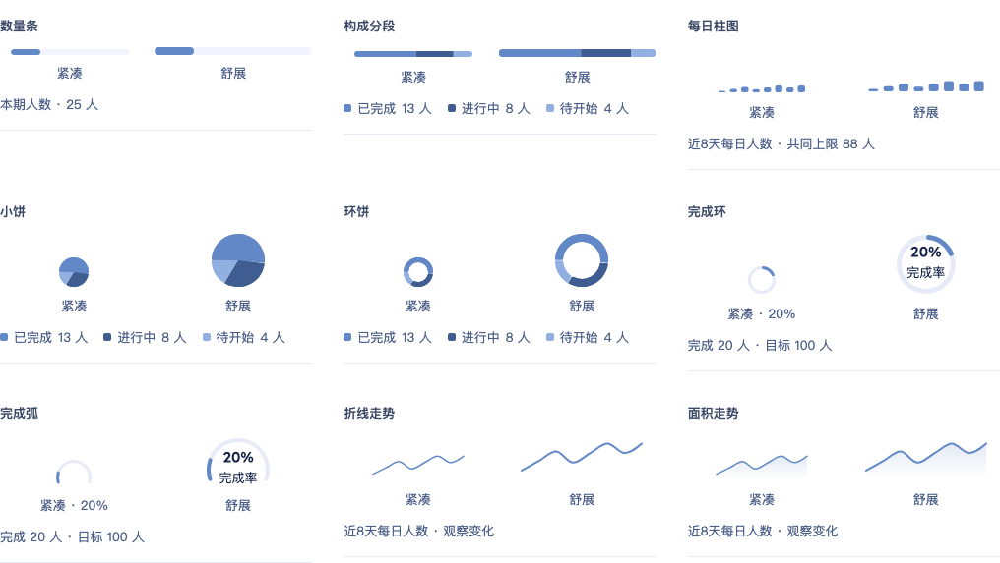

# 图表视觉层级修订：查看入口与前后对照

本轮按“确定，开始修改”实施讨论中确认的四组调整。下面比较本轮修改前后；不是把早期独立目录与当前文档站混为同一基线，也不表示整套图表已获视觉接受。

## 直接查看

- [趋势图](http://127.0.0.1:5173/#chart-line)：主图先于示例调节项，源码与接口按需展开；变体先于详细接口。
- [分类柱图](http://127.0.0.1:5173/#chart-bar)：同样恢复页面标准边距，更新与重播使用轻量文字操作。
- [旭日图](http://127.0.0.1:5173/#chart-sunburst)：分类入口恢复 Rain 文字按钮，去掉重复数值；保留悬停读数、键盘下钻与返回焦点。
- [迷你图表与业务组合](http://127.0.0.1:5173/#chart-business)：18 个样本按 9 个图型配对；共享说明就近出现；三个指标卡统一主数字与图形的关系。

本地预览需要当前服务保持运行。状态切换、图例、更新、重播、源码下载仍可直接操作。复看下方截图时，将主图的“视觉配方”选为“蓝灰单色”；入口原有默认配方保持不变。

## 同条件对照

统一条件：相同页面、1440px / 390px 视口、正常数据、revision 0、蓝灰单色配方、减少动效。桌面内容宽度随标准容器从贴边恢复为 1016px，窄屏为 358px；因此没有把视口相同误写为图形绘图区宽度相同。此组静态对照用于查看布局，正常动效另有浏览器记录。

| 代表 | 桌面修改前 | 桌面修改后 | 窄屏修改前 | 窄屏修改后 |
| --- | --- | --- | --- | --- |
| 趋势图 | [前](before-browser/line-1440.png) | [后](after-browser/line-1440.png) | [前](before-browser/line-390.png) | [后](after-browser/line-390.png) |
| 分类柱图 | [前](before-browser/bar-1440.png) | [后](after-browser/bar-1440.png) | [前](before-browser/bar-390.png) | [后](after-browser/bar-390.png) |
| 旭日图 | [前](before-browser/sunburst-1440.png) | [后](after-browser/sunburst-1440.png) | [前](before-browser/sunburst-390.png) | [后](after-browser/sunburst-390.png) |
| 业务指标卡 | [前](before-browser/business-cards-1440.png) | [后](after-browser/business-cards-1440.png) | [前](before-browser/business-cards-390.png) | [后](after-browser/business-cards-390.png) |
| 迷你图库 | [前](before-browser/business-gallery-1440.png) | [后](after-browser/business-gallery-1440.png) | [前](before-browser/business-gallery-390.png) | [后](after-browser/business-gallery-390.png) |

指标卡当前画面：

迷你图库当前画面：

## 本轮接受范围

待用户判断：主图是否重新成为阅读重点，9 组配对是否便于比较，指标卡 28px 主数字和 13px 普通读数是否有清楚层级，旭日分类入口是否易于发现。

自动检查只确认已覆盖范围的行为、数据、尺寸与样式约束；不等于视觉接受、对比度认证或 Safari / VoiceOver / 真实触屏验收。Human Gate 仍为 awaiting-user-review。未发布、未同步 Figma、未迁移业务、未提交或推送 Git。

技术范围与已知限制见 [验证记录](verification.md)，独立复核见 [代码与画面复核](independent-review.md)。
