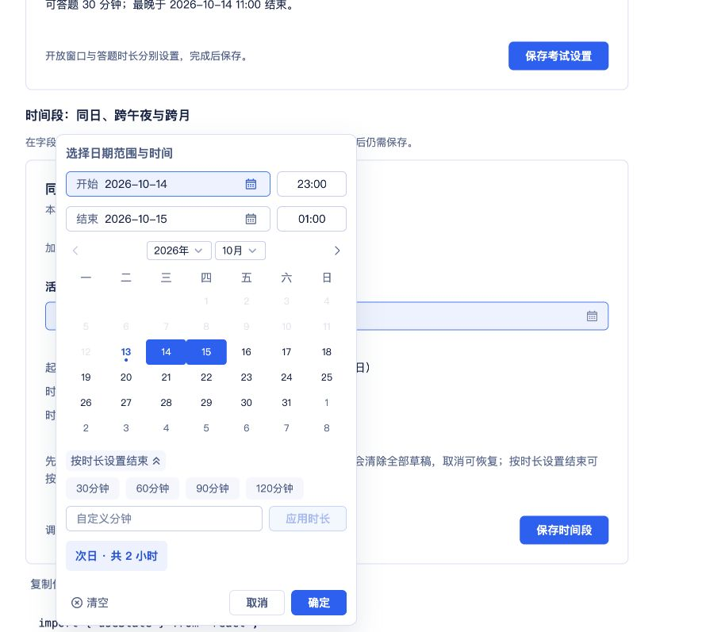

# DatePicker 本轮复验与手动反馈

2026-10-13，本地可执行检查完成。用户确认 Safari 浅色、深色全部通过，原生缩放已完成 200%；其他真实环境检查继续保留实际进度。

## 本轮亲自执行的检查

- [定向测试](unit.log)：6 个文件、86 项通过，包含 80 项日期测试与 6 项收口检查。
- [来源核验](machine-checks.json)：15 个来源文件仍匹配此前收口记录；旧共享读者仍拒绝未采纳的 S3 差异，没有把整条共享检查标为通过。
- [实际浏览器复验](browser.json)：无效 `24:00` 离焦后关联具体错误，确定不可用；取消恢复原跨午夜值及入口焦点，摘要仍为“次日 · 共 2 小时”。914×797 当前视口内面板完整、无水平溢出，应用错误为 0。
- Safari 自动操作已加载本地预览，随后用户切换到原有标签，检查在交互步骤前中断；临时标签已清理。这次自动操作不作为 Safari 交互通过证据。

本轮未修改组件代码，没有重复类型检查、构建或整套浏览器回归；上一轮对应证据继续保留在[完整收口记录](../verification.md)。原来源记录、phase、Manifest 和此前视觉确认未被改写。

## 用户报告的手动结果

直接反馈：“我只完成了部分手动验证”“Safari 浅色/深色全部通过；缩放只完成 200%”。结果与本轮来源绑定，见[人工反馈记录](manual-acceptance.json)。设备、系统和浏览器版本未提供；200% 的主题结果没有分别报告。

| 项目 | 当前结果 | 依据与剩余范围 |
| --- | --- | --- |
| Safari S1–S4 | 两种主题通过 | 用户报告；不与自动化结果混记 |
| 原生缩放 Z1 | 200% 已完成 | 用户报告，主题未分项 |
| 原生缩放 Z2、Z3 | 待验证 | 400% 重排、恢复 100% |
| 真实触屏 T1–T4 | 待验证 | 实机点按、软键盘、转向及跨午夜 |
| VoiceOver V1–V4 | 待验证 | 实际语音、状态、错误与焦点 |

[15 项清单](../manual-checklist.md)中 5 项登记为已完成，10 项仍待验证。Safari 的有限人工结果不关闭全组件无障碍、共享来源链、发布或生产采用检查；无 Git、Figma、发布或业务迁移操作。

## 本轮截图

这是实际 914×797 桌面 Popover，截图时展开时长工具；随后取消并恢复原确认值与入口焦点。它不作为触屏或原生缩放证据。

