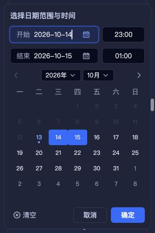
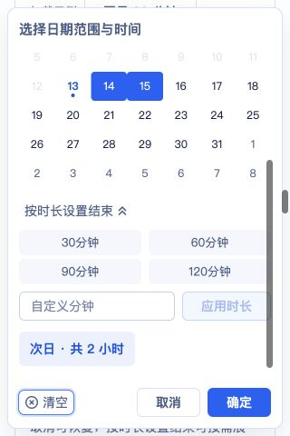

# DatePicker 本地检查收口记录

2026-10-13，本轮 DatePicker 的辅助文字对比度、定向交互测试、类型、构建及独立来源检查已通过。后续复跑 86 项检查通过，15 个来源文件仍与记录一致。用户报告 Safari 浅色、深色全部通过，原生缩放已完成 200%；真实触屏、VoiceOver、400% 和恢复 100% 仍待验证，见[本轮复验与反馈](final-confirmation/verification.md)及[手动验证清单](manual-checklist.md)。整个共享来源链保持未关闭。

## 本轮变更与授权

用户要求“接下来把 DatePicker 的剩余检查收口，先说明共享检查为什么还没关闭，以及哪些需要我手动验证”，随后选择“将说明文字调至达标，保留当前布局和按钮外观”，并要求整理四组手动验证步骤及通过标准。

只有两条实际样式规则将 Text/Neutral/6 改为现有 Text/Neutral/4：DatePicker 内缺少起点的辅助原因，以及当前 DatePicker 展示页的说明和帮助文字。日期逻辑、TimeField、公开 API、展示样例源码、布局、按钮配方和触屏规则保持原源。时长按钮仍为中性浅底、透明边框、28px 高、13px 常规字重；时长摘要和错误层级保留。

Manifest 同步当前 Token、局部合同、来源版本与证据指向。[此前视觉确认](../date-picker-visual-feedback-2026-10-13/acceptance.json)继续绑定其原版本；它没有被重写，也不用于宣称新版本已完成人工无障碍验收。没有 Git、Figma、发布或业务迁移操作。

## 本地结果

| 检查 | 结果 | 证据与范围 |
| --- | --- | --- |
| 日期交互、时间输入、工具函数、UX 回归和作业考试样例 | 5 个文件共 80 项通过 | [最终日期测试](date-unit-final.log) |
| 辅助文字对比度与独立来源边界 | 6 项通过 | [最终收口测试](closeout-unit-final.log)，包括未知授权、错误 Gate、第三哈希、伪造 before、原证据篡改、错误 owner 和 S3 仍被拦截 |
| UI、Playground 与测试类型 | 通过 | [UI](ui-typecheck-final.log)、[Playground](playground-typecheck-final.log)、[测试](tests-typecheck-final.log) |
| 标准 Playground 构建 | 通过 | [构建记录](playground-build-final.log)，保留现有大文件体积提示 |
| 真实本地浏览器观察 | 9 项通过，应用错误 0 | [浏览器检查](browser/checks.json)：浅深色、提示、按钮、320×480、焦点、无效时间和取消恢复 |
| 独立审阅 | 有限范围通过 | 实际调用独立读者、核对 15 个来源与两条 CSS，以及旧共享读者保留拦截；发现的 Manifest Token 描述已同步 |

上述浏览器结果使用 CUA 实际操作与只读样式测量；没有把 `date-picker-refinement.spec.ts` 的 12 项测试文件记为整套已执行。真实触屏 Sheet、Safari 和 VoiceOver 没有用桌面模拟替代。随后 Safari 的人工结果由用户分别确认浅色、深色全部通过；它登记在独立反馈记录中，不计入 AI 的 9 项浏览器观察。

辅助文字在浅色白底的实际对比度由 2.2821201039 提升到 5.5666792385；深色任务表面由 3.6137822500 提升到 5.6224275614。[浅色测量](browser/contrast-after-light.json)、[深色测量](browser/contrast-after-dark.json)保留实际前景、合成背景和主题状态。两个主题的两个既有中性表面最低值为 5.2881078，见 [Token 对比矩阵](contrast-token-matrix.json)。普通文字按未舍入数值 ≥4.5 判定，参考 [W3C 对比度标准](https://www.w3.org/WAI/WCAG22/Understanding/contrast-minimum.html)。这只关闭两条辅助规则的数值问题，不构成全组件、全库或全部状态的无障碍验收。

无效时间在离焦后关联 `aria-invalid` 和具体错误描述，确定不可用，错误仍以原红色显示，见[离焦后的错误记录](browser/invalid-time-after-blur.json)。[输入中的中间记录](browser/invalid-time.json)保留编辑态，它不是错误语义通过的依据。

## 共享检查为何仍未关闭

原来有三处 DatePicker 技术完成字段比 Select 的 before 快照更新，以及两个治理测试文件由并行任务交错写入。这些差异在[本轮来源记录](source-bindings.json)中逐项声明，只允许已核实的三个字段和三个 owner 路径哈希元组；没有覆盖旧 before 或重签旧日期、Select 记录。

期间，S3 原型任务又登记了五个完成观察字段。当前 phase 原样保留了它们，但本轮 DatePicker 不验证或采纳 S3 完成状态。六个旧共享读者仍在 Select 的“必须保留此前全部阶段与 Gate”检查处拒绝该差异，见[共享检查状态](shared-checks.json)。这条拦截保留，没有删掉 S3 或把未知差异变成白名单。

Slider 仍在进行，当前来源记录可以继续由它的任务更新。本轮保留初始观察副本，并冻结另一份用于治理测试来源核对的[并行观察](parallel-observations/slider-source-bindings.json)；只核对本轮明确用到的两处最终测试来源，不将观察副本当成 Slider 完成证明。整体链后续需要由相应任务衔接这些变化。

标准[工作区检查](shared-workspace-final.log)另保留 7 条失败：原 B2 历史状态、受共享链阻止的 Button Group、同源的图标授权审计、两条命令表约束、两个图表测试反向依赖。旧 DatePicker Visual 和 UX 的 before 快照也复现同一 B2 失败，见共享检查状态中的原始对照；本轮未改这些历史、命令或图表记录。

## 来源与截图

[初始 baseline](baseline.json)及其 before 副本保持不变。[有效闭合 baseline](closure-baseline.json)另外保留 S3 五字段观察后的 phase，标明未采纳。15 个本轮当前来源分别绑定 before 和 after，四份日期行为源码保持原哈希，10 份前置记录的观察副本完整保留。

正常尺寸的两次截图采集未成功；浅深色的正常尺寸计算样式测量有效。下面保留的截图均为实际 320×480 视口，没有把它们标成宽屏或触屏证据。临时视口设置已清除，最终观察到的默认视口仍为 320×480，浅色、原跨午夜确认值保留，应用错误 0。

手动验证的记录、失败步骤和设备版本填写在[清单](manual-checklist.md)末尾；每组全部达到通过标准后，再分别登记对应验收结果。
