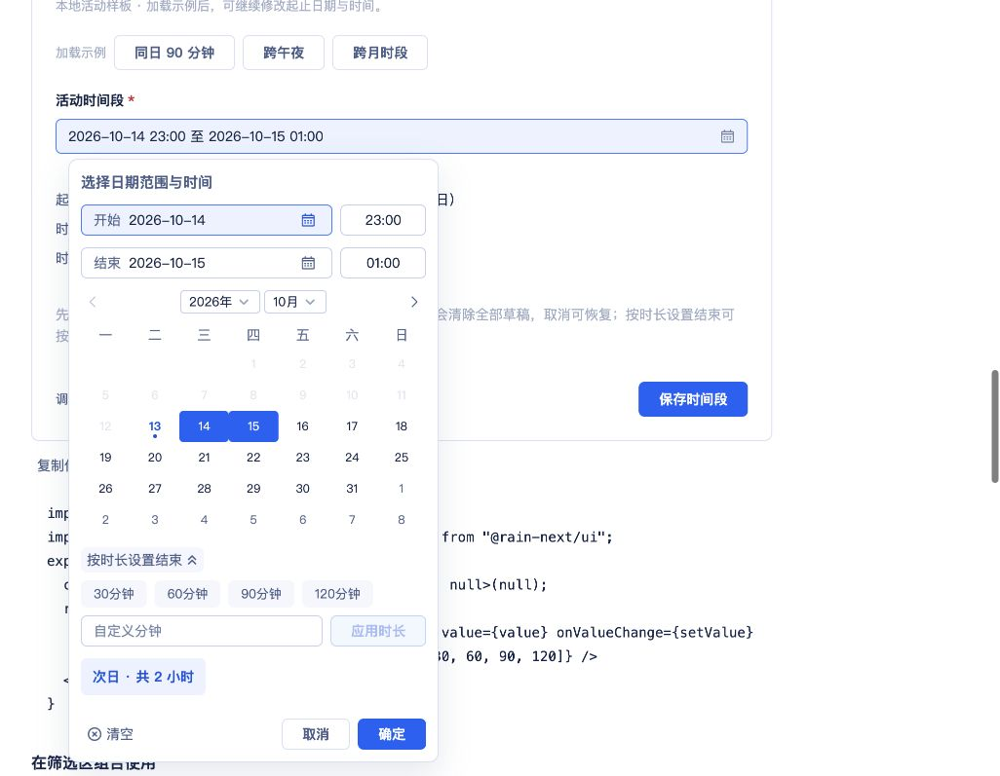

# DatePicker 2026-10-13 视觉反馈

本轮实现用户四点反馈及追加的按钮要求：辅助说明很淡；四个时长按钮中性浅底、无可见描边且更小；展开图标后置并缩小；时长读数突出；减少不必要分隔线。此记录仅说明当前本地 DatePicker 的视觉修订，不代表全库、对比度、发布或业务接入验收。

## 当前可操作结果

- 预览：<http://127.0.0.1:5395/#date-picker>。
- 四个时长按钮复用 Button tertiary/mini 和具名 feature Recipe，28px 高、13px 常规字重，采用 Neutral Solid 6/5/4 的默认、悬停和按下表面，描边透明；桌面键盘焦点保留。Sheet 的既有至少 44px 命中区规则保留，未验证真实触摸。
- DatePicker 内辅助原因和本页面同类样板说明使用 Text/Neutral/6；日期、操作和校验错误保持原层级，非法自定义时长仍显示错误提示。
- “按时长设置结束”使用右侧 12px 图标；派生时长采用浅品牌表面与半粗文字。内部通过留白分区，移除本轮不必要的分隔线。
- 确认、取消、清空、日期时间校验及一次应用时长的行为保持既有合同。没有新依赖、公共 Button 变体、全局 Token 或公共 API。

## 实际验证

| 检查 | 当前结果与证据 |
| --- | --- |
| DatePicker、TimeField、日期工具及日期时间样板 | 5 文件、80 项通过：[unit-final.log](unit-final.log) |
| UI 类型检查 | 通过：[ui-typecheck-final.log](ui-typecheck-final.log) |
| Playground 类型检查 | 通过：[playground-typecheck-final.log](playground-typecheck-final.log) |
| Playground 标准构建 | 通过，保留既有大块体积提示：[build-final.log](build-final.log) |
| 实际浏览器 | 15 项记录，含最新按钮几何/字体/透明描边、Tab 焦点、Enter 应用、320×480 无横向溢出、真实深色主题、错误优先级与取消恢复；控制台错误 0：[checks.json](browser/checks.json) |
| 整个测试项目类型检查 | 本次失败，诊断只在并行 Select 的 select-form.test.tsx 两个 ByRoleOptions.exact 用法：[tests-typecheck-final.log](tests-typecheck-final.log) |
| 本轮来源治理测试 | 7 项通过：[governance-final.log](governance-final.log)；其中前态桥接使用独立合成夹具，不能作为实时全库链通过的依据 |
| 独立审查 | 本轮 4 视觉源、具名配方、错误层级、有限来源读取及新拒绝测试静态审查通过；原 5 intake 字节完整，未发现本轮阻塞问题。未替代浏览器、对比度或人工验收 |
| 实时前态链 | 未关闭：[live-governance-final.log](live-governance-final.log)。共享文件与阶段状态仍由并行 Slider / Select 的各自有限证明保护，未刷新其他 owner 的记录来消除失败 |

最新窄屏与深色证据：[07-neutral-narrow.jpg](browser/07-neutral-narrow.jpg)、[09-neutral-dark-verified.jpg](browser/09-neutral-dark-verified.jpg)。08-neutral-dark.jpg 当时实际为浅色，仅保留观察历史；真正深色的实测表面为 rgb(19, 23, 38)，以 09 图及 checks.json 的主题属性为准。最终恢复浅色与默认窗口尺寸，取消恢复原 23:00 至次日 01:00 草稿，未点击业务保存。

## 来源边界

原始 5 项 intake 的 before 文件及 baseline.json 保持原字节。closure-baseline.json 追加本轮 18 个有限来源与共享脚本前态；新 source-bindings.json 绑定当前本轮记录。两条 CSS 的颜色账本为 26 项 Category paint / 6 项原生或继承 paint，保持 pending-review 与 contrastAcceptance=not-granted。

保存的 Slider 入场 source-bindings 副本是并行进行中的观察，不能描述成已经完成的线性前态；它的原始可变 source-bindings 路径没有被列为永久历史证据。独占 Slider 文件由其当前原记录校验，DatePicker 只回退自己明确绑定的 before。共享记录仍变化时，不忽略未知阶段槽、不删除未验证的 Gate，也不制造其他组件的完成状态。

本轮 DatePicker 视觉实现、有限测试和静态独立审查按本表范围记录为 completed / passed-scoped；实时全链仍未关闭。仅更新本轮 DatePicker 的阶段与 Manifest，其他 owner 的阶段/Gate 未改动。后续并行 owner 须保留各自 intake，并将本轮完成声明及来源作为明确的有限后继衔接，不能静默刷新全部哈希。

2026-10-13 用户明确确认“确定。已完成视觉检验。”，当前 DatePicker 页面与面板的上述视觉修订验收通过，见[限定视觉验收记录](acceptance.json)。记录绑定交付时的 4 项视觉来源及最终浅色画面，原技术来源记录保持原字节；本次仅追加局部视觉结论，不关闭整体阶段或实时共享来源链。

未验收非常浅的辅助文字对比度、Safari、VoiceOver、真实触摸及设备缩放；未执行 Git、发布、Figma 或业务迁移。复核现有 V04、V05、D02、D05 方法后，本轮属于已登记方法在 DatePicker 的应用，未发现需追加的新全局规则；28px 按钮及浅提示仅作为本组件案例参数。
