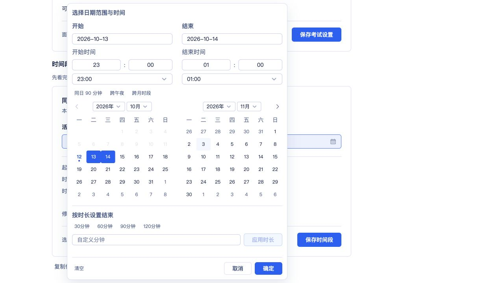
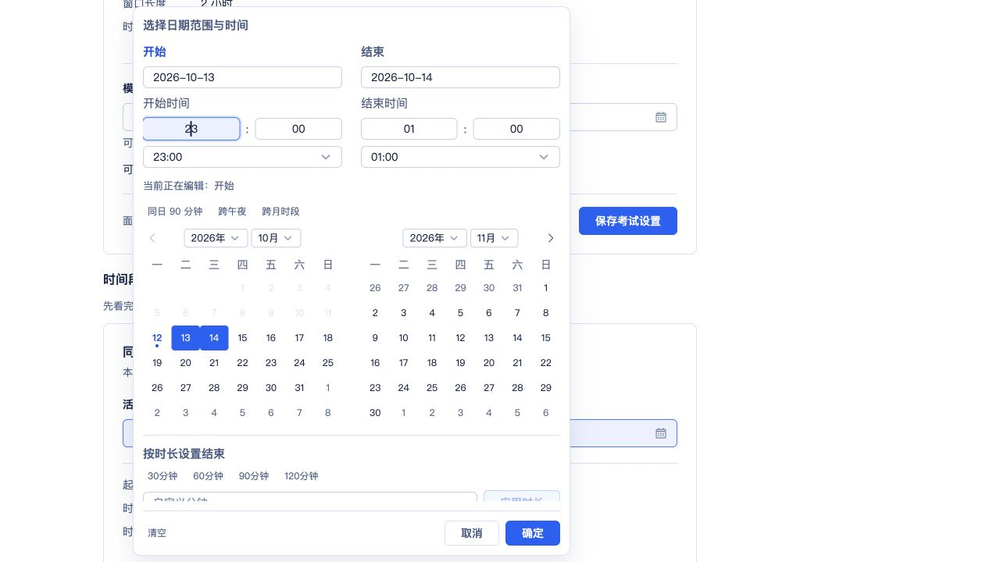
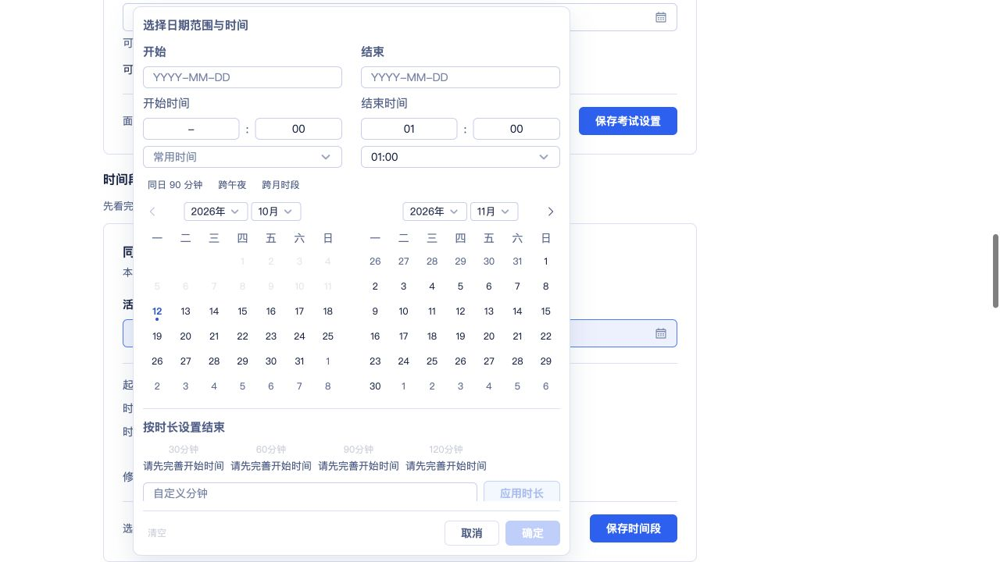
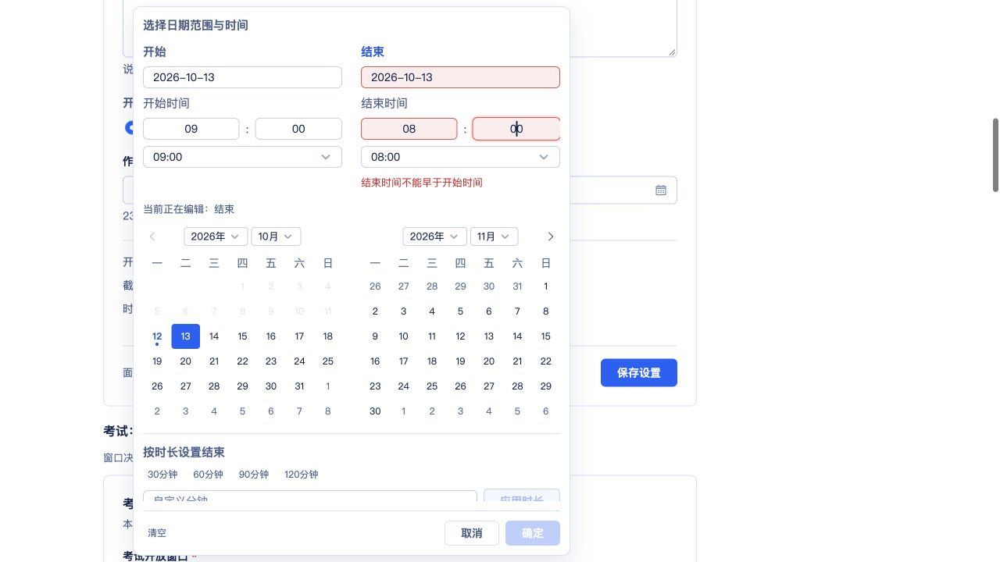
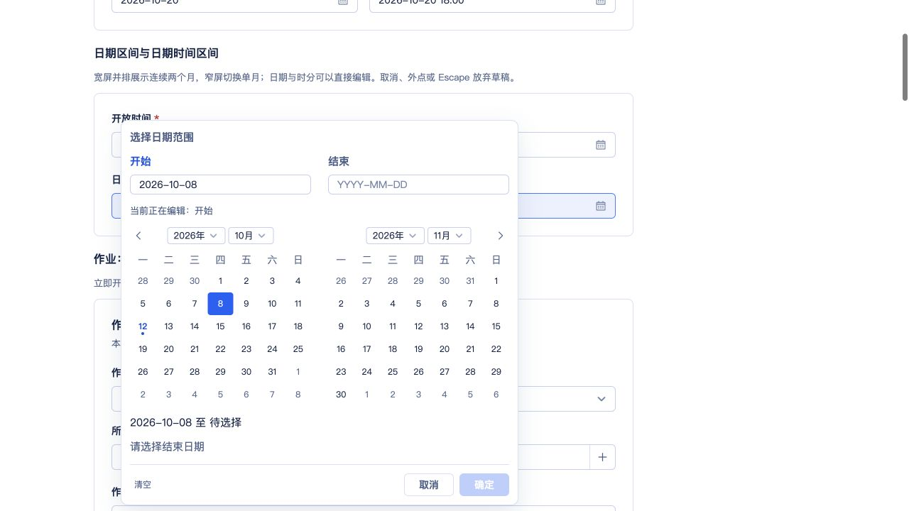

# 日期与时间选择器：第二轮体验复盘

2026-10-12。状态：讨论稿；当前候选的功能、视觉与交互存在需要重新设计的问题。本轮未修改组件、示例、测试、阶段状态或公共设计规则，只记录本次审查证据。此前自动化通过不构成体验通过。

范围：用户提供的三张截图；当前 `http://127.0.0.1:5395/#date-picker`；共享 DatePicker、Calendar、TimeField 及作业、考试、跨日示例的只读源码审查。浏览器截图为本轮采集，1280×720 视口。操作仅作用于面板草稿，均取消，未点击业务保存。

## 判断与自我复盘

这一轮把“能力覆盖”转成了“能力同时铺开”，把底层状态与校验复用扩大成了整套布局复用。端点输入、时间建议、日历、快捷场景、按时长设置、摘要、步骤提示逐项叠加，却没有围绕一个主要选择任务建立层级。

上一轮测试关注值、边界、取消、可达性和控件本体；对焦点光环是否完整、隐式模式是否可理解、共同错误是否重复、默认视野是否包含必要结果，检查不足。部分测试还固定了“清空保留非法时间”和“错误同时关联多个字段”的现状。这些验收条件需要重新评估，不能把测试通过作为保留现状的理由。

## 本轮实际路径与截图

### 1. 查看已选跨日时间段 — 功能可用，结构负担明显

开始、结束两组各有日期、两段时间输入、完整时间下拉；中间是双月；下方再叠时长工具、摘要与提示。当前视口下，摘要在滚动内容下方，默认不能与所有编辑入口同时看到。固定确认区仍可操作，这是应保留的基础。

### 2. 聚焦开始小时 — 焦点被裁，内容重新排布

左侧焦点光环被正文裁切。获得焦点后插入“当前正在编辑：开始”，日历和后续内容下移，底部自定义时长区域开始被滚动边界截断。新增提示行使编辑过程本身增加布局负担。

### 3. 将开始小时输入为 `-`，再清空 — 恢复行为不完整

日期清空，但非法小时 `-`、分钟 `00` 和旧结束 `01:00` 保留，清空按钮随即禁用。四个时长按钮下面分别显示同一句“请先完善开始时间”。这里同时存在清空语义、错误恢复和提示去重问题。

### 4. 考试窗口从 09:00–11:00 改为 09:00–08:00 — 阻止确认正确，错误呈现过宽

结束日期、小时和分钟同时标红，局部及面板底部同时生成“结束时间不能早于开始时间”。当前页面应只在结束一组就近说明一次，避免让用户误判为日期、小时、分钟各自格式都错了。“结束日期改为次日”位于长正文底部，修复入口远离发生错误的结束字段。

### 5. 空日期范围先聚焦开始，再点击 10月6日、10月8日 — 操作模式不易理解

最后开始变成 10月8日，结束仍为空。面板同时显示“当前正在编辑：开始”和“请选择结束日期”。日历的含义取决于先前是否聚焦过字段，用户无法仅凭当前日历清楚判断下一次点击会发生什么。取消后原始空范围恢复。

## 问题清单与候选方向

| 问题 | 证据与影响 | 候选方向 |
| --- | --- | --- |
| 焦点外扩被裁 | 截图2；正文 `overflow:auto` 且没有内侧安全留白，输入光环向外扩3px | 修正滚动边界与内边距关系，完整保留焦点光环；不能通过删除光环掩盖 |
| 时间入口重复 | 用户截图1、截图1/2；两段输入和下拉控制同一值 | 一个可编辑的 `HH:mm` 视觉入口，需要时从同一入口展开建议；保留任意分钟、粘贴与键盘能力 |
| “常用时间”并非常用集合 | 当前默认15分钟步长生成全天96项加23:59，共97项 | 明确它是时间建议列表；真正的业务快捷项保持少量且语义明确 |
| 清空弱小且无图标 | 当前 text small 是12px，右侧普通 small 是14px | 复用现成较大的文字按钮及清空语义图标；中性次级，不使用危险删除样式 |
| 清空保留非法内容 | 截图3及实现 | 清空应回到一致、可重新选择的草稿状态；取消仍恢复已确认值 |
| 步骤提示与当前模式冲突 | 截图5 | 日期范围保持明确两点选区；修改已有端点明确进入和退出；仅聚焦时间不应永久切换日历模式 |
| 重复的结果与说明 | 字段、时间下拉、全量摘要、外层字段与外层摘要反复显示相同内容 | 原始值由字段承载，仅补充“次日／共2小时”等新信息；普通下一步由占位和选中状态表达 |
| 空提示仍占高度 | CSS为 hint 保留24px，正常状态仍渲染空节点 | 去掉无任务价值的保留行；错误采用局部稳定布局，避免插入多处提示使整体跳动 |
| 错误和禁用原因重复 | 截图3/4；共同前置条件重复四次，局部错误再复制到整层 | 共同原因解释一次；错误就近归组；正常未完成状态不使用错误式反馈 |
| 双月与起止端点视觉关系含混 | 上方两列“开始／结束”对齐下方10月／11月，但两月均可操作任一端；同日窗口仍展示下月 | 根据任务选择布局，不能让月份列看起来分别绑定开始和结束 |
| 考试中的两种时长易混 | 弹层按时长改开放窗口，外层另有每人答题时长 | 考试弹层默认仅起止；答题时长留在外层，开放窗口时长仅作结果 |
| 演示场景混入真实选择 | “同日90分钟／跨午夜”会重置为明天；“跨月时段”跳至月底，不以当前选择为基准 | 将演示切换移至面板外；真实快捷项写清实际日期或明确基于当前开始计算 |
| 尺寸与排版关系失衡 | 日历日期文字12px、星期14px；时间分钟列额外承载冒号而变窄；28高自定义输入与32高按钮同排 | 按角色统一字号、高度与对齐，不用全局缩小解决密度；继续复用现有组件规格 |
| 操作反馈缺少方向感 | 快捷时长更新位于上方的结束值；源码未主动强调变化；本轮未实测小屏感知效果 | 在修改对象附近给轻量反馈，结束值变化可见；减少动效仍能感知结果 |

## 推荐讨论方向

优先做一次按任务的结构收敛。只压缩间距或删除文案，无法解决隐式编辑模式；改成多步向导又会增加反复修改的成本。保留共用的数据、校验和确认合同，区分三种轻量布局：

| 用户任务 | 默认结构 | 次级能力 |
| --- | --- | --- |
| 截止日期／时刻 | 单月日历；需要时间时一个HH:mm入口；少量场景快捷项 | 年月跳转、精确键盘输入 |
| 日期范围 | 紧凑起止值＋日期范围日历；桌面跨日选择可保留双月 | 明确修改某一端；必要的范围限制 |
| 日期时间范围 | 开始、结束各一行日期＋时间；共享日历作为当前日期的选择工具 | 按时长设置结束按需展开；跨日提示靠近结束；额外信息仅次日与总时长 |

复杂日期时间范围建议明确三个主要区域：起止编辑区、日历选择区、底部结果与操作区。时长捷径放在结束端附近作为次级入口，展开后再出现预设和自定义输入。分区用对齐、间距和必要分隔表达，避免再套多层卡片。

作业默认关注开放方式与截止，定时开放才出现开放时间。考试默认关注开放窗口与独立答题时长，入场模拟留在演示区。跨日活动保留起止和时长结果；“同日／跨午夜／跨月”的样例切换移到面板外。

动效用于解释实际变化：当前端点切换、月份切换、展开时长工具、应用时长后的结束值更新。避免聚焦时插入整行说明；避免用整层缩放或高度变化放大原有跳动。先确保静态结构与操作含义成立。

## 后续验收应改变什么

- 常用任务在默认面板即可理解从哪里开始、如何结束，不依赖解释实现状态的文案。
- 每个值有一个主要编辑入口；同一错误和共同禁用原因只出现一次。
- 鼠标、键盘仅切换焦点不会暗中改变日历选择规则。
- 清空后能够重新开始；取消能够恢复已确认值。
- 起止字段、必要结果和确认操作在目标视口中关系清楚；滚动后仍能知道刚才改了什么。
- 焦点光环完整、动态状态不使主要控件突然位移，减少动效模式仍保留反馈。
- 实际从任务开始完成一次，再修改、取消、清空、制造错误和恢复；不能只断言最终值正确。

本轮沿用设计方法库 V04（文字角色与层级）、V05（内容／外观／行为一起审查）、D01（任务顺序）、D02（空间关系），仅形成候选经验，不回写为已确认全局规范。

## 源码定位与检查边界

- `packages/ui/src/date-picker/date-picker.tsx:197`：日历端点锁定；`:216`：清空；`:298`：错误分配；`:304/:310`：焦点切换模式；`:316`：编辑提示；`:331`：时长；`:346`：摘要与提示；`:353`：清空按钮。
- `packages/ui/src/date-picker/date-picker.css:24`：时间列布局；`:41`：空提示高度；`:45–46`：滚动裁切边界。
- `packages/ui/src/date-picker/date-picker-time-field.tsx:34`：时间建议列表；`:73`：两个Input；`:83`：重复的Select；`:93`：局部错误。
- `packages/ui/src/styles.css:572`：外扩焦点光环；`packages/foundations/src/tokens.css:48/:190`：文字按钮几何与排版。
- `apps/playground/src/docs/components/date-time-examples.tsx:44`：演示场景日期重置；`:107`：考试窗口启用时长捷径。
- `tests/e2e/date-time-optimization.spec.ts:36`：现有几何验收主要检查矩形；`packages/ui/src/date-picker/date-picker.test.tsx:169`：既有清空保留非法时间测试。

仍需单独验证：真实触屏与软键盘、VoiceOver、完整键盘任务、原生浏览器缩放、浅深主题的实测对比度、逐帧动效、短视口首次焦点是否滚走顶部、移动端应用时长后的变化感知。截图与源码审查不构成完整无障碍结论。未运行新自动化套件，未修改或覆盖历史验收。
