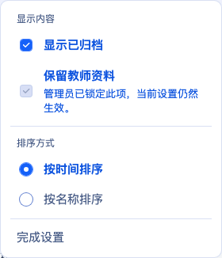

# Dropdown 选择图形统一复用

2026-09-12 更新：用户“视觉已完成人工和检验。”已接受当前组件运行视觉，本页对应正式依赖／菜单选择图形的可见组合一并按 visual-only 记录。颜色、独立人工键盘、真实设备与发布仍未接受；下文为 09-10 技术批次原始记录。详见[当前验收](../../../docs/plans/2026-09-12-existing-assets-closure.md#当前运行视觉人工验收)。

2026-09-10；用户明确指令：“需要统一复用视觉”。本次技术实现与复核完成，菜单视觉 Human Gate 和颜色接受仍独立待定。

## 结果与实际边界

| 项目 | 现在的实现 |
| --- | --- |
| Checkbox | 复用原生 CheckboxIndicator：24px 画布，16px 方框，10px 勾号 |
| Radio | 复用原生 RadioIndicator：24px 画布，18px 圆框，6px 圆点 |
| 共享范围 | 同一绘制函数、同一份 styles.css 控件配色与 hover/pressed/disabled/forced-colors 声明；不是复制另一套颜色 |
| 状态来源 | 原生输入保持既有表单/fieldset/reset 行为；菜单由 Base UI ItemIndicator 提供 checked/disabled/highlighted，保留 keepMounted 的未选外框 |
| 交互目标 | 菜单没有新增 input、label、button 或额外 Tab 目标；焦点仍在菜单行，原生焦点仍在输入 |
| 改动边界 | 原生两个源文件只抽出被动图形；UI 公共出口不增加这两个函数；Registry 补齐真实依赖。原生验收没有扩展成菜单验收 |
| 布局 | 菜单文字继续 15/22、13/18；选择行因 24px 画布自然为最小 36px，普通 action 仍 34px，多行按内容增长 |

删除原菜单私有的 14/12 标记与配色；action/link 的 16/10 圆形确认标记继续保持独立职责。

## 验证

- 红绿检查：先断言菜单应与原生 canvas/control/mark 完全一致，旧实现明确失败；接入后菜单 14 项通过。新增断言也检查取消选中、禁用状态及没有嵌套交互节点。
- 全库单元：79 个文件，1214/1214 通过。没有修改业务断言或超时；旧 Radio CSS 负面测试更新为真实新选择器，并增加“变更确实发生”的断言。
- 相关 Chromium：39/39 通过，覆盖 Dropdown、Checkbox、Radio、SelectionCard、SelectionPatterns；公共 Dropdown 11/11。其他家族证据写到临时目录。新增背景采样后仅复跑两主题视觉检查，2/2 通过。
- 两主题逐状态直接比较：Checkbox/Radio 各 checked/unchecked × normal/hover/pressed；另比较已选禁用 Checkbox 三态与两种控件选中 forced-colors。control/canvas/halo/mark 全字段相等。原生 mixed、fieldset disabled、reset、卡片行为继续通过。
- 独立只读复核：45/45 原生与菜单单元检查通过；独立 Chrome 复核尺寸、圆点/勾号、选中、悬停、禁用及 Registry 闭合，未发现可复现 P1/P2。
- 全工作区类型、构建和治理检查通过。新增内部函数没有进入 UI 公共出口；无新依赖、全局 Token 值变化、发布或 Git 写入。
- 最终材料复核另行独立重算 24 组图形，最低值与记录一致；确认旧 Gate、历史 finding、Registry、截图和日志均如实。

日志见 [selection-checks.log](selection-checks.log)。配对原始值：[Light](selection-light.json)、[Dark](selection-dark.json)。

## 颜色测量与剩余事项

[本次颜色记录](selection-color-review.json) 从 Chromium 实际样式读取菜单祖先背景链，再叠加画布 halo 与控件。边框保持 padding-box 的真实合成关系，使用已有 Foundation 对比度函数，不提前四舍五入。

普通菜单的两种控件 × 两种主题 × 选中/未选 × 三态，共 24 组；未选边界相对内外相邻背景、选中勾号/圆点相对控件底色的最低比值 **3.714:1**，均达到原 **3:1** 门槛。该范围是普通菜单的本次运行测量；不把它扩成所有变体或 Human Gate。禁用与强制色另做可视/状态比较，没有强行套入普通数值门槛。

公共菜单自有 CSS 从 38 项颜色消费变为 35 项，移除了退役的私有选择标记；它们仍有 **9 项对比度、26 项用途资格 finding**，全部未接受例外。旧 19/30 记录和图片保留在初版证据中。文字 4.5:1、必要图形/边界 3:1 门槛均未调整。

`dropdownFamily.selectionVisualReuse` 技术范围 completed / passed / passed；Human Gate awaiting_human、contrastAcceptance not-granted。公共家族整体继续 in-progress / findings，未发布。
