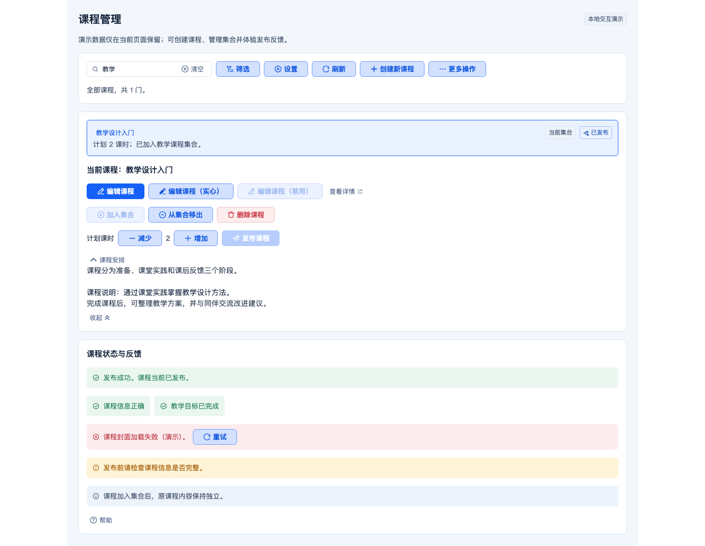

# 图标消费首次验收记录

日期：2026-09-03。目标仓库：`/Users/wenchengkai/CodexFile/雨课堂-shadcn组件库架构/rain-classroom-vibe-ui-spike`。

本次为没有设计讨论历史的新消费者，仅读取上述仓库公开入口、组件源码和当前任务需求。没有读取历史会话、记忆或其他临时任务产物。工作模式为 Prototype Mode / local-experiment；仅交付本目录 `Consumer.tsx` 与本记录。仓库阶段仍为 Foundation Spike Day 3；图标库实施 `in-progress`，Human Gate `not-evaluated`。不修改仓库、不请求远程业务数据、不新增公共组件、不推进阶段、不进行 Git 或发布。

## 首次读取与首次阻塞（保留，不覆盖）

1. 首次从 `AGENTS.md` 得到图标消费入口 `docs/ai/icon-selection.md`，而非从旧组件、按钮名称或个人偏好猜图标。
2. 首次查询时，`packages/foundations/package.json` 只导出根与四个 CSS 入口，尚无 `@rain-next/foundations/icons/catalog`。`packages/ui/package.json` 只导出根与 `styles.css`，尚无 `@rain-next/ui/icons/<slug>`；`packages/ui/src/icons` 和 `evidence/icons` 目录也尚不存在。此时不能宣称任何新静态图标已经可导入。
3. 已有 `packages/ui/src/icon/icon.tsx` 与 `.rain-icon` 样式存在；通用 Icon 实现存在不等于单图标资产已经可用。
4. 当前任务已说明资产生成仍在进行，允许先写消费片段并记录导出缺失。因此代码保留文档指定的静态导入作为待生成入口；未用近似 SVG、Unicode、外部库或旧图标替换。所有图标首次状态为「语义已选定 / availability 未检查 / 静态模块未能解析」，不把语义 `selected` 写成运行时 `available`。
5. `registry/` 与 `manifests/` 文件枚举没有可消费资产（各仅一个隐藏占位项）。因此退回现有 UI 层组合，没有绕过现成的 Template、Block、Pattern 或 Layout。
6. 初次较大批量文件读取出现工具输出截断。随后按相关行段重读 SPIKE_BRIEF、阶段、Benchmark/Evidence 索引、图标选择规范及组件 API；不声称逐行阅读所有历史计划或所有源码。

## 实际读取的仓库路径

以下路径均相对于上述绝对仓库根目录；「部分」仅代表读取了与本任务有关的段落或查询命中，并非全文审计。

- `AGENTS.md`：入口、优先级、模式、检索顺序、图标、颜色、字体、密度、Focus、交付边界等条款；部分。
- `SPIKE_BRIEF.md`：第 1–6、10–13 节及结构索引；部分。
- `status/current-phase.yaml`：当前阶段、允许/禁止项、图标和文字按钮 refinement；部分。
- `benchmarks/README.md`：全文。
- `benchmarks/benchmark-registry.yaml`：Benchmark 索引与 BM-A/B/C 及 BM-D 起始条目；部分。
- `evidence/visual-evidence.yaml`：元数据、状态说明与节点索引；部分。未打开截图、未现场复核 Figma。
- `docs/ai/icon-selection.md`：规则、优先级、全部相关静态导入、反例与未知行为；全文。
- `packages/foundations/src/icons/semantic-rules.json`：图标语义元数据；重点提取实心编辑与加载资产的 `exportName`/`importPath`，首次大批量输出截断后进行了定向提取。
- `packages/foundations/src/icons/icon-contract.ts`：类型、可用性边界及匹配流程起始部分；前 150 行。
- `package.json`、`packages/ui/package.json`、`packages/foundations/package.json`：依赖、脚本与实际导出。
- `packages/ui/src/index.ts`：可消费 UI 导出。
- `packages/ui/src/button/button.tsx`、`packages/ui/src/input/input.tsx`、`packages/ui/src/tag/tag.tsx`、`packages/ui/src/surface/surface.tsx`、`packages/ui/src/icon/icon.tsx`：全文。
- `packages/ui/src/styles.css`：按钮宿主色、状态、图标 mask、loading、Input/Tag/Surface 相关样式；部分。
- `packages/foundations/src/tokens.css`：语义色与圆角 Token 段；部分。
- `packages/foundations/src/index.ts`、`packages/foundations/src/density.tsx`、`packages/foundations/src/typography.css`、`packages/foundations/src/motion.css`、`packages/foundations/src/focus.css`：消费入口与规则。
- `apps/playground/src/main.tsx`：已存在样式加载顺序。

额外执行了仓库文件枚举和 `git status --short`，首次工作区全部资产显示为未跟踪。未更改任何仓库文件，也没有把这些已有修改认领为本任务成果。技能参考使用 using-superpowers、brainstorming、test-driven-development、verification-before-completion；任务明确限定为临时片段，并由主任务负责后续构建/浏览器检查，未新增测试文件或请求额外批准。

## 首次选择（冻结保留）

下表静态入口均为 `@rain-next/ui/icons/<slug>`，组件均为具名导出；所有选择在实际写 JSX 前确定。依据中 `icon-selection.md` 指 `docs/ai/icon-selection.md`。首次语义选择没有失败或改选；运行时入口缺失是独立阻塞。

| 实际行为 | 首次资产 / 导出 / slug | 依据 |
| --- | --- | --- |
| 普通、一级、禁用编辑 | `icon/edit-pencil` / `EditPencilIcon` / `edit-pencil` | §编辑，69–80 行；不因按钮等级、hover、pressed 或 disabled 换实心 |
| 用户明确实心编辑 | `icon/edit-pencil-filled` / `EditPencilFilledIcon` / `edit-pencil-filled` | §编辑 78 行 explicit filled；JSON 同资产的 exportName/importPath |
| 普通内容展开 / 收起 | `icon/arrow-down` / `ArrowDownIcon` / `arrow-down`；`icon/arrow-up` / `ArrowUpIcon` / `arrow-up` | §内容展开/收起，82–106 行 |
| 有展开更多 / 收起文案的文字按钮 | `icon/double-arrow-down` / `DoubleArrowDownIcon` / `double-arrow-down`；`icon/double-arrow-up` / `DoubleArrowUpIcon` / `double-arrow-up` | §文字按钮展开/收起，108–131 行；场景规则优先于通用展开 |
| 创建新的课程对象 | `icon/add-bold` / `AddBoldIcon` / `add-bold` | §新建对象，133–144 行；bold 不推导为 filled |
| 已有课程加入集合 | `icon/add-circle-outline` / `AddCircleOutlineIcon` / `add-circle-outline` | §向集合添加项目，146–157 行 |
| 增加 / 减少数量 | `icon/add` / `AddIcon` / `add`；`icon/minus` / `MinusIcon` / `minus` | §增加数值、减少数值，159–169、196–206 行 |
| 删除课程对象 | `icon/delete` / `DeleteIcon` / `delete` | §删除对象，171–181 行；危险 Button 提供颜色 |
| 从集合移出且保留课程 | `icon/minus-circle-outline` / `MinusCircleOutlineIcon` / `minus-circle-outline` | §从集合移除，183–194 行；原课程仍在列表数据中 |
| 搜索 | `icon/search` / `SearchIcon` / `search` | §搜索，208–216 行 |
| 筛选 | `icon/filter` / `FilterIcon` / `filter` | §筛选，218–226 行 |
| 设置 | `icon/settings-3` / `Settings3Icon` / `settings-3` | §设置，228–237 行 |
| 更多操作 | `icon/more-horizontal` / `MoreHorizontalIcon` / `more-horizontal` | §更多操作，239–250 行；没有指定或已确认组件来源支持竖向三点 |
| 关闭编辑/设置面板 | `icon/close` / `CloseIcon` / `close` | §普通关闭，252–263 行；没有支持 close-bold 的明确要求 |
| 清空搜索 | `icon/circle-close` / `CircleCloseIcon` / `circle-close` | §清空已有值，265–276 行；颜色随普通文字按钮，不使用错误色 |
| 失败提示 | `icon/circle-close` / `CircleCloseIcon` / `circle-close` | §失败/错误提示，278–289 行；错误宿主用 semantic-error Token |
| 菜单选中标记 | `icon/check-bold` / `CheckBoldIcon` / `check-bold` | §菜单/列表选中，291–301 行；不用成功圆勾，不替换 Checkbox 内部形态 |
| 成功 / 正确 / 完成，包括发布成功 | `icon/circle-check` / `CircleCheckIcon` / `circle-check` | §成功/正确/已完成结果，303–339 行；success Token |
| 警告 | `icon/alert-circle` / `AlertCircleIcon` / `alert-circle` | §警告，341–350 行；warning Token |
| 中性提示 | `icon/info` / `InfoIcon` / `info` | §普通提示，352–363 行；中性 text-secondary 宿主 |
| 帮助 | `icon/help` / `HelpIcon` / `help` | §疑问/帮助，365–374 行；普通按钮宿主 |
| 刷新 / 重试 / 恢复默认设置 | `icon/refresh` / `RefreshIcon` / `refresh` | §刷新/重试、恢复默认，376–400 行；恢复目标明确为页面设置 |
| 发起发布 | `icon/publish` / `PublishIcon` / `publish` | §发布/发送操作，402–413 行 |
| 当前已发布状态 | `icon/published` / `PublishedIcon` / `published` | §内容已发布，415–426 行；以现有 brand Tag 为状态宿主，不把它当 publish filled |
| 查看详情、切换当前页内容 | `icon/share-alt` / `ShareAltIcon` / `share-alt` | §按钮内页面跳转提示，428–439 行；该规则不决定打开方式，本任务要求当前页切换 |
| 加载 | `icon/button-loading` / `ButtonLoadingIcon` / `button-loading` | §加载指示，441–451 行；保留资产渐隐与宿主颜色，不用静态 refresh 代替 |

## 未明确场景如何处理

- 只说「添加课程」：先检查页面上下文或数据行为，是新建对象、加入集合还是增加数量。仍无实际行为时按 `{ intent: "add" }` 的 `ambiguous` 结果澄清目标，不向用户询问图标名，也不默认使用加号。
- 分享：`intent: "share"` 在当前合同为 `unknown`；不把 `share-alt` 的名字当分享依据。先查询完整可用图库与准确的分享目标/行为，可形成有证据的局部选择并记录来源；若仍不能判断再澄清行为，不新增全局默认。
- 重新编辑：仍按 `edit` 使用线性铅笔，除非当前明确要求实心；不因「重新」用 refresh。
- 恢复已删除内容：`{ intent: "restore", target: "deleted-content" }` 为 `unknown`；先查完整图库和业务恢复语义，不套用恢复默认设置的 refresh。可记录可追溯的局部选择，不能冒充已确认全局规则。
- 明确指定不存在或不可用的资产：分别记录 unknown/unavailable 及准确资产名；明确报告缺口，请求准确资产或授权调整需求。不暗换近似 SVG、Unicode、外部同名图标或其他已存在图标。

## 实现与验证记录

实施前约定：一个页面私有 `Consumer` 组件，用现有 Button、Input、Tag、Surface、DensityProvider，模拟课程对象与集合成员关系。页面内所有色值来自 UI 宿主或语义 Token，字号/字体加载已有 Foundation；交互使用本地状态、定时器与可访问原生按钮。不得将该片段当成公共业务组件。

待完成写入后追加实际静态检查。构建、运行时导出解析、浏览器截图、键盘和 Focus 路径、图形忠实度、宿主色、渐隐加载、reduced-motion、Human Gate 当前均未验证。主任务后续负责实际构建和浏览器检查。

## 写入后的复核（追加，首次记录不删除）

- 交付目录实际只有 `Consumer.tsx` 和 `report.md`；Consumer 共 324 行，28 个单图标静态导入。未新建公共业务组件，未向仓库写文件。
- 已编写可交互路径：课程选择、搜索及清空、筛选菜单选中；创建对象；加入/移出集合；删除对象；课时增减；普通/实心编辑与校验保存；普通展开和文字按钮展开；设置与恢复默认；帮助；本页课程详情切换与返回；刷新、失败后重试；发布 loading → 发布成功反馈 → 当前已发布状态。
- 使用实际 Button `variant`/`tone`/`disabled`/`loading`、Input `prefix`/`trailingAction`、Tag、Surface、DensityProvider；普通图标未单独覆盖 color。状态宿主使用 success、error、warning 与中性 Token。原生 Checkbox 不置换内部图形。详情通过页面状态切换，无 `window.open` 或远程请求。
- 静态扫描：28 个导出名/静态入口均与 `semantic-rules.json` 中身份相符，0 不匹配；未发现十六进制裸色值、内嵌 `<svg>`、`fetch`、`XMLHttpRequest` 或 `window.open`。
- 首次尝试用 TypeScript 旧 JS 编译 API 做纯语法检查失败：`TypeError: Cannot read properties of undefined (reading 'Latest')`。读取模块后确认当前 TypeScript 7.0.2 的入口是 `lib/version.cjs`，仅暴露 version 信息。该失败为检查工具入口不适用，不计为 Consumer 类型检查失败，也未静默删除。
- 随后读取现有 Vite 的 `node_modules/vite/dist/node/index.d.ts:3331` 及 `index.js` 的公开导出，调用仓库已有 `transformWithOxc` 在内存中转换 TSX。结果通过，0 warnings，生成 29241 字节 JavaScript；没有落盘生成物。此项只验证 TSX 解析/转换，不验证类型、组件模块解析、打包或浏览器表现。
- 复核时发现主任务的生成入口已出现，因此追加读取 `packages/foundations/src/icons/catalog.generated.ts`、`evidence/icons/README.md`、`packages/ui/src/icons/edit-pencil.tsx`、`packages/ui/src/icons/button-loading.tsx`，以及 UI/Foundation 最新 package exports。
- 依据实际新目录再次查询本片段 28 项：28 项均 `availability: available`，28 项具名导出与包导出指向的文件存在；28 项均为 `colorMode: host`，其中 27 项 `svg-mask`、1 项 `png-mask`（button-loading）。因此首次导出缺失已被后续生成解决；首次记录仍保留，未改选任何图标。
- 菜单写入 ArrowUp/ArrowDown/Home/End/Escape/Tab 的基本路径与面板返回焦点；最后静态修订仅补足菜单焦点管理和注释，没有图标改选。实际键盘行为仍需浏览器检查。
- 最后修订后再次执行 TSX 内存转换：通过，0 warnings，生成 29307 字节 JavaScript；目录仍只有两个授权交付文件。

本子任务未运行完整 TypeScript 检查、构建、浏览器测试或截图；未验证字体可用性、真实图形大小/颜色/透明渐隐、响应式表现和辅助技术行为。Human Gate 仍未评估，发布、Figma、生产迁移及 Git 均未执行。主任务可直接把 `Consumer` 挂到自己的临时消费检查入口，完成真实构建与浏览器检查后再记录结论。

## 2026-09-03 真实消费验证追加记录

本节接续原始首次记录，不删除先前的导出缺失、TypeScript 旧 JS API 失败和未验证说明。主任务明确授权：对仓库中的原始片段做严格类型检查、真实生产构建与浏览器验证；仅必要时修复该片段，不改公共组件/语义。此次未修改 Consumer 代码，也没有图标改选。

### 可复现输入与检查范围

- 源文件：`evidence/runtime/icon-migration/vibe-consumer.tsx`。最初临时交付、仓库副本与实际构建副本 SHA-256 完全一致：`ee0347fbd7e5bb353049169f070815a4a17acccd651e8b6727e4d19d27c5cd82`。
- 临时消费者位于 `apps/playground/node_modules/.cache/icon-vibe-verification/`，只按原文复制 Consumer，添加 React 挂载与 HTML 入口；通过 playground 已有的 workspace dependencies 真正解析 `@rain-next/ui`、`@rain-next/ui/icons/<slug>` 与 `@rain-next/foundations`。未使用图标 mock、声明 shim、源码路径 alias 或完整图库入口。
- 严格类型检查：`node_modules/.bin/tsc --noEmit --project apps/playground/node_modules/.cache/icon-vibe-verification/tsconfig.json`，继承仓库 `tsconfig.base.json` 的 strict、noUncheckedIndexedAccess 等设置，首次退出码 0。
- 实际 Vite 8.2.2 production build：使用 React 插件，`assetsInlineLimit: 0`，生成 HTML、JS、CSS、SVG/PNG。首次构建成功，61 个模块经过 transform；生产输出总字节 286206。
- 通过 Vite generateBundle 的真实 module graph 和 chunk.modules 独立统计：graph 28 个单图标组件，最终 chunk 28 个单图标组件；`fullCatalogIncluded: false`。不是仅搜索源码 import 字符串。
- 实际打包的 28 个 slug：`add-bold`、`add-circle-outline`、`add`、`alert-circle`、`arrow-down`、`arrow-up`、`button-loading`、`check-bold`、`circle-check`、`circle-close`、`close`、`delete`、`double-arrow-down`、`double-arrow-up`、`edit-pencil-filled`、`edit-pencil`、`filter`、`help`、`info`、`minus-circle-outline`、`minus`、`more-horizontal`、`publish`、`published`、`refresh`、`search`、`settings-3`、`share-alt`。
- 生产构建由本机 `127.0.0.1:4176` 提供，未使用 4173/4175；Chromium 视口 1440 × 1100。检查目标是生产包，不是开发 JSX 模拟。

### 首次失败与后续处理

首次 Chromium 启动受沙箱阻止：`bootstrap_check_in ... Permission denied (1100)`，随后 `kill EPERM`。当时浏览器尚未打开页面，因此没有将其归因为页面交互失败。按主任务明确授权申请仅用于本机 Chromium 和 127.0.0.1 的执行权限后重试成功；未改代码或语义来规避检查。

严格类型检查、生产构建和获得权限后的首次真实浏览器检查均通过。Consumer 修正次数：0。公共组件/语义修正次数：0。此前纯语法检查工具 API 失败与本次环境失败均保留，未涂改为首次全绿。

### 真实浏览器结果

| 检查组 | 结果 |
| --- | --- |
| 编辑：一级反白、明确实心、禁用、校验保存与返回焦点 | passed |
| 普通展开与带文字展开使用独立箭头并真实切换 | passed |
| 新建对象、加入集合、数值增减与删除/移出各改变正确数据 | passed |
| 搜索和清空与失败共用资产但继承不同宿主颜色 | passed |
| 菜单选择、键盘、设置恢复、帮助与关闭面板 | passed |
| 发布动作、加载、成功反馈与当前已发布状态 | passed |
| 查看详情提示当前页切换、无新标签并可返回 | passed |

总计 7 组通过，0 组失败；页面异常 0，console error 0，远程请求 0。检查使用真实鼠标/键盘操作及 DOM 状态断言，未直接注入 React state。

实际行为证据：

- 编辑：空白名称触发 circle-close 错误提示；保存后列表名称成为「教学设计进阶」，对象总数仍为 3；普通与实心入口关闭后焦点分别返回触发按钮。禁用编辑不可操作，资产仍为 edit-pencil。
- 两种展开分别完成 arrow-down → arrow-up → arrow-down、double-arrow-down → double-arrow-up → double-arrow-down；收起后对应内容节点确实移除。
- 数量 2 → 3 → 2 时课程对象数保持 3。已有课程加入集合及移出集合时对象数仍为 3，集合标签与按钮禁用状态改变；移出后的原课程仍可见。创建新对象后为 4，删除该对象后回到 3，已删除课程按钮不存在，当前操作区回到未选择状态。
- 搜索「教学」得到 1 门；清空后 value 为空、课程恢复 3 门、焦点回输入。清空与失败两处 maskImage 完全相同，而宿主色分别为普通操作与错误色。
- 筛选菜单的选中标记为 check-bold；ArrowDown/End/Home/Enter/Escape/Tab 路径通过，Tab 从菜单到设置按钮。集合筛选为 2 门，恢复全部为 3 门；恢复默认设置重新显示三条说明、清空搜索，关闭设置返回焦点。
- 发布按钮先使用 publish；执行后 aria-busy=true，显示 button-loading 与旋转动画；等待完成后 circle-check 成功文案出现、课程 Tag 显示 published、发布按钮禁用。重试使失败提示消失并出现成功；刷新完成。reduced-motion 下独立 loading 动画为 none。
- 查看详情按钮的 share-alt 只作为跳转提示。页面 data-state 为 list → detail → list，详情时列表不存在，返回后恢复三门课程；URL 未改变、浏览器始终只有 1 个页面，标题收到焦点。

### 实测宿主颜色与尺寸

以下为浏览器 getComputedStyle 的实际结果；CSS mask 的 backgroundColor 即图形着色。图标不自行定义业务颜色。

| 场景 | 资产 | 图标 color | 图标 backgroundColor | 宿主 color | 图标像素 |
| --- | --- | --- | --- | --- | --- |
| primaryEdit | `icon/edit-pencil` | rgb(255, 255, 255) | rgb(255, 255, 255) | rgb(255, 255, 255) | 16 × 16 |
| explicitFilledEdit | `icon/edit-pencil-filled` | rgb(15, 85, 223) | rgb(15, 85, 223) | rgb(15, 85, 223) | 16 × 16 |
| disabledEdit | `icon/edit-pencil` | rgb(15, 85, 223) | rgb(15, 85, 223) | rgb(15, 85, 223) | 16 × 16 |
| dangerDelete | `icon/delete` | rgb(201, 52, 63) | rgb(201, 52, 63) | rgb(201, 52, 63) | 16 × 16 |
| clearValue | `icon/circle-close` | rgb(86, 104, 143) | rgb(86, 104, 143) | rgb(86, 104, 143) | 16 × 16 |
| failure | `icon/circle-close` | rgb(181, 42, 54) | rgb(181, 42, 54) | rgb(181, 42, 54) | 14 × 14 |
| publishAction | `icon/publish` | rgb(255, 255, 255) | rgb(255, 255, 255) | rgb(255, 255, 255) | 16 × 16 |
| loading | `icon/button-loading` | rgb(64, 80, 106) | rgb(64, 80, 106) | rgb(64, 80, 106) | 14 × 14 |
| publishSuccess | `icon/circle-check` | rgb(24, 121, 78) | rgb(24, 121, 78) | rgb(24, 121, 78) | 14 × 14 |
| publishedState | `icon/published` | rgb(11, 69, 181) | rgb(11, 69, 181) | rgb(11, 69, 181) | 12 × 12 |

一级编辑按钮背景实测 rgb(21, 97, 248)，线性图标 rgb(255, 255, 255)；实心编辑仅来自明确要求的 edit-pencil-filled。禁用宿主保留同一线性资产，视觉弱化来自组件 disabled 样式。清空和失败 mask URL 同为 circle-close 生产 SVG，但颜色为 rgb(86, 104, 143) 与 rgb(181, 42, 54)。加载实际使用 button-loading PNG mask，颜色继承中性宿主。

### 浏览器截图与边界

截图：`evidence/runtime/icon-migration/vibe-consumer.png`，1440 × 1116，SHA-256 `7c94ee4cd5ab6a8a13065e14cee8b848a0e3fca7818cc69c3c9665fa96bbff43`。截图已人工视看本机图像输出：一级线性编辑反白、明确实心编辑、禁用、危险删除、清空/失败不同色、普通与文字收起箭头、发布成功和已发布标签均可见，未见内容重叠或裁切。本句为本次代理视觉检查，不替代 Human Gate。

尚未验证：Safari/Firefox、窄屏布局、屏幕阅读器完整流程、字体回退环境，以及与 Figma 原始节点逐像素比对。本次验证充分覆盖指定消费交互、宿主继承和真实模块构建，不推导为 Human Gate 通过、发布或生产就绪。该临时构建与浏览器服务随后清理，清理结果另行追加。

清理结果：Chromium 已关闭；4176 本机静态服务经 Ctrl-C 正常退出。临时目录 `apps/playground/node_modules/.cache/icon-vibe-verification/`（编译副本、检查脚本、构建目录、临时 JSON 报告）已移除。首次在沙箱内探测已关闭端口返回 connect EPERM，随后经仅本机探测权限复核，socket connect_ex 返回 61（ECONNREFUSED），确认 4176 已关闭。最终保留仓库内原始 Consumer、追加的 cases 记录与 `vibe-consumer.png`；未触碰 4173/4175 或其他任务服务。
