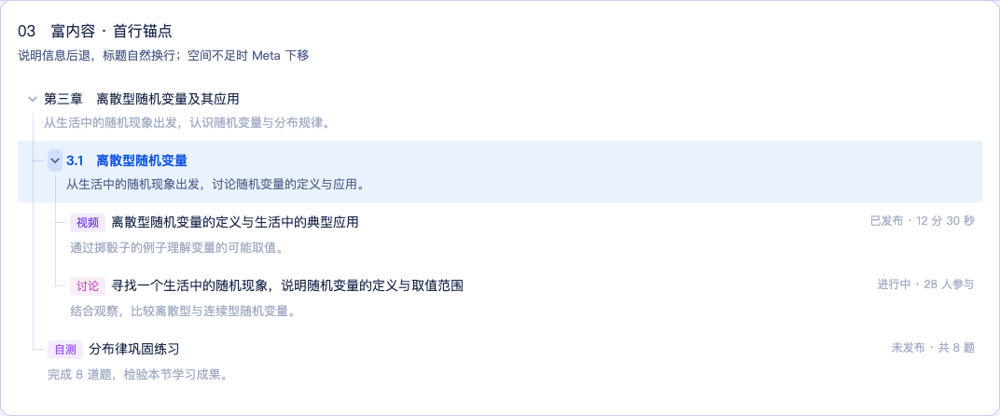
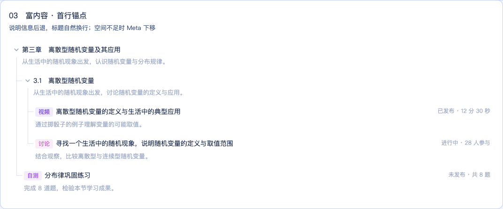
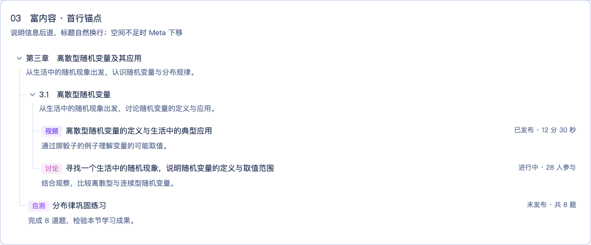
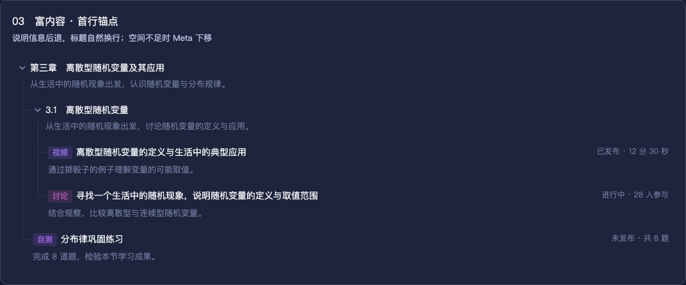
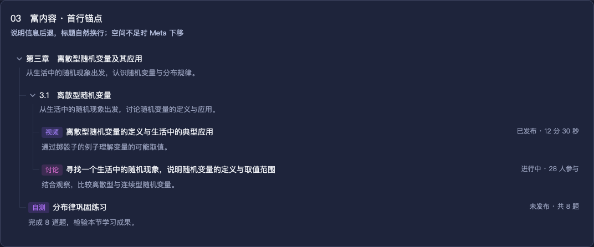

# 最新决定 · 2026-09-29

用户确认“保留当前浅色，候选继续调整”。下方整体加深方案未采用，默认颜色保持审核版。

用户随后确认“确定。继续建设tree组件”，第二版已写入共享 Tree 并由 ManageTree 复用：常态颜色保持，只在悬停、键盘聚焦或接收拖拽的当前行增强文字和图标。实际组件的浅色／深色、两种背景测量中，增强时文字最低 4.69／4.61，图标最低 3.13／4.01；常态仍有原有低对比度限制，不作为完整对比度通过。退出状态恢复及其他行保持浅色均已验证。

[集中审核页](../../../docs/design-reviews/tree/closeout-review.html) · [实际组件测量](interaction-readability-facts.json) · [历史候选测量](readability-facts.json)

---

# Tree 可读性对照 · 2026-09-28

默认组件仍保留已经审核的浅色版本。候选只作用于测试截图，未改默认颜色；关系线、缩进、节点排布保持原样。

候选复用现有 Token：说明和辅助信息从 Text/Neutral/6 改为 Text/Neutral/4；展开箭头及拖拽手柄从 Icon/Neutral/4 改为 Icon/Neutral/3，悬停时为 Icon/Neutral/2。最初的 Text/Neutral/3 候选偏重，已选择同样通过本轮测量、视觉更轻的 Text/Neutral/4。

测量覆盖浅／深主题、Background/Neutral/1 和 /2、常态、行悬停、控件悬停、行选中、选中后的控件悬停、拖入目标。下表为每组已测状态的最低值；文字按 4.5:1、有效图标按 3:1 检查。

| 主题 | 版本 | 文字最低对比度 | 图标最低对比度 |
| --- | --- | --- | --- |
| 浅色 | 当前审核版 | 1.92:1 | 1.87:1 |
| 浅色 | 可读候选 | 4.69:1 | 3.13:1 |
| 深色 | 当前审核版 | 2.96:1 | 3.36:1 |
| 深色 | 可读候选 | 4.61:1 | 4.01:1 |

候选在上述已测组合通过；这不等于全组件或所有宿主背景的无障碍验收。当前浅色版本的不足仍如实保留，未被登记为接受的例外。

## 浅色

当前审核版：

可读候选：

## 深色

当前审核版：

可读候选：

选中和拖入截图位于 [closeout](closeout/)，原始测量见 [readability-facts.json](readability-facts.json)。默认视觉的采用决策待人工确认。
